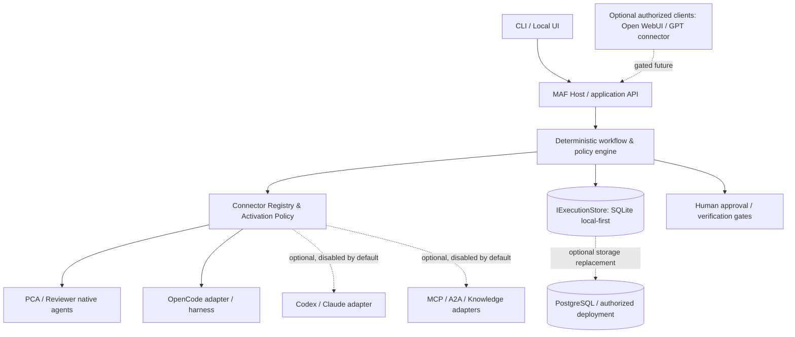

# MAF — Product & Engineering Roadmap

> **Proposed v0.2** · 2026-10-15 · Project: `ytcha-dev/MAF`  
> **Status:** Proposal for owner review, not an implementation authorization  
> **Decision retained:** deterministic Workflow-first (A), then bounded Hybrid orchestration (C).  
> **Deployment preference:** company-local / offline-capable first; portability and optional remote access later, subject to organizational authorization.

> **Architecture guardrails:** [Seven ownership boundaries and delivery discipline](architecture/ARCHITECTURE_GUARDRAILS.md). These are design constraints, not claims of implemented enforcement.

## 1. Vision and operating principles

MAF is a **local-first, extensible orchestration platform** coordinating native agents, existing independent harnesses, and optional knowledge/tools/services. It must **not** recreate OpenCode's coding loop or a general-purpose RAG engine.

**Build the orchestration. Integrate the execution. Reuse the infrastructure.**

Key distinction: **integration availability ≠ installation/configuration ≠ activation ≠ authorization to execute**. External integrations are plug-in sockets, not automatically trusted capabilities. A provider may be installed and configured but **disabled**, in which case it is invisible to routing and cannot be invoked through any execution path.

MAF is the product/repository name; Microsoft Agent Framework is an implementation dependency, not a permanent architectural lock-in.

## 2. Verified baseline and explicit limitations

Evidence at 2026-10-15: [Phase 2A acceptance](acceptance/PHASE2A_RESULTS.md) records a completed **local, approved, read-only** end-to-end OpenCode delegation proof: CLI → official MAF Workflow → OpenCodeExecutor → OpenCode Server → typed result. Three runs completed with distinct sessions and unchanged source/index/status. Tested scenarios include server unavailable, cancellation, ambiguous timeouts, permission waiting, and fake-provider concurrency. Submit-response loss/reconnection was covered with fakes, not destructive live network fault injection. These checks do **not** establish production readiness or coding quality.

Existing modules:

- `MAF.Host`: CLI and DI, with independent PCA, Review and external-task modes; external CLI output supports `json`, `text`, `verbose`.
- `MAF.Core`: provider-neutral contracts and shared bounded tools.
- Native PCA (Comprehension) and separate Review service.
- `MAF.Workflows.External`: official custom Workflow executor and OpenCode API client, read-only and bounded.

**Not yet delivered:** an operator approval interface, authorized write execution, PCA → external harness → Reviewer as one automatic workflow, a connector registry/activation switch, a remote gateway, Hybrid LLM routing, additional production harness adapters, A2A integration. Durable cross-process state and same-session recovery are implemented and have controlled home acceptance evidence below. Registry rules remain target requirements; current execution uses explicit approved endpoint/workspace configuration and read-only provider checks.

Known observations: long-running tasks may generate hundreds of HTTP observations; current OpenCode permission cancellation can leave a pending permission even after abort acknowledgment; completed execution does not guarantee accurate repository analysis.

Current boundaries: ephemeral mode keeps in-memory run mapping/single-flight (100 retained identities, default concurrency 2). Opt-in durable mode adds SQLite identity/state and same-machine, same-DB-path OS ownership; copying/changing the DB does not deduplicate. The provider remains loopback-only with explicit HTTP opt-in, one approved root and read-only permissions; no automatic permission/question replies. Timeout and remote cancellation differ; abort acknowledgment is not terminal evidence. Harness permissions are not an OS sandbox; redaction is best effort. See [ADR-003](architecture/ADR-003_OPENCODE_WORKFLOW_EXECUTOR.md) and [ADR-004](architecture/ADR-004_DURABLE_EXECUTION_RECOVERY.md).

Phase 2B-1 home acceptance (2026-10-15): the separately authorized personal environment passed build, 43 focused tests, 155 offline regression cases, six cross-process SQLite checkpoints, seven actual Host-crash fake-provider variants and three live OpenCode 1.19.0 / opencode/big-pickle variants. Same run/execution/session/message IDs survive recovery; each live variant has session/prompt POST counts 1/1 and unchanged source/index/status. See [home results and reliability limits](acceptance/PHASE2B1_HOME_RESULTS.md). This satisfies the bounded home technical gate, not production readiness or corporate compatibility. The [corporate security event](acceptance/PHASE2B1_SECURITY_EVENT.md) and [historical pending results](acceptance/PHASE2B1_RESULTS.md) remain unchanged; corporate execution hold requires its own clearance. Do not advance automatically to Phase 2B-2 or Phase 2C.

The [Windows setup](setup/WINDOWS_VALIDATION_SETUP.md) and [original home validation sequence](acceptance/PHASE2B1_HOME_VALIDATION_PLAN.md) retain the preparation-time Pending statuses and runner specifications. Actual home evidence now exists in [PHASE2B1_HOME_RESULTS](acceptance/PHASE2B1_HOME_RESULTS.md), with reproducible [test-only runners](../tests/MAF.Acceptance/README.md). Neither the preparation nor home results authorize corporate material transfer or lift the corporate execution hold.

Historical evidence and reading path:

- [Phase 1 acceptance](../TEST_RESULTS.md) and [Review Agent acceptance](../TEST_RESULTS_PHASE2.md) retain the native agent baselines. The older documents call Review "Phase 2"; this roadmap groups both native agents under Phase 1 fundamentals.
- [Phase 2A execution plan](plans/PHASE2A_EXECUTION_PLAN.md), [P0 API discovery](plans/PHASE2A_API_DISCOVERY.md), [external harness architecture](architecture/EXTERNAL_HARNESS_ARCHITECTURE.md) and [historical handoff](plans/PHASE2A_HANDOFF.md) preserve the original gates, verified SDK/API choices and failures. They are not new implementation authorization.
- CLI output enhancement is delivered in commit `760f6c5`: 29 focused tests and 112 offline regression cases passed; three live tests were excluded. This later check does not replace the earlier [Phase 2A live evidence](acceptance/PHASE2A_RESULTS.md) or change its historical test counts. See [CLI usage](../README.md#phase-2a--opencode-外部-workflow).
- [SQLite smoke evidence](acceptance/SQLITE_SMOKE_RESULTS.md) confirms basic local native-library loading and cross-process persistence only. It does not establish a durable execution store or complete Phase 2B-0.

Retain PCA/Reviewer as educational and regression references for `IChatClient` versus `AIAgent`, tool execution, sessions, provenance and bounded evaluation. Stop broadening PCA without measured need; do not treat stale external knowledge as verified repository evidence. An external harness or service need not be wrapped in another LLM-powered `ChatClientAgent`.

## 3. Roadmap at a glance

| Stage | Objective | Main output | Acceptance / gate |
|---|---|---|---|
| Phase 1 — Agent fundamentals | Learn native MAF agents and tool boundaries | PCA + independent Reviewer | Evidence-backed selected tests; retain baselines |
| Phase 2A — External harness proof | Verify whole-task delegation | MAF Workflow → OpenCode read-only | **Passed for controlled local PoC**; see acceptance report |
| **Phase 2B-1 — Durable execution** | Recover without duplicate submissions | `IExecutionStore` + SQLite + reconciliation + test-only acceptance runners | Controlled home technical gate passed; same-session/no-extra-POST evidence; corporate clearance separate |
| **Phase 2B-2 — Policy & approvals** | Trustworthy state / safety transitions | Explicit human approval states; lifecycle cleanup | Pending approvals and cancellation remain honest; default deny |
| **Phase 2B-3 — Diagnostics & artifacts** | Understand cost, latency, outcome | Correlated trace and trusted provenance | Distinguishable provider calls, model usage where supported, and verified result limits |
| **Phase 2B-4 — Deterministic multi-agent path** | Join specialists safely | PCA → OpenCode → Reviewer → human gate | Typed handoff and failure boundaries; first read-only, write pilot separately approved |
| **Phase 2C — Connector registry & switches** | Optional integrations safely enabled | Registry + disabled-by-default lifecycle + policy checks | Disabled adapter cannot be listed as available to router or invoked via direct API |
| Phase 3 — Bounded Hybrid | LLM recommends **only allowed** steps | Planner / router with validated typed decisions | Measurable gain against fixed workflow, no policy escalation |
| Phase 4 — Ecosystem expansion | Multiple harnesses and protocols when justified | Optional Codex, Claude Code, MCP, A2A, knowledge adapters | Each connector has capability negotiation and contract tests |
| Phase 5 — Operational / remote maturity (optional) | Enterprise-compliant, cross-platform operation | Protected API, identities, audit, multi-worker when needed | Approved security review; never expose company workspace by default |

Stages are **outcome gates**, not fixed deadlines. Phase 2C is a logical milestone; small portions of its *contracts* may be implemented during 2B as needed, without creating a premature plugin marketplace.

## 4. Target architecture

This diagram includes **unimplemented target components**: registry, runtime approval gates and optional ingress. The local execution store is implemented; protected v2 runtime integration is pending. Local-first/offline-capable is a deployment goal, not evidence that the configured OpenCode model is local or that current tasks work without network access.



Architecture boundaries:

1. **Host** owns auth/config/entrypoints; must not duplicate any harness tool loop.
2. **Workflow** owns typed transitions, allowed routing, budgets, safety gates and recovery decisions.
3. **Registry** owns connector identity, configuration status, admin activation and discoverable capabilities; it **does not** grant file/network privileges by itself.
4. **Execution adapter** owns provider API translation and correlation, not global routing decisions.
5. **Harness** owns its internal model, context, tools and task execution within permitted boundaries.
6. **Storage** persists execution state, not raw credentials or unbounded tool transcripts.
7. **Review / approvals** independently verify evidence; `Completed` is not equivalent to `Accepted`.

## 5. Connector socket / switch model

A connector is an integration endpoint or adapter, not necessarily an LLM Agent. The same registry concept can represent harness execution, knowledge retrieval, notification services, MCP tools, and eventually remote A2A peers, but their execution contracts remain distinct.

### 5.1 Lifecycle and capability resolution

Suggested administrative lifecycle (not an API contract yet):

`NotInstalled → Installed → Configured → Enabled → Healthy/Available`

- **Installed**: code/provider package is present; no credentials or permission inferred.
- **Configured**: validated non-secret settings or secret references exist; still **disabled by default**.
- **Enabled**: an authorized operator explicitly activates it for an allowed environment and purpose.
- **Healthy/Available**: fresh health/capability checks pass, and policy permits this caller, workspace and action.
- **Disabled / Unhealthy / Revoked**: unavailable to routing, manual invocation and background workers. Never silently fall back to another connector.

Keep `Enabled` (administrative intent) separate from `Healthy` (runtime observation), rather than treating them as one mutable enum. Suggested effective capability rule:

`Usable = Installed && Configured && Enabled && Healthy && CallerAuthorized && WorkspaceAllowed && OperationAllowed && WithinBudget`

An integration can be switched **off** without uninstalling or deleting configuration. Connection testing while disabled must require a separate explicit admin action and cannot submit work.

### 5.2 Minimal registry fields (proposal)

- `ConnectorId`, `Kind` (`Harness`, `NativeAgent`, `Knowledge`, `Tool`, `Notification`), `AdapterVersion`
- `Enabled` (false by default for new external connectors), `Configured`, `HealthStatus`, `LastHealthCheck`
- `AllowedScopes` and supported capabilities, e.g. `ReadRepository`, `ExecuteTask`, `WriteWorkspace` (the last never implied)
- Secret **reference** only, not API key value in database/logs
- `PolicyVersion`, config revision, operator change audit metadata

Do **not** equate `Enabled=true` with unrestricted authority; execution policies and explicit approvals remain mandatory. Distinguish platform-level enablement from workspace/task-level grants.

### 5.3 Hard controls and test cases

- Disabled connectors must not appear as executable options to Hybrid router or auto-routing; optional UI may list them as *disabled* for administration.
- All execution entrypoints, including direct CLI/API calls and reconnect workers, perform policy checks **server-side**, not just UI toggles.
- Disabling during a running task follows an explicit policy: **deny new submissions immediately**; existing work is either allowed to finish, requested to cancel, or quarantined pending review, as operator policy specifies. Do not claim cancellation confirmed merely because a disable flag was set.
- Configuration changes, enable/disable actions, and approval decisions have audit trails; changing credentials does not authorize retries of ambiguous submissions.
- Health-check failure cannot trigger an automatic switch to another provider when work may already have been submitted.
- Secrets stay in approved credential stores/environment references; no company source or request data sent externally without explicit policy authorization.
- Test scenarios: absent/unconfigured, disabled, enabled+unhealthy, revoked while queued, disabled mid-run, denied workspace, failed approval, competing run, restart, capability mismatch.

### 5.4 Configuration example (illustrative; **not implemented**)

```json
{
  "connectors": {
    "opencode-local": {
      "kind": "Harness",
      "adapter": "OpenCode",
      "enabled": true,
      "endpoint": "http://127.0.0.1:4096",
      "allowedCapabilities": ["ReadRepository", "ExecuteReadOnlyTask"]
    },
    "codex-remote": {
      "kind": "Harness",
      "adapter": "Codex",
      "enabled": false
    },
    "gpt-gateway": {
      "kind": "ClientGateway",
      "adapter": "FutureApprovedConnector",
      "enabled": false
    }
  }
}
```

This is a future conceptual registry example, **not** an existing `appsettings.json` format or permission to expose localhost. Connecting ChatGPT/Codex requires a separately supported, authenticated integration route; personal external services must not see company code or metadata without organizational authorization.

## 6. Phase 2B implementation plan (incremental)

### 2B-0 — Feasibility / engineering baseline (short)

**Historical SQLite feasibility smoke passed on 2026-10-15:** the [disposable .NET 10 smoke](acceptance/SQLITE_SMOKE_RESULTS.md) created a Temp database, committed one row, reopened it in a separate process, deleted the row and confirmed zero rows in another process. That throwaway project/database were removed; no store was added by the smoke itself. The subsequent authorized implementation and home acceptance are recorded above. Corporate baseline/API/endpoint clearance remains separate.

- Confirm `Microsoft.Data.Sqlite` package and native library work under company-managed Windows app-control policies on a throwaway fixture; no admin install or policy bypass.
- Confirm current code/tests, record actual OpenCode API and version, save controlled baseline.
- If SQLite native package is blocked, pause and choose an approved alternative. Do **not** redirect internal task data to personal Supabase simply to bypass local restrictions.

### 2B-1 — Durable execution and restart reconciliation (implemented; controlled home gate passed)

- Add a small `IExecutionStore` contract with a SQLite implementation. Store stable TaskId, workflow/execution/session/message IDs, request digest, submission phase, status, timestamps, and concurrency/lease metadata as warranted.
- Serialize durable state transitions around side effects. Before submit, persist submission intent and correlation identifier; after remote response, persist observable result. Recognize the **uncertain POST window**; local transactions cannot make a remote POST exactly-once.
- On restart, **inspect and reconcile the original remote session** before any retry. Missing proof → `Unknown`, never blindly create a second prompt.
- Ensure unique task identity/request digest, safe transition checks and single-run ownership; scoped fake-provider fault injection at each crash boundary.
- Keep the first implementation single-host; do not claim distributed exactly-once semantics or reliable multi-worker coordination.

**Gate:** restart while a remote task is active; same external handle recovered; no duplicate POST; original result eventually collected or explicit `Unknown` with actionable identity.

### 2B-2 — Approval and cancellation semantics

Architecture/planning only (2026-10-16): [ADR-005](architecture/ADR-005_POLICY_APPROVAL_CANCELLATION.md), [execution plan](plans/PHASE2B2_EXECUTION_PLAN.md) and [acceptance plan](acceptance/PHASE2B2_ACCEPTANCE_PLAN.md) propose default-deny MAF task authorization, durable exact-scope human decisions and cancellation reconciliation. MAF approval does not grant OpenCode internal tool permissions; approval resume first revalidates current policy/control/provider state and never resubmits an existing execution. These documents do not implement Phase 2B-2 or authorize runtime work; operator trust and schema migration decisions require owner review before implementation.

M1 baseline: independent Core policy contracts, immutable snapshot evaluator, trusted-context interface and versioned canonical binding are implemented; 98 focused cases and 253 offline cases passed ([M1 results](acceptance/PHASE2B2_M1_RESULTS.md)). The evaluator remains outside submission/recovery and supplies no production authentication or approval bypass. Subsequent persistence progress and remaining runtime gates follow.

Subsequently authorized M2-A storage only: explicit offline schema-v2 migration, separate approval/control storage and atomic coordinator are implemented; 51 focused and 304 offline cases passed ([M2-A results](acceptance/PHASE2B2_M2A_RESULTS.md)). Approved rows never dispatch tasks. Normal Host remains v1-only; production authority/identity, v2 runtime integration, provider cancellation and M3 remain disabled pending approval. See the [maintenance/backup procedure](setup/SQLITE_APPROVAL_MAINTENANCE.md).

Subsequently authorized M2-B foundation: replaceable policy acquisition, operator authentication/exact authorization and serialized durable activation contracts are implemented; 43 new cases, 94 focused and 347 offline cases passed ([M2-B results](acceptance/PHASE2B2_M2B_RESULTS.md)). Production policy provenance and human-versus-same-account-agent separation are not established, so activation/approval remain disabled. No Broker, M3 CLI/runtime enforcement or provider dispatch was added; schema remains v2 and audit archival remains disabled.

- Separate operator request, external provider pending permission, abort acknowledgement and confirmed terminal state.
- Expose safe operator actions for resolving pending permissions; no automatic approval.
- Preserve audit trail and safety policy on reconnect; never transform `Unknown` into `Cancelled` without evidence.

**Gate:** replay tests covering lingering `/permission` after abort, policy changes and interrupted cleanup.

### 2B-3 — Observability and outcome evidence

- Record high-value bounded trace: per-endpoint HTTP request count and time, workflow correlation, timing budgets, truncation flags, source/version provenance.
- Measure baseline polling before choosing SSE/long polling; use fallback with reconciliation on event loss.
- Collect token/cost only when provider supplies grounded usage data; never infer usage from HTTP request count.

**Gate:** identify slow stage and discrepancy between execution status and answer-quality evaluation.

### 2B-4 — Deterministic pipeline and future write gate

- Typed handoff: PCA → external OpenCode → Review → human acceptance, with skipped/failed/partial states distinct.
- Start with read-only analysis and review of trusted inputs. Write-enabled pilot requires separately approved workspace isolation, diff/artifact provenance, rollback strategy, explicit permissions and security acceptance.

**Gate:** repeatable fixed workflow and verified cross-step evidence; no unsanctioned writes.

**4A controlled typed-handoff proof:** the official four-executor graph, native PCA with
scripted chat, test-only external delegation and simulated independent evidence review
are implemented; see [execution plan](plans/PHASE2B4_EXECUTION_PLAN.md) and
[results](acceptance/PHASE2B4_A_TYPED_HANDOFF_RESULTS.md). The final output is an explicit
human-review handoff, never Accepted. This is not live OpenCode integration, source-level
semantic acceptance or operational Host authorization. M3-C remains blocked; the
separately authorized 4B integration status follows.

**4B protected integration:** the same outer official graph now has an internal adapter
to the existing protected child Workflow, real M3 admission/effect guards and explicit
v4 receipts, using synthetic trust/fake HTTP. See [4B results](acceptance/PHASE2B4_B_PROTECTED_HANDOFF_RESULTS.md)
for actual request accounting, seven OS crash/restart checkpoints and independent
Inspect recovery with no duplicate POST. This does not implement persistent parent-stage
resume, live provider or operational Host activation. M3-C remains mandatory/blocked;
stop for controlled owner acceptance before any next increment.

### 2C — Registry MVP

- Start with two known connector IDs: the existing native path and OpenCode. One disabled mock external connector tests disable behavior without external requests.
- Centralized `IsUsable` authorization and audit, CLI administration first; UI and generic plugin discovery later.
- Do not allow connector state to bypass `OpenCodeClient` read-only safety policy.

**Gate:** integration can be configured, disabled and re-enabled without reinstall; disabled means zero provider task API submissions, including after restart or through direct entrypoints.

## 7. Phase 3 — Hybrid orchestration, after stable gates

An LLM may propose a typed selection among **currently enabled and authorized** connectors, ask for more context or choose review. The deterministic runtime approves/denies the choice. It cannot enable connectors, change allowed scopes, grant credentials, auto-approve writes, invent task completion, or retry ambiguous submissions.

Start with **one routing choice**, compare against a deterministic baseline (quality, cost, latency, correctness, permission compliance), then increase autonomy only with measured benefit. Preserve human override and disable-by-default for newly installed adapters.

## 8. Phase 4 / Phase 5 — Optional ecosystem and remote operation

- Add Codex or Claude Code **only via a verified adapter**, user/company-supported terms, safe session semantics and controlled scopes. OpenCode direct API is already the initial external harness.
- Add MCP for exposed tools/context; A2A for genuine remote agent peers; do not conflate protocols or mandate them without a use case.
- Direct OpenCode API integration is harness-specific, not A2A. Do not assume native OpenCode A2A support; reconsider a gateway only for a verified interoperability requirement.
- Open WebUI can be a client or knowledge provider, not implicitly the central orchestrator.
- Future GPT/ChatGPT connector: only through a supported integration, authenticated API, explicit user consent, and company data-governance approval. **No automatic personal cloud exposure of company source.**
- Keep MAF local-first and network-closed by default. Cross-platform executability (.NET/SQLite), remote access, and distributed multi-worker execution are different milestones.
- Upgrade from local SQLite to PostgreSQL (including approved managed providers) only if multi-worker consistency, centralized operation, or remote hosting genuinely requires it. Supabase is a potential *approved* PostgreSQL deployment, not a requirement or shortcut around company policy.

## 9. Architectural invariants

1. OpenCode/Codex/Claude harnesses own their task/tool loops; MAF owns orchestration and policy.
2. Provider-specific details stay in adapters; native agents need not masquerade as external harnesses.
3. Distinct identities: native MAF `AgentSession`, workflow run, durable execution, provider session and external message. Workflow checkpoints do not persist or roll back OpenCode state; recovery still requires provider reconciliation.
4. All **external connectors are disabled by default** until explicitly enabled; an enabled connector still requires workspace/action authorization.
5. Disabled connectors cannot be routed to **or directly invoked**; no silent fallback or privilege escalation.
6. Durable submission + reconciliation precedes autonomous retries or write access.
7. `Completed` means execution finished; `Accepted` needs independent validation.
8. Least privilege and human approval for risky actions; no secret or internal-source exfiltration to unauthorized services. Treat repository content, tool results and provider messages as untrusted data, not instructions that can alter tools or policy.
9. Provenance and bounded budgets: time, retries, requests, concurrency, and where supported, token usage. Validate typed schemas, allowlisted capabilities and maximum depth/iterations before accepting planner recommendations.
10. Portability through small contracts, not premature generalized adapter/plugin frameworks.
11. Local-first; network exposure is an opt-in architecture/security decision.
12. Document verified evidence, remaining limitations and explicit owner decisions separately.

## 10. Decision log and migration checklist

Existing decisions remain:

- **ADR-001 (2026-10-14):** integrate rather than reimplement harness/RAG internals.
- **ADR-002 (2026-10-14):** deterministic A before bounded Hybrid C.
- **[ADR-003](architecture/ADR-003_OPENCODE_WORKFLOW_EXECUTOR.md) (adopted 2026-10-15):** official Workflow Executor + OpenCode direct API; A2A remains optional. Compiled matching Agent/Workflow SDK 1.24.0 and verified OpenCode 1.18.35 API evidence is in [P0 discovery](plans/PHASE2A_API_DISCOVERY.md).

ADR-001/002 are decision-log entries; no standalone files currently exist. ADR-003 has a standalone record. Preserve historical evidence/links and update stale 'Phase 2A next action' text rather than rewriting prior acceptance results. Future records must distinguish context, alternatives, decision, consequences, evidence and revisit trigger.

**Actual ADR index (supersedes the old proposed numbering):**

- [ADR-004](architecture/ADR-004_DURABLE_EXECUTION_RECOVERY.md) — implemented local-first durable execution and reconciliation boundary.
- [ADR-005](architecture/ADR-005_POLICY_APPROVAL_CANCELLATION.md) — policy, human approval and cancellation design; M1/M2-A/M2-B foundation exists, production trust and runtime enforcement do not.
- [ADR-006](architecture/ADR-006_TRUSTED_BROKER_BOUNDARY.md) — **adopted for architecture planning only**: replaceable trusted policy/approval authority, with an isolated Broker as a future deployment option. No Broker or production approval activation is implemented. Connector lifecycle and remote ingress ADRs need new numbers if separately proposed.

**M3-0 documentation instructions:** Read the [M3 architecture gate](plans/PHASE2B2_M3_ARCHITECTURE_GATE.md) and verify actual code-level call paths before proposing runtime interfaces. Keep this roadmap a stage-level index; record detailed trust choices, verification gaps and gate decisions in the dedicated plan/ADR. Do not authorize M3-A, Broker deployment, live provider execution or production approval through a docs-only commit.

### Immediate next action

**M3-0 is accepted; separately authorized M3-A1, M3-A2a, M3-A2b and M3-A2c increments are complete.** [A2b](acceptance/PHASE2B2_M3_A2B_RESULTS.md) provides atomic Allow admission and owner-bound continuation. [A2c](acceptance/PHASE2B2_M3_A2C_RESULTS.md) connects controlled synthetic admission to the existing official Workflow and mandatory provider-effect guards (37 focused / 530 offline passed). Public external/raw entrypoints fail closed without protected context; Host external modes are disabled because production trust is unavailable. Ephemeral/batch/list/Abort are denied; native PCA/Reviewer remain separate unprotected routes. Explicit-only activation is preserved. Production Broker/identity, human approval/resume and cancellation delivery remain disabled. M3-B/M3-C/M4 require separate owner authorization; do not proceed automatically.

**M3-B1 and the separately authorized M3-B2 synthetic increments are complete.** [B1](acceptance/PHASE2B2_M3_B1_RESULTS.md) persists non-executable Pending/Approve/Reject. [B2](acceptance/PHASE2B2_M3_B2_RESULTS.md) adds explicit original-input Resume, atomic consumption+Created, same-owner one-use handoff and exact consumed-approval effect authorization (44 focused / 604 offline passed). RequireApproval never becomes Allow; existing executions require separate Inspect/recovery and never regain a submit continuation. Direct-Allow behavior and explicit-only activation remain. Production human proof/Broker, same-principal isolation, cancellation/Abort delivery, D12 replacement and M3-C/M4 remain gated; stop after B2.

**Subsequent M4-A authorization: source review stopped at the cancellation-evidence schema gate.** [M4-A review/results](acceptance/PHASE2B2_M4_A_RESULTS.md) identifies that existing v2 control/audit rows do not retain an independent exact Cancel authorization binding, while the old primitive checks the original approval operation. No runtime/schema changes were made; M4-A is **Blocked, not accepted**. Existing regressions rerun: 259 focused / 604 offline passed; build 0 warnings/errors. Owner review of a minimal versioned cancellation-evidence storage extension is the next step. Cancel-intent coordination must not wait for a running execution's TaskId lock. Accepted sequencing is M4-A durable intent → separately authorized M4-B Abort delivery → M4-C reconciliation. M3-C is deferred, remains blocked and mandatory before production trust-dependent activation; this sequencing is not a security waiver.

**M4-A0 documentation gate delivered for owner review:** [schema design](plans/PHASE2B2_M4_A0_SCHEMA_DESIGN.md) proposes immutable cancellation_requests, explicit audit linkage, offline additive v2→v3 migration, exact ExplicitV3 store profiles, lifetime TaskId winner and unverified legacy-intent preservation. DDL/replay/compatibility/failure contracts are proposed, not implemented or migration-tested. Next step is owner acceptance and separate M4-A1 authorization for the reviewed migration/profile + provider-free cancellation admission only. M4-A remains incomplete; Abort delivery and M3-C production trust remain disabled.

**M4-A0 was subsequently accepted; separately authorized M4-A1 is implemented for controlled synthetic validation.** [M4-A1 results](acceptance/PHASE2B2_M4_A1_RESULTS.md): explicit authorized offline v2→v3, strict ExplicitV3 profiles, independent Cancel Allow, immutable evidence/control/revocation/audit atomicity, exact replay and real-process crash/ownership competition. 129 focused / 733 offline passed; build 0 warnings/errors. Cancellation does not wait for execution ownership, invoke a Workflow/provider, or assert a remote terminal state. Legacy intent remains unverified; production Host/trust, Abort delivery, retries and M4-C remain disabled. Stop after M4-A1; M4-B requires separate authorization and delivery-evidence review. Full Phase 2B-2 and corporate compatibility remain unaccepted.

**M4-B0 design gate:** [results](acceptance/PHASE2B2_M4_B0_RESULTS.md) reproduce late original Create response breaking cancellation/control reads and independent Inspect in both Allow and Approved Resume (Create/Prompt/Abort=1/0/0). Existing v3 intent audit cannot authenticate the later session; strict checks are retained, repair/reconciliation remain blocked. 139 focused / 743 offline passed, including 10 characterization/negative cases; build 0 warnings/errors. Green characterization does not establish successful temporal recovery. [Combined B/C proposal](plans/PHASE2B2_M4_BC_DELIVERY_DESIGN.md) recommends one reviewed offline v4 extension for session receipt and delivery evidence; no schema/runtime/delivery implemented. Owner review and exact schema/provenance contract precede separately authorized B1. Production trust/Host, Abort and M4-C remain disabled; stop after B0.

**M4-B1a documentation gate:** [exact v4 contract](plans/PHASE2B2_M4_B1A_V4_SCHEMA_CONTRACT.md) proposes two bounded tables plus an immutable execution provenance-profile flag, original-response-only one-use receipt finalization, quarantine, strict legacy no-backfill/independent GET limits and one reserved Abort attempt. Includes exact DDL/triggers, offline migration/crash contract and B1b positive acceptance matrix. Proposed, not implemented/executed or owner-accepted: B0 bug remains unfixed, no new tests/build run, historical 139 focused / 743 offline is not v4 proof. Next is owner acceptance and separate B1b receipt/storage authorization; Abort remains B2, M3-C remains blocked, stop after B1a.

**M4-B1a was accepted; M4-B1b controlled implementation passed.** [Results](acceptance/PHASE2B2_M4_B1B_RESULTS.md): exact offline v3→v4, strict ExplicitV4/provenance profiles, original-response-only one-use receipt, atomic SessionKnown/audit, preserved immutable cancellation evidence, quarantine and conservative legacy GET. Both B0 Allow/Approved Resume cases now have positive reads/GET recovery (Create/Prompt/Abort=1/0/0), including real owner death + independent Inspect-only restart. 125 focused / 858 offline passed; build 0 warnings/errors; all 743 historical cases retained with two authorized B0 positive conversions and 115 new cases. Delivery storage is inert; no Abort reservation/grant/POST, Host/production trust or new orchestration enabled. Stop after B1b; B2 requires separate current-operation authorization/delivery ownership/one-attempt dispatch acceptance. M3-C and full M4/Phase 2B-2 remain blocked/unaccepted.

**M4-B2 controlled Abort delivery passed.** [Results](acceptance/PHASE2B2_M4_B2_RESULTS.md): independent `AbortExistingExecution=8` / `ExecutionAbort=4`, exact current Allow, independent OS delivery owner, atomic v4 one-attempt reservation/audit and owner-bound one-use continuation. Direct-Allow and Approved-Resume originals each receive one original-session Abort POST with zero delivery GET/Create/Prompt. Ack remains outcome None and does not update Execution. Real process crashes and competition while the execution owner holds TaskId prove no resend after committed intent; a crash before HTTP may permanently send zero requests. 181 focused / 914 offline passed (all 858 historical cases retained, 56 added), build 0 warnings/errors. No schema change, Host activation, production trust, live provider or retry worker. Stop after B2; independently authorized original-session reconciliation is separately gated M4-C, and M3-C remains mandatory/blocked before production. Full M4/Phase 2B-2 and corporate endpoint compatibility are not accepted.

**M4-C controlled cancellation lifecycle technical gate passed; ready for owner acceptance.** [Results](acceptance/PHASE2B2_M4_C_RESULTS.md): independent current Inspect-only authorization, verified original session/message, same OpenCode Observe parser/GETs, v4 canonical terminal metadata and one atomic execution+delivery terminal transaction. Completed/Partial/Failed/Cancelled are proven from correlated messages; Ack/idle/pending/unavailable are not Cancelled. Five real-process crash checkpoints preserve complete old/new states; fresh Inspect repeats only GET (normal 9/0/0/0 GET/Create/Prompt/Abort). The reproduced B2 owner-disposal gap is closed by a narrow live dispatch-use scope, with no SQL/authority lease across HTTP. 240 focused / 973 offline passed, all 914 historical cases retained plus 59 new; build 0 warnings/errors. No schema v5, second Observe, retry worker or Host activation. M3-C and corporate clearance remain blocked; full Phase 2B-2 is not accepted. Stop after M4-C and request owner architecture review before more infrastructure; the next separately authorized direction is minimal deterministic PCA → OpenCode → Reviewer typed handoffs with controlled fake harnesses first.

**Phase 2B-1 controlled home technical acceptance is complete within the documented reliability boundary.** Corporate endpoint clearance remains separate. Phase 2B-2 has separately authorized M1/M2-A/M2-B foundation increments above; production trust and operational approval remain pending; controlled synthetic runtime/approval increments are documented above, and the full phase is not accepted. Connector Registry remains Phase 2C; no write-enabled execution or new provider is authorized by this roadmap.
