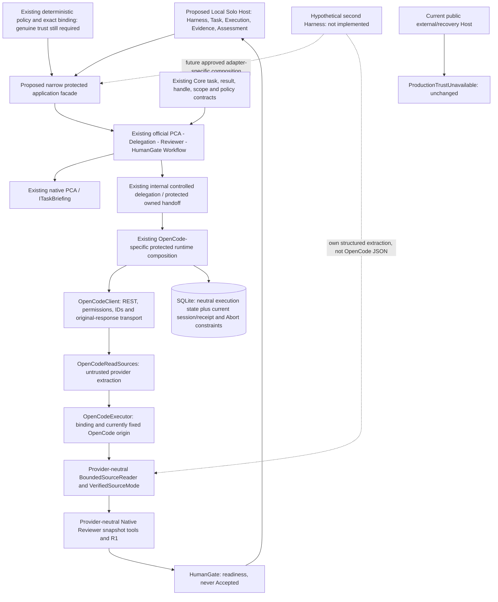

# Local Solo MVP-S0 — Harness Extensibility Review & Roadmap Realignment

日期：2026-10-19（Asia/Taipei）。性質：source audit／最小設計釐清；**沒有實作 Local Solo mode、信任來源、第二個 adapter 或 provider activation**。

## 1. Repository baseline、scope 與證據

- Repository：`ytcha-dev/MAF`；開始 HEAD：`e5ed74288aa7fdedfbde331e8af92fe840816faa`，分支 `main`，與本機 `origin/main` 記錄相同；不據此宣稱開始時已 refresh 遠端。
- 起始 working tree 只有未追蹤 `.opencode/`；保留、不讀取、不提交。本輪只新增本 review 與最小更新 [Roadmap](../ROADMAP.md)。
- Owner 將 immediate product priority 改為 **Local Solo MVP**：一個本機 operator／configuration／approved workspace、OpenCode 初始 adapter、ReadOnly、兩個 native model role bindings、local task/result/evidence UX、每 installation 可有自己的 SQLite。這是 deployment／UX 假設，不是 cryptographic caller authentication 或獨立 human consent proof。
- shared multi-user app、central IAM、enterprise policy publisher service、general approval platform、centralized Orchestrator 不再是 immediate MVP infrastructure requirements。[M3-C-W0](../plans/M3C_CORPORATE_WORKSTATION_TRUST_FEASIBILITY.md) 保留為 deferred enterprise-trust planning evidence；其 source-level security 限制與企業 execution hold 沒有被取消。
- Codex CLI／Claude Code／其他 CLI/API/A2A 僅是假想未來 Harness。本輪未查詢、安裝、執行或驗證這些產品，不能推論其真實 API、session、resume、sandbox 或 permission 能力。

證據分級：**S**＝本輪 source verified；**T**＝既有 synthetic／offline assertions 與歷史報告；**R**＝歷史另准 real-provider 環境；**D**＝本輪未實作建議；**U**＝未驗證／缺少部署證據。沒有新 build/test/live pass。

查核包括 [guardrails](../architecture/ARCHITECTURE_GUARDRAILS.md)、ADRs [003](../architecture/ADR-003_OPENCODE_WORKFLOW_EXECUTOR.md)／[004](../architecture/ADR-004_DURABLE_EXECUTION_RECOVERY.md)／[005](../architecture/ADR-005_POLICY_APPROVAL_CANCELLATION.md)／[006](../architecture/ADR-006_TRUSTED_BROKER_BOUNDARY.md)、[4A–4F plan](../plans/PHASE2B4_EXECUTION_PLAN.md)、[closeout](PHASE2B4_CLOSEOUT_REVIEW.md)、[Safe Host design](../plans/SAFE_HOST_COMPOSITION_USER_FLOW_DESIGN.md)、W0，以及以下實作／tests。歷史 next-action／Host 描述不當作 current implementation。

## 2. Architecture verdict：可擴充，但不是只換 client 即可

**現有架構有足夠可重用骨架，可支援第二個適合的 Harness，而不必重寫四階段 Orchestrator、PCA、Native Reviewer、policy evaluator 或基本 execution store。它尚不是 operationally provider-pluggable，也不能保證任何 CLI 的 durable／cancel 模型都無須改契約或儲存。**

三種成熟度實際共存：

| 類別 | Source 證據／結論 |
| --- | --- |
| 1 已實作的 provider-neutral seams（S） | `ExternalTaskRequest/Result/Observation/Handle`、`IExternalHarnessClient`、`IResumableExternalHarnessClient`、`IExecutionStore`、typed handoffs、exact policy descriptors／binding、independent source reader、Native Reviewer 的 snapshot tools。它們沒有 OpenCode REST JSON，也沒有依賴另一 Harness 的 SDK |
| 2 刻意的 OpenCode implementation（S） | OpenCodeClient／Options／ReadSources／ProtectedAbortDelivery，以及目前 protected HTTP route／original-response receipt bridge。第一個 adapter 具體而保守是合理的，不需先抽一個萬用 plugin framework |
| 3 越出 adapter 的語義耦合（S） | OpenCodeExecutor 固定蓋 `OpenCodeReadDisplay` origin；ProtectedExternalRuntime 直接建 OpenCode client 並驗 `/session` 等路徑；SQLite Abort authorization 硬性 `Provider == "OpenCode"`；durable／receipt／source／terminal evidence 有 session/message lineage 假設。這些是第二 Harness 的真適配點，不能只宣稱「有 interface 所以不用改」 |

**第一個 OpenCode MVP 前，不需要一般化全部 runtime、重命名 executor 或改 SQLite schema。** 現在應決定並落實的是 provider-neutral Host application/presentation seam，讓既有 OpenCode protected composition 留在窄邊界之後；第二個 adapter 到來時才依實際能力處理 construction、evidence origin、cancel／receipt profile。

這個結論不是目前已能 operationally submit。真正 provider submission 仍取決於 genuine deployment trust、explicit authorization、approved model data flows、corporate execution clearance；Local Solo 不提供替代 proof。

## 3. Provider-neutral 與 OpenCode-specific 邊界圖

APP／UX／FUT 是 **D／U**，不是現有 public plugin API。第二 Harness 到 independent reader 前，仍必須經 trusted application 綁定 original task/execution/provider identity；虛線不授權直接注入候選或 provider client。official Workflow owns sequencing；Harness owns specialist loop；policy owns authorization；persistence owns state/atomicity；Reviewer 和 HumanGate 不產生執行權限。

## 4. Extensibility matrix A–L

每列 implementation／coupling 是 **S**；第二 Harness 情境是 **D／U**，不是對 Codex CLI 的實測規格。「MVP 前」指需要先完成的 Host 設計／第一版補線，不代表本輪允許 runtime change。

| Subsystem／現有 implementation | Provider coupling／intentional? | 假想第二 Harness 會遇到什麼 | 最小 adaptation | 第一個 OpenCode MVP 前／可否等 |
| --- | --- | --- | --- | --- |
| **A Task request/result**：[ExternalContracts](../../src/MAF.Core/ExternalContracts.cs)：`ExternalTaskRequest`、`ExternalTaskResult`、`ExternalObservation` | root/task/timeout/ReadOnly/status 是中立；model/REST 不在 request；`Requests` metric 與 WaitingForApproval 仍有呈現歧義。限制 ReadOnly 是刻意的 MVP scope | 可轉譯原 task，但不能聲稱 write/shell 已支援；native provider permission 與 MAF approval 不是同件事 | adapter 映射 status／limitations；Host view 分離 approval domain／metric kind；不用改成 provider-specific request JSON | generic Host view **NOW**；Core DTO 一般化可等，ReadOnly 不放寬 |
| **B Provider identity/handle**：`ExternalExecutionHandle(ExecutionId, Provider, ExternalSessionId?, ExternalRequestId?)`；[TypedHandoffContracts](../../src/MAF.Core/TypedHandoffContracts.cs) | provider 字串／opaque IDs 中立；Core 不限制 `ses_`/`msg_`。session/request 欄位反映 sessionful lifecycle，屬目前窄 contract | 若有真 durable job/thread/request identity 可映射；沒有則不能拿 PID／自造 `ses_` 冒充 recoverable external session | 保留 generic product Execution／Harness；真 provider IDs 留 adapter diagnostics。缺相應能力就 unsupported，不偽造 | Host identity 呈現 **NOW**；handle revision 等第二個真需求 |
| **C Lifecycle/cancel/recovery**：[ExternalWorkflow](../../src/MAF.Workflows.External/ExternalWorkflow.cs)、[OpenCodeExecutor](../../src/MAF.Workflows.External/OpenCodeExecutor.cs)、[DurableExecutionService](../../src/MAF.Workflows.External/DurableExecutionService.cs) | client interface 中立；base 要求 Abort，resumable extension 要求 Scope/Prepare/Reattach；durable phases 要 session before prompt。是 sessionful profile，不是所有 CLI 通用語義 | 一次 process execution 未必有 Create/Submit split、Abort API 或 restart reattach；盲套會捏造能力 | 先驗具體 lifecycle；只實作可證能力，Unsupported 前置拒絕；必要時窄 optional abort/recovery interface/profile，保留 no-resubmit | 不重構首版；目前 OpenCode 走既有 protected lifecycle，差異 **LATER** |
| **D Fingerprint/provider scope**：[DurableExecution.cs](../../src/MAF.Core/DurableExecution.cs)：`Fingerprint`／transitions；OpenCodeClient.Scope | request fingerprint 不含 provider，而 provider ID／scope 分別保存並檢查；此分責刻意。OpenCode scope hash 是 origin/root/agent/read rules，不是所有 Harness 的 universal encoding | 同 TaskId 不可藉換 provider 或 DB 當 retry；新的 adapter 需 own stable scope digest／version。OpenCode scope 也不證明其 second-hop model recipient | trusted composition 固定 provider＋revision；新 adapter 編碼 scope、保留 binding golden／old row profile，不能只比較 task fingerprint | 第一版 Host 保持 immutable provider binding **NOW**；新 scope encoding **LATER** |
| **E Protected composition**：[ProtectedExternalRuntime](../../src/MAF.Workflows.External/ProtectedExternalRuntime.cs)：ctor／`RunCoreAsync`／ProtectedAccess；[ProtectedHandoffDelegation](../../src/MAF.Workflows.External/ProtectedHandoffDelegation.cs) | 直接建 OpenCodeClient、OpenCodeOptions／HttpClient／ReceiptTransport；scope projection、route allowlist、receipt arm 都具體。安全 implementation 刻意窄，但 current runtime 不能單靠換 interface 換 provider | subprocess/API adapter 沒有相同 HTTP request/response／routes；constructor 會繼續選 OpenCode，放開 injection 又可能放大 authority | Host 前方只留窄 application facade；其內首版固定 OpenCode。未來 trusted code-owned provider construction boundary，含 effect/receipt verifier；禁止 caller 提供 client/factory/access | application seam **NOW**；實作 multi-provider factory **LATER** |
| **F Policy/capabilities**：[PolicyContracts](../../src/MAF.Core/Policy/PolicyContracts.cs)、[OperationBinding](../../src/MAF.Core/Policy/OperationBinding.cs)、evaluator；[SqliteApprovalStore.AbortDelivery](../../src/MAF.Persistence.Sqlite/SqliteApprovalStore.AbortDelivery.cs)：`AuthorizeAbort` | descriptors／scope／binding 大致中立；只支援 bounded ReadOnly Submit/Inspect/Cancel/Abort；Abort coordinator 有 `Provider == "OpenCode"` literal，這是跨層 semantic coupling | 新 Harness 同名「cancel」不代表相同 semantics；missing capability 應拒絕，SQLite Abort literal 會拒絕別的 Provider | 重用 policy algorithm，另審固定 descriptor／adapter profile／Abort verifier；不刪 literal 就宣稱全部支援；native inference 權限亦缺，不等於外部 Submit allow | guards 保留；genuine authorization 是 live gate；general capability work **LATER** |
| **G Source evidence**：[OpenCodeReadSources](../../src/MAF.Workflows.External/OpenCode/OpenCodeReadSources.cs)：`Extract`；Core SourceEvidence；[BoundedSourceReader](../../src/MAF.Core/Tools/BoundedSourceReader.cs)：`Acquire/IsCurrent` | extraction 只懂 pinned OpenCode read display，刻意；Core origin enum 含 OpenCodeReadDisplay；executor 無條件用此 origin 則不是純命名。source binding 亦需真 session/message IDs | 新 Harness 不需模仿 `metadata.display`；但不能用自由文字 citation 或本地衍生 anchor 假裝 provider evidence | 新 structured extractor→untrusted locations→trusted original binding→independent reader；新增明確 origin／binding profile，否則 evidence unavailable | mandatory verified-source path 在首個 live flow 必要；新 extractor/origin **LATER** |
| **H Native Reviewer**：[NativeEvidenceReviewer](../../src/MAF.Agents.Review/NativeEvidenceReviewer.cs)：`ReviewAsync`／R1；[VerifiedSourceMode](../../src/MAF.Workflows.External/VerifiedSourceMode.cs) | 只消費 TaskEvidence/admitted snapshots／digest／refs；不解析 OpenCode JSON、不持有 provider、authority 或 DB；是真中立 seam | 只要新來源滿足相同 independent provenance／binding／freshness，可照讀；無 sources 不可改成 summary success | 重用 reviewer／R1；每個 native model outbound 仍需另有 role/data-flow authorization；不重寫 assessment engine | role binding／view 在 MVP 補線；第二 Harness 不需重寫 Reviewer |
| **I Official Workflow**：[ControlledHandoffWorkflow](../../src/MAF.Workflows.External/ControlledHandoffWorkflow.cs)：`ExecuteAsync`／Delegate／HumanGate | four typed executors 不懂 REST；internal injection/callback 可重用。`delegation is ProtectedHandoffDelegation` 的 timeout/lifetime 分支是 concrete-type coupling，optional sourceMode 另有 controlled summary path | 新 delegation type 若落入普通 Within timeout，可能提早 abandon protected child unwind；不能靠「同樣 interface」保證同 ownership semantics | 優先保留共同 owned protected handoff；真的有第二實作時才提取窄的受信任 lifetime contract；operational facade 強制 verified source mode | 既有 OpenCode type 分支可保留；新 child lifetime generalization **LATER**，不可整批 public |
| **J Host config/UX**：[Program](../../src/MAF.Host/Program.cs)、[ExternalConsole](../../src/MAF.Host/ExternalConsole.cs) | 舊 help/env 是 OPENCODE_*、project path；operational mode 尚未組裝，固定 throw；沒有 deployable registry／selection。具體設定存在合理，但不能成為永久 product API | 若 Host 直接依賴 OpenCodeOptions／routes/session JSON，第二 adapter 會迫使 command/presenter 重寫；目前可在新 UX 一開始避免 | 一個固定 profile／Harness 描述＋task/action view；selection 是 app-owned allowlisted composition、不是任意 type/exe/URL injection | **NOW：第一個 Host foundation 需中立邊界**；multi-provider UI／Registry 可等 |
| **K SQLite/schema/isolation**：[SqliteExecutionStore](../../src/MAF.Persistence.Sqlite/SqliteExecutionStore.cs)、SessionReceipt／DeliveryStorageFormat／Reconciliation | 基本 snapshot/provider/scope/CAS 中立、TaskId 是全 DB unique；v4 要 session receipt、original message/parent lineage；Abort literal 限 OpenCode。不等於 arbitrary-Harness schema | sessionful 第二 adapter 可望重用 base execution；不同 receipt／terminal proof 無法直接過現有 profile；純 CLI 不能拿 exit code 偽造 parent-message evidence | 審查 exact profile／格式；必要時 additive migration 另准，不預設必須或保證不用改。首版維持 explicit v4／same DB | **不為假想 provider 改 schema**；不相容 evidence/profile **LATER**。每 installation DB 不證 hostile isolation |
| **L Diagnostics/presentation**：[ExternalConsoleOutput](../../src/MAF.Host/ExternalConsoleOutput.cs)：`Write`；ExternalTaskResult.Trace／Requests | 輸出有中立 IDs/status/limitations，但 text 顯示 external session/request、verbose 固定 `HTTP requests`；沒有完整 source／assessment／human-choice presenter | CLI adapter metric 可能是 protocol ops／process runs，不是 HTTP；session 值未必有意義 | 新 Host view 預設 Task/Execution/Harness/Status/Evidence/Assessment/Human decision；provider identifiers／protocol metrics 放 adapter diagnostics，缺值用 unavailable | presenter 邊界 **NOW**；通用 telemetry／cost/artifact platform 可等 |

## 5. 已知耦合的逐點判斷與最小可控邊界

### 5.1 Protected runtime：真正的 construction 與 transport coupling

**S**：ProtectedExternalRuntime 同時擁有通用 ownership/admission 與具體 OpenCode construction；`RunCoreAsync` 用 `new OpenCodeClient(http, options)` 做 scope projection，再用 internal protected-access constructor 建實際 client。`ProtectedAccess.BeforeWireAsync` 只認 `session`／`prompt_async`／health/doc/agent/permission/question routes；`ArmOriginalCreate` 綁原始 POST `/session?directory=...`、transport/request/response identity。這些檢查不能被替換成「client 說自己安全」。

**D** 最小未來 construction seam 是 **trusted application-owned 選擇**：approved provider ID/config revision/capability profile → 固定 adapter builder＋effect enforcement＋original-identity/receipt verification。它可先只是窄的 concrete composition method；第二 adapter 真正出現才評估 interface。不需要 reflection、plugin loader、一般 provider factory registry 或 caller-controlled `IExternalHarnessClient` 參數。

Host 只提交 bounded intent 與 genuine verified context；不能供應 client、IRuntimeAccess、assessment Allow callback、transport、executable path 或 arbitrary construction delegate 來替換 authority。新 transport（如 subprocess）的「啟動前／stdin task 送出前／observe／terminate」也必須有相同 current-policy、exact-binding、intent／ownership guards；HTTP route verifier 留 OpenCode，不把它改成全域 shell 授權。

第一個 MVP 可原封使用目前 OpenCode runtime，先把它藏在窄 facade 後；**現在不必抽通用 runtime construction framework**。

### 5.2 OpenCodeExecutor／ExternalWorkflow：不是全都只有名字

**S**：executor 大部分 lifecycle 使用 IExternalHarnessClient；ExternalWorkflow／DurableExecutionService 確實用官方 WorkflowBuilder／InProcessExecution.RunAsync，非手動 Agent loop。其歷史名稱與 official executor ID `OpenCodeExecutor` 可保留。

但 `OpenCodeExecutor.HandleAsync` 對任何 `SourceLocations` 都直接建立 `SourceCandidateOrigin.OpenCodeReadDisplay`；這是真語義 coupling。未來不能把 Codex client 塞進來後仍把它標成 OpenCode provenance。最小修正可在第二 adapter integration 時讓受控 adapter observation 提供已驗的 extractor-origin metadata／由 trusted composition 選 mapping，再由 application 綁 original IDs；不可由任意 caller JSON 自選 origin。reader 還要獨立核對，origin 本身不等授權或驗證。

`ControlledHandoffWorkflow.Delegate` 的 concrete-type timeout 特例亦須保護：新增 adapter 若沿用同一個 owned ProtectedHandoffDelegation bridge，可保留 graph；若另建 delegation class，必須先處理 lifetime contract，不能 race outer timeout 釋放後又建立替代執行。這不構成現在 OpenCode 路徑的已知違規。

### 5.3 三段 source pipeline 必須保持不同信任層級

1. **Provider-specific extraction（S）**：OpenCodeReadSources 核對 version、session/parent/message/part/call IDs、completed read display／preview／flags／range／size；固定完整行 prefix、混合 grep/glob 不當來源、重複與衝突規則。這些 schema 絕不要求別的 Harness 照抄。
2. **Provider-neutral verification（S）**：VerifiedSourceMode → BoundedSourceReader 驗本地 approved root、original binding、exact anchor／range、redaction／UTF-8、budgets、issuer／digest；Agent 後 IsCurrent。source data 仍不可信指令，JSON 不能 rehydrate issuer。
3. **Provider-neutral Reviewer observation（S／T）**：NativeEvidenceReviewer 只經 ReadEvidence/SearchEvidence 接觸 admitted snapshots；R1 要本輪 SDK Tool-role 實際成功結果。另一 Harness 只要能供合格 proposals 與原 identity，可重用整段；無 structured evidence 就 InsufficientEvidence，不解析自由模型 citation 求成功。

目前 SourceBinding 沒有獨立 ProviderId；reader 綁 TaskId/run/execution/session/message，outer handoff 另驗 expected Handle.Provider，trusted execution IDs 負責避免跨 provider 挪用。這不是要求現在將 provider 加入 content digest；不能去掉 outer provider correlation 並宣稱 digest 已涵蓋一切。source reference 相同亦不代表跨 task 已觀察，R1 context 仍 per-run。

### 5.4 Cancel／Abort／terminal evidence：不是共同 HTTP API

**S**：ProtectedAbortDelivery 在 OpenCode 子目錄內驗 provider literal、`ses_`形式、loopback scope、獨立 preflight／one-use continuation、POST `/abort`與 Boolean ack，屬刻意 adapter 實作。`SqliteApprovalStore.AbortDelivery.AuthorizeAbort`也硬性限制 Provider 為 OpenCode，則是跨層耦合；不能只寫新 client 而宣稱整個 M4 可直接重用。

通用不變量是 current exact operation 授權、durable cancel intent、獨立 delivery ownership／one-attempt reservation、原 execution correlation、ack 不等 terminal、unknown 不重送；這些可保留。provider 怎麼取消、如何確認 remote terminal、是否有 permission APIs，應留 adapter/profile。Reconciliation 的 ObservedTerminal 雖是投影，現行仍要求原 session／request 與 parent-message lineage；CLI exit code 不能自動證明這些欄位。

首版受保護路徑 SuppressImplicitAbort，Host 沒有自動 Abort／permission reply 入口；不能藉此把「所有 Harness 都支援 Abort」當已實作。第二 adapter 不支援時，在 descriptor/admission 拒絕對應動作，不發命令、不回假成功、不殺共享程序。

## 6. 假想第二 Harness（以 Codex CLI 名稱為例）的 integration walkthrough

以下全部 **D／U**：不宣稱該產品實際有何 CLI／API／sandbox 或 resume 能力，也不進行任何安裝／執行。

1. **先驗可用能力與資料流**：確認受批准 binary/version／arguments／工作 root／child process／credentials 與 model recipient、最小 ReadOnly enforcement、original job/request identity、observable terminal evidence。若不能阻止 write/shell 或確定資料接收方，這個 ReadOnly 旅程拒絕支援該 adapter；不用只讀名稱冒充 sandbox。
2. **保留 product-level UX**：相同 Task→Execution→Status→Evidence→Assessment→Human decision；第二 adapter 只在 approvedprofile 的 trusted composition 中被選擇。初版不新增多 provider 切換 UI，provider 不是 model 選項或失敗自動 fallback。
3. **對應小 lifecycle**：若 provider 真有穩定 session/job／request 與可驗 Create/Submit/Observe，可實作現有 interface；若無安全 reattach，別實作 IResumableExternalHarnessClient 並捏造 IDs。Core handle 字串可以存真 opaque IDs，不要求`ses_`/`msg_`。單純 process PID／檔名不是 durable reattachment 證明。
4. **補受控 composition 與 effects**：在 application-owned 建構邊界加入唯一核准 adapter；重用 policy matching／scope binding／ownership，補 transport 相應的 pre-effect 驗證。不把 OpenCode HTTP route allowlist 拿來批准 Process.Start 或任意 shell；如果需新 effect/profile，另審窄 scope，不能降低 OpenCode 現有 guards。
5. **確認 durability 與 schema 相容性**：先檢查原 submission phases／v4 原始 response receipt／terminal lineage 是否能真實對應。相容時可重用 base store／CAS；不相容就先 disable unsupported 能力或另審 additive profile/storage，絕不 fallback LegacyV1/raw execution、重置 DB／TaskId 或「等同 session」假資料。
6. **獨立 source mapping**：該 adapter 自己的 bounded structured output 轉成 untrusted path/range/anchor proposal；受控 origin 與 original binding 另附。原 reader／VerifiedSourceMode／R1 重用，不改 PCA／Reviewer 提示去模仿 OpenCode display；沒有證據仍明確不可 review。
7. **按能力補 control**：只有真正支援且有核准 terminal proof 時才整合 cancel／abort／recovery。保留 approval-required 為 blocked/waiting，不能拿 provider permission 替代 MAF authorizer。
8. **單獨驗證，不靠 interface 存在背書**：authoring 適當 contract/negative/process tests，取得 execution/data-flow 授權後才執行；確認 wrong provider/scope／unsupported operations 零 effects、no resubmit、source isolation、原 IDs／crash recovery、guarded transport。fake lifecycle tests 不代表第二個真 provider 已驗收。

### 能力差異的最小邊界

| 能力 | 現有 seam／限制 | 第二 Harness 的最小策略（D） |
| --- | --- | --- |
| Session／job identity | handle nullable IDs，但 durable state／SourceBinding 實際需要穩定 session/request | 無可證 mapping 就拒絕相應 durable/evidence journey；不要偽造 OpenCode IDs |
| Durable reattach | 已有窄 IResumableExternalHarnessClient，真的比 base 多 Scope/Prepare/Reattach | 保留 optional boundary；只在真支援時實作，不從「可重啟 CLI」推論可 reattach 原工作 |
| Cancellation／Abort | base interface 目前強制 AbortAsync；protected Abort 另有 one-use coordination | 第二 consumer 出現時才考慮窄 optional abort boundary；當前不支援就明確拒絕，不先擴一串 optional methods |
| Permission／approval | 外部 WaitingForApproval 與 MAFRequireApproval 不同；沒有 permission reply API | 各 adapter 識別等待／challenge；Host 分 domain 顯示，首版全部不 reply |
| Structured source evidence | observation→untrusted proposals→independent verification | extractor adapter-owned；無 structured source 即無合格 source review，不用 LLM citation parsing 補齊 |
| Tool policy／sandbox | OpenCode read rules 是具體 provider 檢查，不是 OS sandbox contract | 每個 adapter 須證明自己的 ReadOnly 範圍；unsupported 時拒絕，不加入名為 Sandboxed 的未驗布林 |
| Streaming／events | 目前 bounded ObserveAsync＋official final events，不是通用 stream protocol | 首版維持 bounded observation；必要時 adapter 內消費 events，Host 仍顯示 typed state；另審 stream/retry/native-outbound budget |

不需要現在建立數十個 optional 方法或通用 capability-negotiation registry。policy descriptor 已可列支援的 operation 與 enabled/healthy；它是 trusted enforcement 輸入，不是 provider 自我宣稱或配置即授權。原本未支援的能力仍 default deny。

## 7. NOW：第一個 Host MVP 前的必要邊界與 severity

**沒有證據支持現在先做 Core／官方 Workflow／persistence 整體重寫，或先完成第二 Harness framework。** 以下兩項是新 Host foundation 應立即避免的 rework 風險；是缺少 operational 補線，不是現有已啟用漏洞。genuine trust 缺失另外是 live activation blocker，不冒稱「OpenCode 耦合 bug」。

| ID／severity／exact source | 具體失敗情境 | 最小 correction（D；不在 S0 實作）／保留的 security boundary |
| --- | --- | --- |
| N1 Medium：Program／ExternalConsole；ProtectedExternalRuntime ctor；internal ControlledHandoffWorkflow／ProtectedHandoffDelegation／VerifiedSourceMode | 新 CLI 若直接依賴 OpenCodeOptions／session REST，或為接 internal graph 而 public 全部 types，未來換 adapter 會連 Host/graph 一起改，還可能提供 caller-controlled client 繞路 | 第一個 Host coding increment 先固定 provider-neutral intent／result view 與一個窄 application seam；初期只有 blocked executor，不建 trusted context 或 client。之後 protected facade 在現有 External assembly 內組裝 internal graph，第一個 implementation 只用 OpenCode；禁止任意 client/factory/authority injection 與 summary-only operational fallback |
| N2 Medium：ExternalConsoleOutput.Write／ExternalTaskResult／WorkflowOutcome | 新 Host 以 External session ID、HTTP requests、provider permission 當永久 task API，第二 CLI adapter 無欄位可填，迫使改 UX 或填假資料 | 做小型 Host presenter/view mapping：通用 Task/Execution/Harness/Status/Evidence/Assessment/Human decision；provider opaque IDs 與 HTTP metrics 進 adapter diagnostics。保留實際 IDs 不改 ledger、無值明示 unavailable；區分 MAF approval／provider permission／outcomechoice，不把 HumanGate 改 Accepted |

現在只要把這些邊界設計清楚，接下來依實際 OpenCodeconsumer 補線；**不需要在第一個 foundation 前抽 provider factory interface、重命名 OpenCodeExecutor、拆 assembly、修改 SourceCandidateOrigin 或遷移 v4**。後述新增 adapter 的實質差異不被掩蓋，只是不讓假想需求阻擋第一個可用離線旅程。

## 8. LATER／NEVER AS GENERIC CORE CONTRACT

### 可等第二個 Harness，及其風險級別

| 工作 | 為何可延後／啟動時機 |
| --- | --- |
| protected runtime construction／effect 驗證分離（Medium，未來 integration gate） | 第一版固定 OpenCode 可安全保留現有 route／receipt 橋接；Host 窄 facade 不洩漏具體 constructor。真有第二種 transport 時才取出最低必要建構邊界，不刪 checks 求可插拔 |
| SQLite Abort provider literal／receipt／terminal profile（Medium，不能忘記的跨層耦合） | 首版不新增其他 provider 或 AbortUX，不必變動 schema；支援第二 provider 的 control/recovery 前，審查 AuthorizeAbort 與 lineage／format，不能單純移除 literal |
| evidence origin/extractor mapping（Medium，未來錯標 provenance 風險） | 現在唯一 live-target 是 OpenCode；新增 adapter 前修正 executor 固定 origin 並提供其 structured extractor。reader/Reviewer 可重用，不能宣稱當前 origin 已通用 |
| protected child lifetime concrete-type 分支（Medium，未來 ownership 風險） | 原 OpenCode type 分支已刻意等 child unwind；新 bridge 實際出現時才用受控 lifetime 語義取代 type check。不為命名抽象而破壞 await／ownership |
| base Abort 改 optional、無 session lifecycle profile（Medium） | 需要第二 consumer 的真能力才知道契約差異；不支援就 fail closed。可能要窄 extension／additiveprofile，不能承諾所有 CLI 零 schema 變動 |
| executor/class rename 與 event ID rename（Low） | 會影響許多 existingtests／eventassertions，沒有第一個 MVP 可見價值。只改名字不會移除 origin／receipt 耦合，因此延後甚至不必做 |
| Registry／多 providerUI／CLI subprocess／permission mapping／通用 stream telemetry | 沒有第二個 concreteadapter 需求；保留固定 profile 與小 lifecycle 就足夠，資料與權限範圍不因安裝 provider 而擴大 |

### 永遠不應提升為全域 generic Core contract 的內容

- OpenCode `metadata.display`／preview／`read/grep/glob` schema、`ses_`／`msg_`格式、`/session`／`prompt_async`／`permission/question` REST routes、Boolean Abort ack。
- 任何未驗證 CLI 的 arguments/stdin/stdout 格式、process-tree termination、credential layout、provider permission reply、sandbox 宣稱、provider finish/error codes。它們留 adapter 或 versioned profile，不讓 Core 理解某 CLI 的 JSON。
- 任意 modelcitation／provider self-asserted `verified=true`作 trustedsource；任意 username／Local Solo flag／SQLite Approved row 作 human proof；caller 提供 factory／IRuntimeAccess 作 dispatch authority。

可以提升／保留的是可證明的 invariants 與 bounded neutral data：task/execution/provider identity、status／Unknown、明確 capability 缺失、exactscope／expiry／binding、independent provenance 與 observed terminal 的相應驗證。nativeSDK IChatClient 不是 externalHarness 都必須繼承的 Agent 介面。

## 9. Local Solo MVP assumptions 與中立 UX

**D：初版只有一個 local user、一個 profile、一個 approved root、一個 configuredHarness（OpenCode）、ReadOnly、一個前景 task，無 write/shell、permission reply、background submission 或 model/provider failover。** local operator 選擇與 per-installation DB 是部署／UX 便利，不建立獨立 authority、hostile same-principal isolation、provenance authenticity 或 anti-rollback。

| Product-level view（提議，未實作） | 真實資料來源／限制 |
| --- | --- |
| Harness | approvedprofile 固定`OpenCode`作初始 implementation；provider ID 明示，不能把多 provider 未實作說成可選擇 |
| Task | original objective／approved workspace／ReadOnly／budget、application TaskId；preview 與 durable admission 分開，不因按 Enter 就 Created |
| Execution／Status | ExecutionId／WorkflowRunId／Provider、已觀測 status、as-of／freshness、reason／limitations；preflight NotExecuted 不是 remote Failed |
| Evidence | admitted reference／exact line／content digest／coverage／review-time currentness；缺候選顯示不足，完整 JSON 不能 restore trust |
| Assessment | Native Reviewer advisory status／refs／uncertainty／R1 observation；不等 semantic correctness；無 review 就 Unavailable，不當無缺陷 |
| Human decision | accept/reject/undecided 只描述所見結果，預設 Undecided，不消費 MAF approval、不 replyprovider、不派新 task；是否 SessionOnly 沿用 SafeHost 提議待 owner 批准 |
| Adapter/provider diagnostics | 真 external session/request ID、HTTP route/protocol category／requestcount、adapter version、provider error 及 coverage 細節，只給有權者看；不把它當 default command grammar 或自由執行命令 |

第一個 offline journey 可以讓人選 profile、審閱 boundedtask、查看明確標為 sample 的狀態／證據／assessment 與本地 decision 展示，**不能回報真 provider Completed 或 ReadyForHumanReview 已成立**。sample 只是 presentation data，不 deserialize trusted VerifiedSourceEvidence、不執行 protected runtime、不注入 synthetic authority；真正 submit 按鈕／指令仍 blocked。

SQLite 按 installation 配置，路徑與 explicitprofile 必須明確。現有 execution ledger 只存 identity/state，不存 prompt／providerbody／sources／assessment／parent checkpoint；首版不得假設重開 DB 就能還原完整 result view 或 human acceptance。offline foundation 先做 path/config validation 與 memory sample，不以 fake maintenance authorizer 自動建 v4／activate；真正 DBpreparation 與 protectedmetadata 披露在下一個獲准 scope 處理。若要 durable human result artifact，另行明訂資料保存與 trust semantics，不在本審查加 schema。

## 10. 重設後的三個增量（都需另行授權）

### 1 — Provider-neutral Host foundation＋bounded offline journey（首選 coding 方向）

- **產品結果**：一個本機 profile 與 workspace 的 configuration inspection／task preview、generic status/evidence/assessment/human decision 呈現；sample view 明確標 OfflineSample／NotExecuted，真 submit 仍顯示 ProductionTrustUnavailable。
- **程式邊界／reuse**：在現有 Host 補小型 CLI/applicationview 與 blocked-operation seam；重用 Core DTO 語彙、path validation、bounded output／redaction 與 ExternalConsoleOutput 的格式化片段。保留 ExternalConsole 原 guard，不連 protected runtime，不變更 interfaces／packages／schema 以求可插拔。
- **安全前置**：只用明確自有／核准的 offline fixture 與無秘密設定；不取 token／企業 API／model，不註冊 syntheticresolver、Allow-allpolicy 或 fake authority。公司 execution hold 仍有效：可寫 code/tests，但執行任何新增 binary／testhost 須另有 clearance。
- **計畫驗證／acceptance**：在獲准環境 targeted parser/presenter／bounds／scope/profile／secret rejection 測試；offline 操作零 model/provider process/HTTP、不自動 DB migration/activation；sample 不可當 truth 或執行 ticket，unknown/permissiondomain/decision 語義可讀。可用 test fixture 驗 viewshape，不把 test trust 裝進 Host。
- **停止條件**：只完成可 review 的 offline UX；不因此啟用 native 模型或 OpenCode，沒有真 submission 或重啟 parent resume 宣稱。

### 2 — Safe protected composition，固定既有 OpenCode

- **產品結果**：第一個 real-execution-target 的 protectedapplicationpath、original child Inspect、mandatoryverifiedsource/R1 與清楚 blocked/prerequisite 顯示；不是新增第二 provider 或解除 guard 的捷徑。
- **程式邊界／reuse**：在既有 Externalassembly 做窄 facade，內部組裝 ControlledHandoffWorkflow、TaskBriefingAdapter、ProtectedHandoffDelegation／ProtectedExternalRuntime、ReceiptTransport、SQLiteExplicitV4、VerifiedSourceMode＋reader、NativeEvidenceReviewer；Host 只吃 genericintent/result view。維持原 ownedchild lifetime 與 OpenCodechecks，不先 rename 或造通用 factory。
- **安全前置**：真正 caller／policy publication／exact submission authorization／activation／writer/restore custody 與兩個 native egress binding、OpenCode second-hop 資料流均須定義並證明。Local Solo 不要求 shared IAM 或 enterprise publisher 服務作產品 infra，但**缺 genuine deployment trust 時仍停止 provider activation**；固定設定／user login 不是替代。若需新 trust/native guard code，先納入具體另准 scope，不註冊假實作。
- **計畫驗證／acceptance**：在允許環境驗 wrong caller/provider/scope/revision／disabled／unsupported/RequireApproval 零 effects、原 Task/run/execution/session/message 一致、receipt／intent／crash 窗口不重送、R1 與 source change 降級、human choice 不授權。synthetic trust 只能在 test assembly 用於算法證明，Host 永不 fallback。
- **停止條件**：合格 trust adapter／資料授權／安全 clearance 尚缺則路徑繼續 ProductionTrustUnavailable；最多交付未啟用 composition 與測試來源，不用「只差接線」當 operational accepted。

### 3 — 另准 real-provider compatibility 與 operational evaluation

- **產品結果**：在明確核准環境用一個 fixture、固定 OpenCode 及兩個 native 模型完成真唯讀旅程，人工核對結果與 limitations，評估 original child Inspect 及預期 failure cases。
- **程式邊界／reuse**：既有 adapter/protected runtime/native agents／source pipeline 與最小 acceptance/report seams；不引入 Registry、多 provider selection 或 general approval platform。相容性 evaluation 可獨立使用 test-owned 工具，但不得用 synthetic identity 把 Host 啟用。
- **安全前置**：operation-specific execution／network／model／data-flow 批准，corporate hold 相關 clearance，且 genuine trust prerequisite 已滿足才可 user-facing activate。需明確版本／workspace／有界 workload；不得暗中用公司其他專案或另一 endpoint。
- **計畫驗證／acceptance**：真 Create/Prompt/effect 帳目、無 source/index 變動、bounded status／unknown／waiting、source 候選與 independent lines／R1 觀察、人工 semantic adjudication；Inspect 原 IDs 且 zero new Create/Prompt，無自動 Abort／permission reply。取樣成功不外推所有版本／模型；缺證據仍 needs review，不標 human accepted。
- **停止條件**：有任何 security block／recipient 或 scope 不符立即停受影響執行，不換工具規避。完成固定旅程後停，無自動第二 Harness／Hybrid／central deployment。未通過 evaluation 不啟用 Host。

這個排序讓第一個 offline 可用介面先交付，不先擴企業平台；也不把未解 trust 前置移除。第二個 adapter 將來只需加入受控 composition/profile、capability／evidence/lifecycle 適配與驗收，沿用第一個 user journey。不能承諾所有 provider 都完全不改 store／Core，但可以避免為 provider REST 重寫 Host 或 native Agents。

## 11. Security／trust 約束與既有驗證邊界

必須保留：

- `ProductionTrustUnavailable`與 raw constructors 的 UnavailableRuntimeAccess；missing resolver 保持 UnavailableTrust。offline mode 不是 production trust 實作，不可把 current local user 直接包成 trusted context。
- 不自動 permission approval、無 write/shell/elevation、無 model-selected root／provider／authority；RequireApproval 不變 Allow，第一版不支援就停。
- ambiguous POST／unknown submission 不 resubmit、不建 replacement session／換 DB 繞去重；原 session Inspect 須獨立權限。unsupported cancel／reattach 不模擬，local cancel 不等 remote Cancelled。
- source candidate 不可信→independent Acquire／IsCurrent→R1 實際 tool observation，無 summary fallback；review-time provenance 不等 semantic correctness 或 human acceptance。
- 三條 model/provider data flow 各自需要 approved recipient／data classes／budget 與 current authorization；loopback 只管第一 hop，Native PCA／Reviewer 也會外送 project-derived context。
- personal installation DB 不證 same-principal separation／publisher authenticity／anti-rollback；M3-C-W0 的 enterprise architecture 排程延後，不代表上述 security 風險失效。[corporate incident](PHASE2B1_SECURITY_EVENT.md)相關 execution hold／model data restrictions 維持有效，沒有本輪 clearance。

歷史 tests 只證其範圍（**T**）：

| 實際 test/source | 可支持／不能推論 |
| --- | --- |
| [ExternalWorkflowTests](../../tests/MAF.Tests/ExternalWorkflowTests.cs)：FakeHarness／official event assertions；[DurableExecutionTests](../../tests/MAF.Tests/DurableExecutionTests.cs)：FakeClient、`ScopeMismatchIsRejectedWithoutProviderRequests` | interface-driven lifecycle／scope gate 有 fixture 證據；fake 仍使用 session/request 模型，不能證明 non-session CLI 或真第二 provider |
| [RuntimeEnforcementTests](../../tests/MAF.Tests/RuntimeEnforcementTests.cs)：HostDoesNotConstructLegacyRuntimeWithoutProductionTrust／AllPublicRawEntrypointsDenyWithoutContextBeforeStorageOrTransport | missing context 不應有 storage/HTTP；不能當 true identity deployment evidence |
| [ProtectedHandoffTests](../../tests/MAF.Tests/ProtectedHandoffTests.cs)：FullNestedOfficialGraphUsesRealV4AdmissionReceiptAndEffects／RealProcessCrashRecoversOriginalChildWithoutParentResumeOrPost | synthetic trust/fake HTTP 下真 official nested graph／v4／process crash／original child；不是 parent resume 或 Codex compatibility |
| [NativeEvidenceReviewerTests](../../tests/MAF.Tests/NativeEvidenceReviewerTests.cs)：SufficientAssessmentRequiresActualToolObservation；[SourceEvidenceCoverageTests](../../tests/MAF.Tests/SourceEvidenceCoverageTests.cs)：SourceGroundedCoverage | independent fixture source／scripted model 工具觀察；非 live 模型 semantic certification |

[4F 歷史報告](PHASE2B4_F_EVIDENCE_COVERAGE_RESULTS.md)的 1307 passing offline cases 未重跑；[2A](PHASE2A_RESULTS.md)／[2B-1home](PHASE2B1_HOME_RESULTS.md)真 OpenCode 證據為**R**，不升格成現行 Host／第二 Harness／corporate 驗收。S0 沒有新增 runtime validation。

## 12. Exact next coding milestone recommendation

**建議唯一下一個 coding increment：Local Solo Host foundation＋bounded offline user journey（上節增量 1；未授權、未開始）。**

第一個 reviewable 範圍只做：一個 profile／root 的本地 config 檢視與 task preview；provider-neutral 的 Task／Execution／Status／Evidence／Assessment／Human decision view；用明示 sample 展示 failure／uncertainty；blocked submit 及清楚 prerequisites。先不接 IExternalHarnessClient，不將 internal workflow 公開，不建 native／provider client，不新增信任旗標／DB schema。

將 N1/N2 的 application/presenter 邊界隨這個具體 consumer 交付即可；其他語義耦合等第二個 Harness 或對應 capability 真有需求再處理。這比先建 multi-provider framework／中央 trust service 更直接推進產品，但**offline UX 完成不能當作真 OpenCode 可安全執行的驗收**。可在公司 hold 下實作／靜態審查 code；任何 build/testhost／binary execution 要另確認適用 clearance。

## 13. Owner 決策、S0 驗證與停止

已確立 Local Solo 產品方向；下一步需要 owner 明確批准，而非本輪自動啟動：

1. 是否授權增量 1 的上述小 scope，包括 sample presentation／blocked submission，並定義可用 offline fixture 及是否允許相關 targeted tests 執行；corporate execution hold 不能由 coding task 推定解除。
2. 首版是否採 same-session outcome choice／child-only Inspect、無 durable parent/result rehydration／acceptance schema；是否接受 provider opaqueIDs 與 protocol metrics 只放 diagnostics。
3. 在增量 2/3 前另定 genuine local deployment trust／caller/policy/data-flow/activation 證據與安全 clearance；不預設必須 central IAM，也不以 Local Solo／yes/OS login／fake authority 代替。真 provider／endpoint／model／workspace 授權仍須明確。

本輪驗證限：指定 baseline 與 working tree、各 source/function 與 acceptance report 靜態對照、本文件與 Roadmap 共 99 個本地 link target 存在性（全部通過）、diagram 人工對照、Git diff／staged scope／whitespace。沒有 build/test／testhost／模型／network probe／provider activation，沒有接入 Codex／Claude Code；沒有改 interfaces／runtime／tests／packages／schema／historical reports／ADRs／security incident。diagram 未使用額外 renderer 執行。

只 commit/push 本文件與 Roadmap；保留`.opencode/`。現有 Host external-task／recover／recover-pending **仍拒絕 ProductionTrustUnavailable**。完成 S0 後停止，不開始下一個 coding increment。
