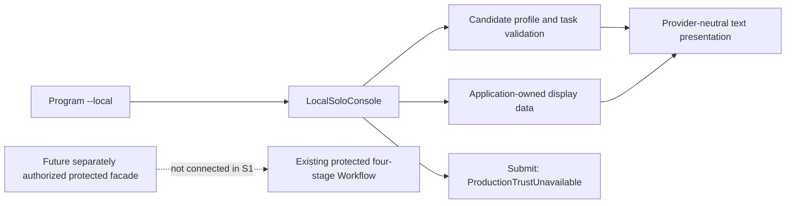

# Local Solo MVP-S1 — Provider-Neutral Host Foundation

日期：2026-10-19（Asia/Taipei）。**Implementation authored / Build NotRun / Tests NotRun / Operational activation BLOCKED**。本文件記錄 source 與靜態審查，不宣稱執行驗收通過。

## 1. Baseline、scope 與限制

- Baseline：`fc19a360bc891ad8719f2abb89e45eaff4eb9b5c`，`main`，本機 `origin/main` 相同。開始 working tree 僅未追蹤 `.opencode/`；未讀取、修改或提交。
- Owner 授權：實作 narrowly scoped offline Host foundation；不授權 provider/model activation、trust adapter、protected facade、S2 或其他 Harness。
- 依據：[S0 extensibility review](LOCAL_SOLO_MVP_HARNESS_EXTENSIBILITY_REVIEW.md)、[Safe Host design](../plans/SAFE_HOST_COMPOSITION_USER_FLOW_DESIGN.md)、[Roadmap](../ROADMAP.md)。Local Solo sequencing 以 S0 與本次 owner scope 為準；不改歷史設計／acceptance。
- [Corporate security incident](PHASE2B1_SECURITY_EVENT.md)及 execution hold 維持。未執行 dotnet build/test/restore、testhost、新 binary、provider、server、model、企業 endpoint 或 identity probe。

## 2. Implemented CLI contract（source-level；本輪沒有執行範例）

以下是傳給現有 Host 的參數，不是已安裝的全域 command：

```text
--local help
--local config [--workspace <absolute-local-directory>]
--local preview --workspace <absolute-local-directory> --objective <text>
--local sample [--diagnostics]
--local submit [--workspace <directory> --objective <text>]
```

| Action | Actual source behavior |
| --- | --- |
| help | 固定離線參數說明，不讀設定或 filesystem |
| config | 單一候選 profile；Harness 名稱、workspace、ReadOnly intent、兩個 model-role binding 的 metadata availability、database NotEstablished 與 activation blockers；不輸出模型值、endpoint 或 credentials |
| preview | 必須明選 workspace 與 objective；顯示候選 objective、ReadOnly、120 秒候選 timeout、尚未建立的 request/tool/output budgets 及三條 future data flow；不配置 TaskId／ExecutionId |
| sample | 純 application-owned in-memory view；整體標記 `OfflineSample / NotExecuted / ApplicationOwnedSample / NotVerified`；無真實 observation／trusted evidence |
| submit | 合法語法直接 `ProductionTrustUnavailable`，早於設定／workspace 存取；有無候選 intent 都不派送。未知／混合參數則先報 InvalidLocalInput |

`--local` 必須第一個參數，action 區分大小寫；拒絕未知、重複、缺值與混用舊模式。只有 sample 接受 boolean `--diagnostics`，不寫檔。沒有 `--output`、執行開關、status、Inspect、accept/reject、配置檔 loader 或 background behavior。

| Exit | Meaning |
| --- | --- |
| 0 | 離線 config／preview／sample／help 成功；不代表執行成功、已授權或 Accepted |
| 2 | InvalidLocalInput；不回顯原始參數／設定值 |
| 1 | ProductionTrustUnavailable 或 LocalInspectionUnavailable；沒有執行嘗試 |

## 3. Application／presentation 邊界與檔案

| File | Responsibility |
| --- | --- |
| [Program.cs](../../src/MAF.Host/Program.cs) | 最前方辨識 `--local` 後直接 return；早於舊 project lookup、OpenAIClient、DI、native agents；舊 help 增加一行 local 用法，其餘既有流程不改 |
| [LocalSoloConsole.cs](../../src/MAF.Host/LocalSoloConsole.cs) | 小型 strict parser、TextWriter output/error、safe error classes、固定 action dispatch；無 client/store/authority factory |
| [LocalSoloApplication.cs](../../src/MAF.Host/LocalSoloApplication.cs) | `LocalProfile`／`LocalTaskPreview`、metadata allowlist、候選輸入檢查、unconditional Submit denial；不是執行 request 或 authorization contract |
| [LocalSoloPresentation.cs](../../src/MAF.Host/LocalSoloPresentation.cs) | Host-owned `LocalResultView`／`LocalEvidenceView`、bounded text presenter／pure redaction 與 sample；使用 Core `ExternalExecutionStatus`，不使用 OpenCode REST、session schema 或 trusted proof constructor |
| [LocalSoloHostTests.cs](../../tests/MAF.Tests/LocalSoloHostTests.cs) | focused tests source；不註冊 synthetic authority、不建 provider/model/store。未執行 |

沒有新增 project、package、interface、general framework 或 DI registration。Local types 為 internal，沿用既有 `InternalsVisibleTo MAF.Tests`。未修改 Core、protected runtime、OpenCode client／effect guards、official executors、SQLite、source reader 或 Reviewer。



未來真正 facade 必須在既有 External assembly 的受保護邊界內 deliberate composition；本輪沒有為接線公開 internal graph 或提供 caller-controlled client/factory injection。

## 4. Candidate profile 與 validation

只讀以下非秘密 metadata，不列舉環境、不讀 `.env`／JSON、credential store、`AI_*` 或 `OPENCODE_*`：

| Metadata | Behavior |
| --- | --- |
| MAF_LOCAL_HARNESS | 預設 OpenCode；1–64 ASCII identifier characters，首字母；只是顯示名稱，不能選 executable／type／URL 或觸發 adapter construction |
| MAF_LOCAL_WORKSPACE | config 的 optional fallback；preview 必須用 explicit `--workspace`，覆蓋且不讀 fallback |
| MAF_LOCAL_PCA_MODEL | 只檢查非空，顯示 ConfiguredMetadataOnly / NotValidated；不顯示原值、不取得 credentials、不證明可用 |
| MAF_LOCAL_REVIEWER_MODEL | 獨立同上，不隱式沿用 PCA 或舊 AI_MODEL |

Workspace 上限 1024 字元；要求 fully-qualified local path，拒絕 control/format／line separator、UNC/device/URL、wildcards、traversal、額外 colon、尾端點／空白等不支援形狀。只查所選 drive metadata（Fixed／Removable／Ram），再從 drive 到目標逐層查 attributes，拒絕 reparse point 與非目錄；不遍歷／讀檔、不啟動 Git。不接觸明確 remote path。此為有界 availability preflight，**不是 workspace approval、sandbox、敵對 race-free handle boundary 或完整網路隔離證明**；底層未來 source/runtime guards 仍須重驗。OS alias、競態及部署 custody 不能由這個檢查消除。

Objective 1–4000 字元、不能全空白、拒絕 control/format／line separator；trim 後保留候選內容。只顯示 redacted preview，不傳送或保存。120 秒僅為候選 budget；native/provider call/tool/output 限額尚未建立。

Local profile／本機使用者／可用路徑都不代表 genuine caller、policy publication、human intention proof、protected writer、hostile same-principal isolation 或 anti-rollback。S1 不開啟或建立 per-installation SQLite，database location/profile 顯示 NotEstablished。

## 5. Actual result output contract

text-only display projection，不是 serialized execution input、authority proof 或 durable artifact：

| Field | Semantics |
| --- | --- |
| Harness／Task／Execution | 中立名稱與原 identities；缺值 Unavailable，不產生 fake execution ID。session/request/protocol metrics 不是必要欄位 |
| Observed status／at／freshness | 可顯示 Core status 與 supplied observation time；不推論 currentness，Freshness 固定 NotEstablished。sample 強制 status NotExecuted／time Unavailable，即使 view 帶 status/time 也不當真 observation |
| Summary／limitations | 有界文字；無值 Unavailable，不推論無限制 |
| Evidence／provenance | display reference 與來源描述；無 evidence 顯示 Unavailable / provenance NotEstablished。不是 VerifiedSourceEvidence，也不能以 view 重建 proof |
| Advisory assessment | 無 review 就 Unavailable；sample 只有 illustrative advisory text，未執行 Reviewer／R1，不能證 semantic correctness |
| MAF pre-dispatch approval | 獨立欄位，預設 NotEstablished；不能由 WaitingForApproval 推論來源 |
| Harness tool permission | 獨立欄位，預設 NotEstablished；不自動回答 provider permission |
| Human result choice | 獨立 display enum；無 result NotEstablished，sample Undecided。沒有決定操作、fresh consent 或 durable acceptance；HumanGate readiness 永不等於 Accepted |
| Adapter diagnostics | 只有 explicit sample `--diagnostics` 才顯示；獨立 section，不成為 Host command grammar；不接 raw transcript |

所有 free-text fields 走 pure bounded `Safe`：最多處理 8192 字元、輸出 4096 字元加 truncation marker；list 最多 8 筆加 marker。遮蔽常見 secret assignments、private-key block、常見 token 格式與 URI；control／format／line separators 不直接輸出。**Heuristic redaction 不能辨識所有秘密**；不可把秘密或未受限 transcript 當輸入，也沒有讀取 secret env 來比對。error 固定文字、不輸出 stack／原 path／raw argv。

## 6. Offline sample 與 blocked-effects review

- Sample 只有 Host-owned display records；illustrative `fixture/example.txt:1` 未讀取、不建立 SourceBinding／SourceCandidate／VerifiedSourceEvidence，不 deserialize proof。
- sample/help/submit 不讀 profile；submit 無效應依賴，唯一行為是 throw `ExternalHarnessException(ProductionTrustUnavailable)`，Console 轉 exit 1。
- Local branch 沒有 HttpClient／OpenAIClient、process launch、native model、execution store、policy activation、authority registration 或 task dispatch。config/preview 只讀 allowlisted metadata 與明選 directory attributes，無 file writes。
- [ExternalConsole](../../src/MAF.Host/ExternalConsole.cs)與 [ExternalConsoleOutput](../../src/MAF.Host/ExternalConsoleOutput.cs)原檔未改，原 external-task／recover／recover-pending 仍拒絕 ProductionTrustUnavailable；舊 PCA／Git-diff Review 仍是原獨立 native routes，沒有因此獲得 production policy 保護。
- 本輪 zero provider/model activation 是 source path／本次未啟動任何 runtime 的審查結論，**不是執行過 CLI 或 live instrumentation 得到的測量**。

## 7. Authored tests 與實際 verification

[LocalSoloHostTests](../../tests/MAF.Tests/LocalSoloHostTests.cs)涵蓋：metadata allowlist／模型值不輸出、缺設定、Harness identifier、workspace shape／不存在／traversal／file／長度、explicit selection 優先、objective 字元／上限、strict/mixed CLI、blocked submit 早於設定與 filesystem、sample labels／缺 identity／不得 Completed、Unknown／Partial／WaitingForApproval、缺 evidence／assessment、三種事件分離、opt-in diagnostics、代表性 secrets／terminal controls／bounded output，以及舊三條 external denial。

測試只使用未來執行時自行建立的空 `maf-local-s1-` directory，non-recursive cleanup；沒有 provider fixture、SQLite 或 synthetic trust。它們的空目錄斷言能檢查 fixture 內沒有新檔，不能單獨證明全程序無 effects；零 client/store path 另以靜態 call-path 審查。沒有建立 junction／mapped drive 來驗 OS 行為，這些仍需另准環境 targeted validation。

| Verification | This increment |
| --- | --- |
| Test source authored | 20 methods（12 Fact／8 Theory）；31 InlineData rows＋13 MemberData rows，合計 56 預期案例，僅靜態計數，未經 runner discovery；既有 assertions 不變 |
| Build／restore | **NotRun**，corporate execution hold |
| Tests／testhost | **NotRun**，0 executed；沒有新增 pass count |
| Provider／model／server | **NotRun / NotActivated** |
| Static review | CLI return 順序、dependency/effect absence、literal denial、old protected files 不變、輸出 bounds／redaction、scope diff／whitespace；README／Roadmap／本文件共 98 個本地 link targets 存在性通過，diagram 人工對照（未跑 renderer） |

靜態 review 不能替代 compiler／test runner；在獲准環境需先驗編譯與 focused tests，再談 S1 執行驗收。歷史 4F 1307 tests 不屬本輪 evidence，未重跑／未改寫。

## 8. S2 prerequisites 與停止點

1. 另行 owner 授權具體 protected-composition scope；在獲准環境完成 S1 build／focused test verification，並取得 corporate affected execution clearance。S1 commit 不解除 hold。
2. genuine caller verification、trusted current policy publication／exact operation scope、explicit activation／revocation、protected writer/credential custody、restore/anti-rollback 假設必須有具體可證 deployment integration。Local Solo 不要求中央 IAM，但不能用 synthetic resolver、Allow-all、OS login、環境設定或按 yes 取代。
3. 分別核准 PCA native inference、OpenCode 及其模型 second hop、Reviewer native inference 的 recipient／workspace／data classes／budgets／retry／tool-round-trip disclosure；不是只核准 loopback origin。
4. 未來固定 OpenCode facade 重用 ProtectedExternalRuntime、original session/receipt/effect guards、ExplicitV4 control、owned child lifecycle、mandatory independent source verification／Native Reviewer R1 及官方四階段 Workflow；不公開 arbitrary client injection、不重送 ambiguous POST、不改原 Inspect identity。RequireApproval 不支援就停止，不能轉 Allow。
5. bounded operational view mapping、human decision 語義／是否只同 session、parent checkpoint 缺口與 child-only Inspect 另定驗收；不以 SQLite ledger 假裝完整 result/parent 可還原。

目前停止在 offline foundation。**沒有 S2、Host activation、第二 Harness、Registry、general IAM 或服務安裝；真正提交仍 BLOCKED。**


## 9. S1-R1 follow-up — Personal Windows validation (2026-10-19)

**Offline foundation validation passed / Owner execution-acceptance review ready / Operational activation BLOCKED.**
Original sections 1–8 above preserve S1's authored-only / NotRun evidence. These results
were obtained later on the owner's explicitly authorized personal Windows development
machine, not on the affected corporate workstation and not as corporate clearance.

### Baseline and exact correction

HEAD, branch and fetched origin/main were `8aa93ef1fbec6d6ce30ba9ec334d9fffd391bc5b`,
`main`; no intervening changes. Unrelated untracked `.vscode/` was left untouched and
excluded from the commit. No untracked OpenCode data, secrets or company content was read.

xUnit constructs a class instance for each case. The eager `CreateTempSubdirectory`
field therefore allocated a workspace even for pure parser/presenter and blocked-submit
cases. The field now owns a `Lazy<string>`; only tests requiring an existing workspace
access its Value. Dispose checks IsValueCreated before accessing Value and deletes only
that fixture-owned empty directory, non-recursively. Prefix and temporary location are
unchanged; no security-control evasion or global fixture/cleanup framework.

Pure tests now assert IsValueCreated is false. Empty-directory assertions which themselves
allocated a workspace were replaced only in no-workspace cases. Invalid-objective and
external-denial cases pass inert `unused` input instead of evaluating the lazy property;
their original rejection/code/configuration assertions remain. Six cases still allocate
real isolated directories for metadata validation, preview/profile and objective-limit
behavior; the other 50 S1 cases do not allocate the test-owned workspace. This counts
fixture allocation by reviewed code/IsValueCreated assertions, not system-wide filesystem
instrumentation. Cleanup cannot initialize an unused fixture.

Changed files:

- [LocalSoloHostTests](../../tests/MAF.Tests/LocalSoloHostTests.cs): lazy ownership and pure-case assertions.
- This report: dated R1 evidence appended; historical S1 results retained.
- [Roadmap](../ROADMAP.md): current personal validation status and next gate.
- [README](../../README.md): matching concise current status / S1 validation labels.

No production source, package, Host route, protected runtime, policy, schema, Workflow,
provider, source-evidence or Native Reviewer code changed. No S1-local compilation or
behavior bug was found; the correction is confined to test fixture isolation.

### Actual commands and results

Personal Windows; installed SDKs 10.0.201 and 10.0.401; selected `dotnet --version` =
10.0.401, target net10.0. Project/package references were inspected. Existing dependency
assets/cache sufficed: no restore, new packages or external restore source was used.

```powershell
dotnet --list-sdks
dotnet --version
dotnet build src/MAF.Host/MAF.Host.csproj --no-restore
dotnet build tests/MAF.Tests/MAF.Tests.csproj --no-restore
dotnet test tests/MAF.Tests/MAF.Tests.csproj --no-build --no-restore --filter 'FullyQualifiedName~LocalSoloHostTests' --logger 'trx;LogFileName=local-solo-s1-r1-focused.trx' --results-directory TestResults/home-validation
dotnet test tests/MAF.Tests/MAF.Tests.csproj --no-build --no-restore --filter 'FullyQualifiedName~ExternalConsoleOutputTests|FullyQualifiedName~RuntimeEnforcementTests.HostDoesNotConstructLegacyRuntimeWithoutProductionTrust' --logger 'trx;LogFileName=local-solo-s1-r1-regression.trx' --results-directory TestResults/home-validation
```

| Verification | Actual outcome |
| --- | --- |
| SDK inspection | Exit 0; SDK 10.0.401 selected |
| Host build | Exit 0; 0 warnings / 0 errors; 6.18s |
| Test-project build and referenced projects | Exit 0; 0 warnings / 0 errors; 4.91s |
| Focused S1 | Exit 0; discovered 56 / passed 56 / failed 0 / skipped 0; 220ms |
| Narrow regression | Exit 0; discovered 32 / passed 32 / failed 0 / skipped 0; 139ms |

The runner confirms the earlier static estimate of 56 cases. The narrow regression is
29 ExternalConsoleOutput cases plus three pre-existing Host denial cases, not the whole
RuntimeEnforcement suite. Those three retain their own empty temporary-directory fixture;
no DB is created and the rest of that class is excluded. TRX artifacts are ignored under
TestResults/home-validation. No full suite, launcher, server, live provider, model, native
inference, company service or uncontrolled workspace execution was performed.

No antivirus/endpoint block, security alert or testhost crash was observed in command
results. Security-product telemetry was not queried; successful execution does not certify
absence of alerts elsewhere or grant corporate clearance. No security policy/ACL changes.
The historical [corporate security-event report](PHASE2B1_SECURITY_EVENT.md) is unchanged.

### Invariants and remaining gates

Assertions cover bounded/non-disclosing CLI errors, sample NotExecuted / NotVerified,
Unknown/Partial/WaitingForApproval without inferred human acceptance, separate permission
and approval displays, opt-in diagnostics, provider-neutral missing identifiers and all
three external denials. Static review confirms Program's local branch returns before
native client/DI construction, LocalSoloApplication.Submit always throws
ProductionTrustUnavailable, and S1 owns no HTTP/client/store/trust dependencies. These are
assertion plus call-path evidence, not system-wide network/process/DB instrumentation;
passing tests alone are not claimed to prove zero effects.

No unresolved build/test failures. Reparse/junction/mapped-drive behavior and malicious
same-principal filesystem races remain unvalidated platform boundaries. Redaction remains
heuristic. S1 is ready for owner **offline execution-acceptance review**, not operational
provider acceptance. Corporate affected execution clearance remains outstanding.

S2 still requires separate owner authorization, genuine caller/current policy and explicit
activation/custody/rollback boundaries, separately authorized PCA/Harness-model/Reviewer
data flows and budgets, and deliberate protected composition with original identity,
effect/receipt guards and mandatory 4C/R1 verification. RequireApproval must not become
Allow; parent durable resume remains out of scope. No S2 implementation or provider
activation was performed. **STOP after S1-R1.**
