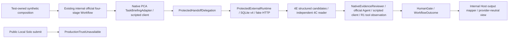

# Local Solo MVP-S2A — Controlled Workflow Outcome Integration

Date: 2026-10-20 (Asia/Taipei). Baseline: `3659e1cb01866e38bb7d18abf8929b602c9e9fbf`, main.
**Controlled offline validation passed; ready for owner acceptance. Operational Host/provider activation remains BLOCKED.**

## Scope and ownership

Owner explicitly authorized personal Windows development and offline validation, not S2B or
live execution. Initial HEAD and origin/main matched the baseline; unrelated untracked
`.vscode/` remained untouched/excluded. No company source, endpoints, credentials or
untracked OpenCode data was read. The historical corporate security incident and hold are
unchanged; personal results are not corporate clearance.

| Changed file | Responsibility |
| --- | --- |
| [LocalSoloOutcomeMapper](../../src/MAF.Host/LocalSoloOutcomeMapper.cs) | Internal output-only WorkflowOutcome → provider-neutral Host view; exact correlation checks |
| [LocalSoloPresentation](../../src/MAF.Host/LocalSoloPresentation.cs) | ControlledOfflineFixture classification, run/review/readiness/stage display; existing bounded sanitization |
| [LocalSoloWorkflowTests](../../tests/MAF.Tests/LocalSoloWorkflowTests.cs) | 12 actual-engine journey and projection/negative cases |
| [SourceCandidateIntegrationTests](../../tests/MAF.Tests/SourceCandidateIntegrationTests.cs) | Only Fixture and scripted Reviewer visibility changed private→internal inside tests; assertions/behavior unchanged |
| [README](../../README.md), [Roadmap](../ROADMAP.md), this report | Current bounded status, evidence and next gate |

No packages, schema, migrations, Core contracts, trust source, provider/effect code,
Workflow graph, dispatch behavior, production DI or CLI route changed.

## Composition decision — reuse the existing seam

The requested smallest application composition seam already exists:
[ControlledHandoffWorkflow.RunAsync/ExecuteAsync](../../src/MAF.Workflows.External/ControlledHandoffWorkflow.cs)
and [ProtectedHandoffDelegation.DelegateAsync](../../src/MAF.Workflows.External/ProtectedHandoffDelegation.cs)
inside MAF.Workflows.External. Per the authorization to reuse existing internal classes,
**no extra facade/wrapper or public factory was introduced**. Their offline disclaimer,
visibility, one-attempt task binding, immutable request construction and specialist budgets
remain intact. A model cannot replace original task/objective/workspace/ReadOnly intent.
This is reuse of the controlled application boundary, not a newly deployable facade.

The tested composition is:



Tests reuse SyntheticProtectedHandoff, its original response-gated HttpMessageHandler,
explicitly activated synthetic authority and disposable SQLite v4, plus the existing 4E
source metadata fixture and scripted native Reviewer. Two test-only access changes avoid
copying that infrastructure. The official outer graph is exactly PCA → ExternalDelegation
→ EvidenceReviewer → HumanGate, with one WorkflowOutputEvent. The child runs the existing
official external Workflow and unchanged guards. There is no second graph/agent loop.

Host assembly receives only Core WorkflowOutcome in an internal **output mapper**, not
ProtectedExternalRuntime, caller contexts, policy callbacks or clients through ingress.
No additional friend assembly or access to internal Workflow constructors was granted.
The public CLI cannot select this composition or test authority. An operational facade
is still blocked: genuine trust, native outbound authorization and deployment custody are
not implemented. Removing an offline label or trusting the outer Allow is not a solution.

## Mapping rules

| Input / condition | Host projection |
| --- | --- |
| Task/run and external handle | Original TaskId/WorkflowRunId, Provider as neutral Harness, ExecutionId; no generated replacement identifiers |
| Mismatched external task/run or review task/execution | Reject OutcomeCorrelationMismatch before projection |
| External status / summary | Preserve observed status and summary, including Unknown; missing external result stays Unavailable, not Failed/Completed |
| Observation time | Unavailable: WorkflowOutcome supplies no trustworthy observation timestamp; Freshness remains NotEstablished |
| Limitations | Merge outcome, external and review limitations; deduplicate/bound and retain non-live/output-only disclaimers; presenter bounds/sanitizes all free text |
| Source evidence | Only admitted reader-issued snapshots with exact task/run/execution/session/message binding; copy reference/path/range provenance as display strings, no source content/proof object |
| Mixed outcome references | Execution/summary/PCA strings never become independently verified evidence; missing sources stay Unavailable |
| Review | Separate advisory status/summary; SufficientEvidence is not semantic correctness; Completed is not review success |
| HumanGate / stages | Display exact readiness and stage states; skipped delegation is visible; ReadyForHumanReview is not Accepted |
| MAF approval | Explicit RequireApproval reason is displayed as requiring approval, not granted; otherwise NotEstablished, even after a successful direct-Allow journey |
| Harness permission | WaitingForApproval external observation is shown separately with authority NotEstablished; never inferred to be MAF approval |
| Human choice | NotEstablished; no operator decision/consent/dispatch right is fabricated |
| Adapter diagnostics | Session/request IDs and existing adapter request count/duration only in opt-in diagnostics; absent values stay Unavailable |
| Provenance | Every mapped result explicitly ControlledOfflineFixture / NotLiveProvider; independently read fixture evidence retains that classification |

Mapper/view records are not proof or authorization inputs. No JSON input method or
VerifiedSourceEvidence rehydration was added; the existing evidence converter still rejects
input. There is no arbitrary operational provenance selector. In-process visibility and
classification do not establish malicious same-principal security isolation. S1's static
OfflineSample / NotExecuted behavior remains separate and unchanged.

## Actual integration evidence

| Required case | Executed evidence |
| --- | --- |
| A — successful journey | Official four stages/order + one output; exact task/run, persisted handle and verified original-session receipt; native tool result actually includes Example.cs:120; one PCA call, two scripted Reviewer calls, two independent-reader checks; Host maps SufficientEvidence + ReadyForHumanReview without Accepted |
| B — Deny / RequireApproval | Outer advisory Allow cannot override current activated runtime policy; zero fake provider requests, zero Reviewer calls, no execution row; skipped external stage and distinct approval display |
| C — missing/changed/insufficient | Missing structured candidates, changed actual anchor and partial R1 observation preserve Completed externally but map InsufficientEvidence/NeedsHumanReview; no summary fallback |
| D — ambiguous Create | Lost original Create response leaves Unknown and runtime-execution; no fabricated session, no prompt; repeated same-instance Run returns original attempt without new Create |
| E — unavailable Reviewer | Injected reviewer failure becomes ReviewUnavailable/NeedsHumanReview while external Completed remains factual; historical unsupported-tool R1 regressions also pass |
| F — projection safety | Missing IDs, bounded/redacted controls/secrets, opt-in adapter metrics, fake mixed references ignored, proof deserialization refused, wrong correlation rejected; neutral OtherHarness display tested only as a negative/display-only DTO, not a second adapter |
| G — Host denial | All 56 S1 tests plus existing three external denials pass; no new CLI routes/config switches, synthetic resolver or operational clients registered |

Successful controlled journey IDs: Task `runtime-task`, run `runtime-run`, execution
`runtime-execution`, session `ses_runtime`, request `msg_runtime`. Raw fake transport
method/path counts **Create/Prompt/GET/Abort = 1/1/9/0**. Replaying the same in-memory
Workflow task preserves these counts; changed objective/workspace for that TaskId is
rejected. Deny/RequireApproval counts are all zero. Lost Create issues at most one Create,
zero Prompt and zero Abort. This is not proof of durable outer Workflow restart/resume.

No real provider/model call occurred: clients are the existing custom in-memory handler
and scripted IChatClient; the real Agent/Workflow engine invokes these fakes. Assertions
account for fake transport requests and SDK tool results, not OS-wide packet/process
instrumentation. CLI no-client/no-store behavior is supported by S1 assertions and static
Program/Console call-path review, not claimed solely from green tests. Native PCA and
Reviewer model quality or live OpenCode compatibility are not measured.

## Personal Windows validation

Installed SDKs 10.0.201 / 10.0.401; selected SDK 10.0.401, net10.0. Existing restore assets
and local dependencies sufficed. No restore, new package or network dependency access.
Commands (all final verification exits 0):

```powershell
dotnet --version
dotnet --list-sdks
dotnet build src/MAF.Host/MAF.Host.csproj --no-restore
dotnet build tests/MAF.Tests/MAF.Tests.csproj --no-restore
dotnet test tests/MAF.Tests/MAF.Tests.csproj --no-build --no-restore --filter 'FullyQualifiedName~LocalSoloWorkflowTests' --logger 'trx;LogFileName=local-solo-s2a-focused.trx' --results-directory TestResults/home-validation
dotnet test tests/MAF.Tests/MAF.Tests.csproj --no-build --no-restore --filter 'FullyQualifiedName~LocalSoloHostTests|FullyQualifiedName~ExternalConsoleOutputTests|FullyQualifiedName~RuntimeEnforcementTests.HostDoesNotConstructLegacyRuntimeWithoutProductionTrust' --logger 'trx;LogFileName=local-solo-s2a-host-regression.trx' --results-directory TestResults/home-validation
dotnet test tests/MAF.Tests/MAF.Tests.csproj --no-build --no-restore --filter '(FullyQualifiedName~ProtectedHandoffTests&FullyQualifiedName!~RealProcessCrashRecoversOriginalChildWithoutParentResumeOrPost&FullyQualifiedName!~CompetingProcessCannotExecuteOrInspectWhileOriginalOwnerIsActive)|FullyQualifiedName~NativeEvidenceReviewerTests|FullyQualifiedName~SourceCandidateIntegrationTests|FullyQualifiedName~SourceEvidenceCoverageTests' --logger 'trx;LogFileName=local-solo-s2a-protected-regression.trx' --results-directory TestResults/home-validation
```

| Final verification | Discovered / Passed / Failed / Skipped | Other results |
| --- | --- | --- |
| Host build | N/A | 0 warnings / 0 errors; 5.97s |
| Test build (includes final Host source) | N/A | 0 warnings / 0 errors; 2.40s (initial test build also passed, 4.27s) |
| New S2A focused | 12 / 12 / 0 / 0 | 2s |
| S1/Host narrow regression | 88 / 88 / 0 / 0 | 56 S1 + 29 output + 3 denial; 143ms |
| Protected/source/Reviewer regression | 201 / 201 / 0 / 0 | 34 protected + 66 Reviewer + 59 source candidate + 42 coverage; 20s |
| Total final executed cases | 301 / 301 / 0 / 0 | Scoped suite, not full offline regression |

First S2A focused run exited 1 (10 passed / 2 failed): the new mapper initially omitted
component limitations when outcome limitations were empty, and the changed-source fixture
appended text outside its anchor, which correctly remained verifiable. Corrected mapper
merges component limitations; corrected fixture changes the actual anchor. Original safety
expectations were retained. Rebuild and all 12 focused cases then passed. No historical
assertions were weakened; only two test-helper access modifiers changed.

Selection was inspected before execution. Explicitly excluded two protected-handoff
process crash/competition methods, all live/model/provider launcher/acceptance tests and
unreviewed broad suites. No server/provider process was launched. Ignored TRX artifacts
are in TestResults/home-validation. No endpoint-security block or testhost crash was
observed; security-product logs were not interrogated and successful personal runs do not
certify corporate clearance. Relative documentation links and scoped diff were checked.

## Preserved guarantees, gaps and smallest S2B prerequisite

ProductionTrustUnavailable, UnavailableTrust/UnavailableRuntimeAccess defaults, explicit
policy activation, exact v4 admission/receipt, ownership, intent-before-wire, independent
Inspect authorization, no ambiguous POST retry, no implicit Abort, source currentness and
R1 actual observation requirements are unchanged. No HTTP transaction atomicity claim.
The production dispatcher, native outbound permission boundary and genuine identity are
not provided by the view or by the controlled outer advisory Allow.

D1 durable evidence/outer checkpoint recovery, D2 semantic correctness, D3 filesystem
snapshot isolation and malicious same-principal custody remain open. This increment does
not enable child-only operational Inspect, Human Approval UI, durable result acceptance,
parent resume, permission replies, write/shell, Registry, another Harness or Hybrid.

Smallest recommended S2B: separately authorize a **fixed genuine trust/native-egress
contract and disabled composition design gate**, mapping exact operator/task/workspace,
policy activation/revocation, protected storage/provider custody/rollback and all three
PCA→model / Harness→model / Reviewer→model recipient/data budgets onto the existing seams.
If those contracts cannot be grounded, document the specific blocker rather than adding
Allow-all/test-trust activation. Actual Host/provider activation and live compatibility
require further explicit scope; no new general IAM/Broker platform is implied.

**STOP after S2A. No S2B or operational activation implemented.**
