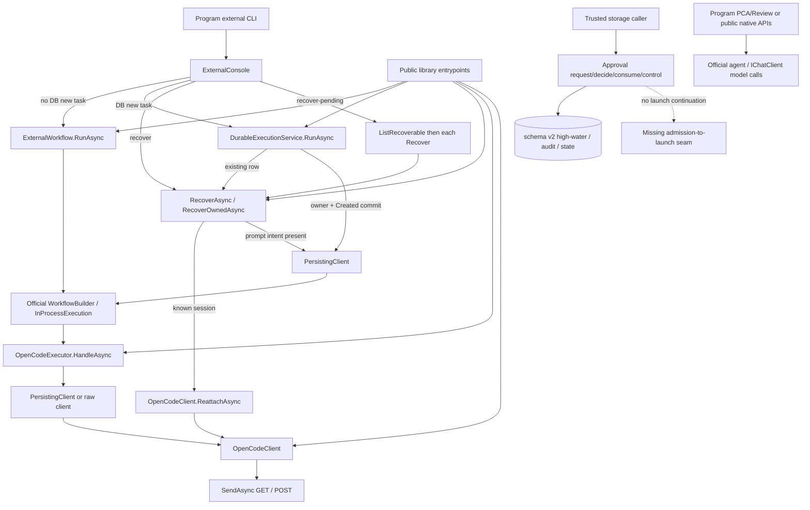
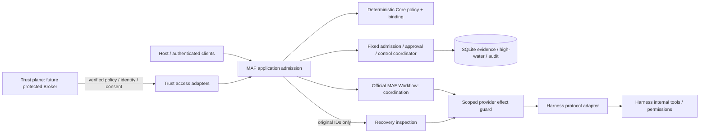

# Phase 2B-2 M3-0：架構審查與 M3-A 提案

日期：2026-10-16（Asia/Taipei）。Source baseline：`f37e22282b63fbe2ce177e2ef8ce7e86ce226da9`，分支 `main`。**本輪只有 source review 與文件，沒有 runtime 修改、build/test、DB 操作、模型或 provider 呼叫。** M3-0 審查產物完成；下述建議等待 owner 接受，不是 M3-A/B/C 實作或部署授權。完整 Phase 2B-2 未驗收。

同步前 tracked tree 乾淨；既有未追蹤 `.vscode/` 保留、不讀取內容、不提交。Fetch 後 fast-forward 至上述 baseline；ADR-006 與 M3 gate 均存在。依據：[Roadmap](../ROADMAP.md)、[七項護欄](../architecture/ARCHITECTURE_GUARDRAILS.md)、[ADR-004](../architecture/ADR-004_DURABLE_EXECUTION_RECOVERY.md)、[ADR-005](../architecture/ADR-005_POLICY_APPROVAL_CANCELLATION.md)、[ADR-006](../architecture/ADR-006_TRUSTED_BROKER_BOUNDARY.md)、[M3 gate](../plans/PHASE2B2_M3_ARCHITECTURE_GATE.md)、[execution plan](../plans/PHASE2B2_EXECUTION_PLAN.md)、[acceptance matrix](PHASE2B2_ACCEPTANCE_PLAN.md)、[M2-B results](PHASE2B2_M2B_RESULTS.md)。Source 與 target 不同時採 source。

## 1. 結論與 gate 狀態

能力分工：**Broker/Trust Authority 證明誰有權、誰核准了什麼；MAF 決定 admission、協調與 recovery；Harness 負責專業執行與內部 tool loop。** Broker 不接管 Workflow，也不取代 MAF 本地 deterministic enforcement。未來 Codex/Claude Code 替換 harness adapter，不各自建立 operator trust；Open WebUI 若作 ingress，仍須驗證 client identity，不能因此成為 trusted authority。

現有 source 已有 no-resubmit ledger、policy evaluator、v2 approval transactions、serialized authority adapter，但**沒有統一 runtime authorization boundary**。主要缺口：

- Host 與公開 library 可以直接執行，raw provider client/executor 也可直接建構；CLI-only gate 不足。
- Recovery 不重送 session/prompt，但取消時仍可 Abort。正常觀測是 GET-only，不代表整個 recovery API 無 POST。
- Consume 已建立 Created，現有 RunAsync 見到它卻只 recovery；缺乏只給 committing owner 的一次性 launch continuation。
- Execution store 拒絕 schema2，不能直接讀寫 Consume 建立的 v2 execution。
- 普通 PinAuthority 隱含 activation；store reads 無資料授權；cancel intent 無獨立 cancel-policy evaluation；approval generation replacement 未完成。

**判定：M3-0 source verification complete，M3-A proposal ready for owner review；M3 runtime 未開始。** Broker、M3-C、production activation/human approval = Blocked / Not Demonstrated。歷史 M2-B 94 focused／347 offline 僅引用原報告，這輪未重跑，不能作 M3 runtime 通過證據。

## 2. Source inventory（函式與已核對行號）

所有連結相對於 repository；行號以本 baseline 核對。

| 代號 | File / function 與實際責任 |
|---|---|
| H1 | [Program:23](../../src/MAF.Host/Program.cs#L23)：external modes 先分支；Review/PCA 分別呼叫 ReviewAsync、agent.RunAsync |
| H2 | [ExternalConsole.RunAsync:12](../../src/MAF.Host/ExternalConsole.cs#L12)：raw OpenCodeClient、ExternalWorkflow、可選 SqliteExecutionStore/DurableExecutionService；無 policy/trust DI |
| W1 | [ExternalWorkflow.RunAsync:16](../../src/MAF.Workflows.External/ExternalWorkflow.cs#L16)、[ExecuteAsync:42](../../src/MAF.Workflows.External/ExternalWorkflow.cs#L42)：bounded readonly request、100 identities、single-flight、官方 Workflow |
| D1 | [DurableExecutionService.RunAsync:20](../../src/MAF.Workflows.External/DurableExecutionService.cs#L20)：owner、fingerprint；existing→recover，new→Created commit→launch |
| D2 | [RecoverAsync:41](../../src/MAF.Workflows.External/DurableExecutionService.cs#L41)、[ListRecoverableAsync:52](../../src/MAF.Workflows.External/DurableExecutionService.cs#L52)、[RecoverOwnedAsync:55](../../src/MAF.Workflows.External/DurableExecutionService.cs#L55)：same-scope/original-handle reconciliation |
| D3 | [ExecuteAsync:93](../../src/MAF.Workflows.External/DurableExecutionService.cs#L93)、[PersistingClient.SaveAsync:149](../../src/MAF.Workflows.External/DurableExecutionService.cs#L149)：官方 Workflow、typed output、terminal preservation、CAS |
| D4 | PersistingClient [Create:168](../../src/MAF.Workflows.External/DurableExecutionService.cs#L168)、[Submit:183](../../src/MAF.Workflows.External/DurableExecutionService.cs#L183)、[Observe:195](../../src/MAF.Workflows.External/DurableExecutionService.cs#L195)、[Abort:206](../../src/MAF.Workflows.External/DurableExecutionService.cs#L206)：intent-before-HTTP，無 policy/control-version checks |
| X1 | [OpenCodeExecutor.HandleAsync:13](../../src/MAF.Workflows.External/OpenCodeExecutor.cs#L13)：public executor；Validate/Create/Submit/poll；OCE 可 abort+observe。PolicyVerified 只是 Validate trace |
| C1 | OpenCodeClient [Reattach:34](../../src/MAF.Workflows.External/OpenCode/OpenCodeClient.cs#L34)、[Validate:77](../../src/MAF.Workflows.External/OpenCode/OpenCodeClient.cs#L77)：identity/session-policy、discovery GET |
| C2 | OpenCodeClient [Create:175](../../src/MAF.Workflows.External/OpenCode/OpenCodeClient.cs#L175)、[Submit:247](../../src/MAF.Workflows.External/OpenCode/OpenCodeClient.cs#L247)、[Observe:261](../../src/MAF.Workflows.External/OpenCode/OpenCodeClient.cs#L261)、[Abort:370](../../src/MAF.Workflows.External/OpenCode/OpenCodeClient.cs#L370)：public raw provider APIs |
| C3 | [SendAsync:404](../../src/MAF.Workflows.External/OpenCode/OpenCodeClient.cs#L404)：唯一 adapter HTTP transport；provider Basic credential 不等於 operator identity |
| S1 | SqliteExecutionStore [Open:33](../../src/MAF.Persistence.Sqlite/SqliteExecutionStore.cs#L33)、[TryAcquire:70](../../src/MAF.Persistence.Sqlite/SqliteExecutionStore.cs#L70)、[Create:126](../../src/MAF.Persistence.Sqlite/SqliteExecutionStore.cs#L126)、[Update:142](../../src/MAF.Persistence.Sqlite/SqliteExecutionStore.cs#L142)：schema0/1、owner、snapshot CAS，拒絕v2 |
| S2 | SqliteApprovalStore [Transaction:32](../../src/MAF.Persistence.Sqlite/SqliteApprovalStore.cs#L32)、[PinAuthority:46](../../src/MAF.Persistence.Sqlite/SqliteApprovalStore.cs#L46)、[Activate:77](../../src/MAF.Persistence.Sqlite/SqliteApprovalStore.cs#L77)、[GuardedTransaction:87](../../src/MAF.Persistence.Sqlite/SqliteApprovalStore.cs#L87)：v2-only；pin/business分開commit，前後digest check |
| S3 | SqliteApprovalStore [Request:170](../../src/MAF.Persistence.Sqlite/SqliteApprovalStore.cs#L170)、[Decide:198](../../src/MAF.Persistence.Sqlite/SqliteApprovalStore.cs#L198)、[Expire:221](../../src/MAF.Persistence.Sqlite/SqliteApprovalStore.cs#L221)、[Revoke:230](../../src/MAF.Persistence.Sqlite/SqliteApprovalStore.cs#L230)、[Consume:245](../../src/MAF.Persistence.Sqlite/SqliteApprovalStore.cs#L245)、[Cancellation:275](../../src/MAF.Persistence.Sqlite/SqliteApprovalStore.cs#L275)：資料交易，無dispatch |
| P1 | [PolicyContracts](../../src/MAF.Core/Policy/PolicyContracts.cs)、[Evaluator](../../src/MAF.Core/Policy/DeterministicPolicyEvaluator.cs)、[OperationBinding](../../src/MAF.Core/Policy/OperationBinding.cs)：三種結果、canonical v1；evaluator不認證context |
| T1 | TrustedPolicyAuthority [Acquire:84](../../src/MAF.Core/Policy/TrustedAuthority.cs#L84)、[CanDecide:145](../../src/MAF.Core/Policy/TrustedAuthority.cs#L145)、[CanControl:155](../../src/MAF.Core/Policy/TrustedAuthority.cs#L155)：lease/auth/exact rights；未註冊Host，預設UnavailableTrust |
| M1 | [ApprovalSchema](../../src/MAF.Persistence.Sqlite/ApprovalSchema.cs)、[AuthorizedApprovalMaintenance](../../src/MAF.Persistence.Sqlite/AuthorizedApprovalMaintenance.cs)：offline exclusive migration／授權wrapper；primitive仍是trusted code API，非OS隔離 |

## 3. 現況呼叫圖與完整 provider 路徑

AP是獨立資料層，不是已接上的CLI approval path；沒有approval/resume CLI、background recovery worker、Broker listener或provider reply。不能用不存在的邊作enforcement證據。

### 3.1 任務、owner、官方 Workflow

- **Ephemeral**：W1驗bounded request→TaskId equality/single-flight→semaphore→新run/execution IDs→X1 Validate→Create→Submit→poll。重建Workflow/client會丟去重，不具跨restart保證。等slot前取消回CancelledBeforeLaunch，未啟動remote。
- **Durable new**：D1取得TaskId exclusive file owner→Get→預配run/execution/message IDs與fingerprint/scope→S1 Created commit→D3官方Workflow→D4 SessionCreationIntended commit→Create POST→SessionKnown commit→PromptIntended commit→Submit POST→Acknowledged commit→Observe/terminal CAS。Owner持續整輪含等slot；transactions短、不含HTTP。
- **Existing**：D1 fingerprint不同拒絕，相同永遠D2 recovery；現存Created或舊approval不授予重送。RecoverAsync不要求原prompt，驗root/provider scope；unknown TaskId拒絕，無session Unknown；local pre-prompt Failed可回metadata，terminal不被Unknown覆寫。
- **Known session**：Reattach先Validate discovery再GET原session，驗policy、將execution標記submitted以封鎖Submit；未達PromptIntended仍Unknown。已達intent才新建official graph，以原run/handle、recoveryOnly觀測，沒有新Create/Submit。
- **Batch**：先列最多100 nonterminal records（查101以拒絕超量），逐筆Recover。今天無caller授權；未來必須先允許list，再逐筆exactscope，不能先回所有metadata才filter。

### 3.2 Approval／control（未接執行）

Request→lease→Pin獨立commit→guarded tx→RequireApproval+CanControl→operation/control/Pending/audit；無execution。Decide→lease/pin→CanDecide+非self+binding/currentpolicy/Pending CAS/無cancel→Approved或Rejected+audit；無Workflow。合法相同DecisionId重放回原資料，非新grant。

Consume→lease/pin→expiry/currentpolicy/binding/operator仍有權/caller/control+cancel/version/exactCreated mapping→**同tx Consumed+execution INSERT+audit**。不接收IExecutionOwnership、不回launch continuation。Expire無identity參數，只做減權；Revoke需CanDecide、不dispatch。Current authority要求operation revision=current，舊epoch不一定可Revoke；不能把synthetic fixture較寬鬆行為當production規格。

RequestCancellation依approvalId找到原operation，只呼叫該operation的CanControl，**沒有獨立Evaluate(RequestCancelExecution)**；sticky control version/revoke未consume approval/audit同tx。沒有approval record的普通v1任務不可直接走此方法；正常executor也不讀task_controls，故現有intent不會自動阻止raw dispatch。

### 3.3 Provider 外部效果清單

| 來源 / HTTP | 現況驗證 | 所需授權、intent與failure規則 |
|---|---|---|
| Validate：GET global/health、doc、agent?directory | approved root、loopback/API/readonly agent；無Create/Submit | 先允許exact Submit或Inspect的bounded metadata preflight再discovery，不先GET再Deny；不是泛用health permission |
| CreateCore：POST session?directory | 帶readonly session rules，回應驗session/root/permissions；**public Create不自行Validate** | SubmitNewReadOnlyTask/CreateSession phase；owner/currentpolicy/control及SessionCreationIntended先commit；response lost缺session→Unknown，無替代session |
| Submit：GET session，再POST session/{id}/prompt_async | Bound(handle)、TaskId、process submitted去重、session policy；**不比對完整原TaskText/fingerprint** | 同Submit operation的SubmitPrompt phase、exact input/IDs；PromptIntended先commit。GET與POST間仍需wire preflight，不重送ambiguous POST |
| Reattach：Validate + GET原session | ses/msg/provider/session-policy，無MAF Inspect policy | InspectExistingExecution、原IDs與owner；不授Create/Submit |
| Observe：GET session、permission、question、session/status、message最多3頁 | Bound/session-policy、correlated session/message/parentID、pending優先 | 每輪及實際request驗Inspect scope/freshness；pagination/retry不能延長舊許可；global結果只在adapter內篩原session |
| Abort：POST session/{id}/abort | 只有Bound，bool acknowledgement；無cancel policy/operator驗證 | RequestCancelExecution、exacthandle、獨立durableintent/dispatch evidence；ack≠Cancelled。M3 protected profile先拒絕，M4才實作完整dispatch |
| SendAsync | bounded timeout/response、provider Basic credential；count含GET與POST | guard靠近wire；總request count不是可靠POST帳目，驗收按method/path計數 |

沒有其他OpenCode POST：無permission/question reply、shell或write API。PCA/Review的模型呼叫不經此adapter guard。

## 4. Entrypoint／bypass matrix

B編號是本次review findings；severity指**production rollout blocker**，不是本輪新引入漏洞。Store primitive信任呼叫程式，是既有假設，不代表安全隔離。

| 入口 | 現有 authentication／policy | 缺口、required operation/binding/ownership/failure | Finding／接入點 |
|---|---|---|---|
| CLI no-DB external-task／public W1.RunAsync | 無MAF identity/policy，僅readonly bounds | SubmitNewReadOnlyTask、canonical root/provider/agent/config/budget/fingerprint及預配IDs；process內single-flight；crash無durableevidence，RequireApproval不可fallback ephemeral | B1 High：application gate + required provider guard |
| CLI durable external-task／D1.RunAsync | 無；fingerprint+fileowner | owner下先分類new/existing；new需atomic Allow admission，existing只Inspect；DB錯誤不得降回ephemeral | B1/B2 High：coordinator與owned continuation |
| CLI recover／D2.RecoverAsync | 無；scope/handle validation | InspectExistingExecution、原IDs/目前scope、owner與GET permit；inspection取消不能升格cancel權 | B3 High：recovery OCE可Abort，需observe-only cancellation |
| CLI batch／public ListRecoverableAsync | 無；最多100 | scoped metadata list + 每筆Inspect；不得洩漏其他task IDs；owner逐筆、bounded batch | B4 High：無list-specific policy契約，先限scope或拒絕global list |
| Public X1.HandleAsync／raw C1/C2 | 無；可繞Workflow request validator及policy | Create不自行Validate，Submit可換同TaskId文字，executor預設abortOnTimeout=true；需required context及exact binding | B5 High：只包Host/facade不夠；限制raw exposure或缺context deny |
| Approval request/decision | production disabled；S3有authority hooks | Request精確RequireApproval；Decide需獨立human/exactscope/CAS；Approve所有POST0 | B6 High前提：合約不是真human proof，無--actor/terminal fallback |
| Consume／future resume（尚無application入口） | store有freshpolicy/caller/operator/control檢查，無owner參數 | Consume+Created後只有committing owner可launch；D1看到Created只recovery，不能Consume後RunAsync期待submit | B2 High：new-owner continuation與v2 execution access |
| Store reads/get/list/control/audit；S1 mutations；Expire | reads無caller；mutation另有storage invariants | 只供trusted application/writer；reads需授權/filter，Expire純減權；writer可改DB仍是威脅 | B4/B7 High：store不是auth API，需protected writer與transport |
| Activate／ordinary PinAuthority | source由trusted interface供給，但普通mutation可advance | 固定authority/source，無獨立activate operator權限契約；source publication≠activation | B8 Medium，啟用前必解：explicit-only proposal見D02 |
| Ctrl+C/token／raw AbortAsync | 無獨立cancel auth；D4只有AbortRequested bool | ephemeral timeout可abort；durable純timeout不abort，owner/framework取消仍abort，recovery亦然；需cancel policy/control/intent與獨立budget | B3/B9 High：token不是授權，完整dispatch留M4 |
| S3.RequestCancellationAsync | 只有原operation CanControl，需approvalId | 無獨立cancel policy；普通execution可能無approval；intent不由runtime讀取 | B9 High：未來建RequestCancelExecution command，不讓submit權隱含cancel權 |
| Maintenance primitive/wrapper | wrapper exact DB authorizer default deny；primitive只檢bool attestations | exclusive/offline、停Host/verifiedbackup仍是維運前提；primitive不是authenticated入口 | B7：正式維護限trustedwriter；本輪不動DB/ACL |
| PCA --ask/互動、Review CLI／public factories/ReviewAsync | 無新MAF policy；readonly ProjectTools／endpoint credential | 會將admitted source傳模型，並非既有external Submit合約覆蓋；需另審native capability/data ingress權限 | B10 High若聲稱全Host受保護：M3-A不擴建nativepolicy，protectedprofile拒絕未涵蓋mode；legacy基線明列未整合 |
| Test acceptance helpers | synthetic authority、raw fixtures | 不是production入口/身分證據；MAF.Acceptance有explicit live命令，本輪未執行 | helper/resolver不得加入Host；只用driver自建PID/DB |

## 5. 元件所有權與依賴

| 元件 | 重用／提案 | 責任界限 |
|---|---|---|
| Trust access | 重用ITrustedPolicyAcquisition/ITrustedIdentityResolver/IApprovalAuthorization；M3-C才部署真實來源 | 不信任輸入JSON的identity；不能由read/list推approve |
| Core | 重用PolicyRequest/Decision/Scope/Evaluator、epoch/version、canonical digests | 不讀provider JSON、不查OS SID、不做SQL/HTTP；不改2B-1 fingerprint |
| Application | **擬新增concrete ExternalExecutionApplication**：分類入口、derive scope、trustedcaller、組合既有服務 | 不重建agentloop/Workflow，不保存prompt、不建IAM |
| Coordinator | 既有Consume只覆蓋Approved；Allow與dispatch-intent缺固定atomic方法 | 不發HTTP、不launch、不回持久bearer ticket |
| Effect guard | **擬新增required guarded client/decorator + SendAsync附近request preflight**，Create/Submit/Inspect/Abort分開 | 不在provider JSON adapter塞approval business rules、不回permission |
| Execution/Workflow | 重用D1–D4與official graph，新增internal new-owner continuation | existingCreated/graph replay不授Submit |
| Adapter | 重用readonly/session/schema/correlation；必要時新增可信scope metadata投影與guard接點 | 不維護global authority/Broker/approvalstore |

新interface限於真正缺口：窄 `IExecutionAdmissionCoordinator`（概念methods：AdmitAllowed、CommitDispatchIntent，驗owner/currentdecision/control），及必要provider-effect preflight。Application先用concrete class，不建generic command bus。Continuation為internal不可序列化型別，不是公共授權token；IExecutionOwnership仍負責OS互斥。上述新增名稱**尚未實作**。

## 6. 決策記錄：供 owner 核准

| ID | 推薦決策與理由 | 替代方案、目前證據與批准需求 |
|---|---|---|
| D01 Broker替換 | 換可信source、identity/consent access、maintenance/writer access；MAF保留policy/binding/admission/guard，harness管protocol/tools | 不讓Host包辦IAM或Broker包辦Workflow。ADR-006方向已採納；principal/transport/proof custody仍另批 |
| D02 publication/activation | **explicit-only durable activation**；普通Pin改verify-active，不advance。Activate在trusted control boundary單獨授權，high-water+audit commit才生效 | implicit較簡單，但失敗Request也改政策/耗audit，混admin/business權。現況確為implicit；此輪不改；owner需批語義與tests activation setup調整 |
| D03 candidate/unavailable | active digest與fresh acquiredproof不一致／source不可用則fail closed；新版candidate未explicitcommit→PolicyActivationRequired，不用舊cache或自動activate | publication不是全系統生效；接受暫停代價。若要stagedpublication維持舊active，須另定可驗證active snapshot取得協定；M3-C要外部rollback/revocationanchor |
| D04 authentication/authorization | resolver認證transportsubject與humanpresence；authorizer對exactoperation/resource/scope/prooffreshness授權；MAF再驗digest/epoch/expiry/Deny | callback在tx內只能bounded localverification，Broker proof acquisition在tx外；proof/rights revocation revision須受lease或等效可信序列化涵蓋。字串/SID/nonce不足 |
| D05 admission/dispatch | Allow admission或Approved consume與currentpolicy/control/Created/audit同短tx；每Create/Submit再驗並commit現有phaseintent，然後HTTP | 不採一次Allow永久有效；policy/cancel先commit則擋下一intent，intent先commit可能更新後到wire。最後preflight縮窗，不消除commit-to-HTTP race，無exactly-once |
| D06 new/existing | owner下查DB；existing永遠recovery。只有當次成功Created insert的committing owner可得到一次internal continuation | 不用RunAsync(existingCreated)作resume、不從snapshot重建continuation。crash失去continuation可Unknown，不force-submit；新增private seam，不重設state machine |
| D07 approve/resume | approve/reject/revoke只記錄。explicitresume重新提供input、fingerprint、freshpolicy/operatorrights/control，再consume或inspect | 不拿Recovery inspection placeholder作task；無input→InputRequired零POST；受控stdin避免history/DB保存。M3-B只有synthetic，無operational CLI |
| D08 effects/cancel | protectedinspection取消只停止等待，不隱含abort；GET/poll也要guard；Abort先disabled至M4 | 現有executor OCE會abort是B3缺口。保留legacy timeout/cancel assertions，另增protectedprofile負向case；Submit權不等於Inspect/cancel |
| D09 checkpoints | 現在WorkflowBuilder + InProcessExecution，**沒有checkpointstore/resume整合**；officialgraph與durableeffectledger各司其職 | 未來SDK checkpoint只恢復graph，不replayCreate/Submit；existing仍reconcile，checkpoint/runID非授權/已送出證據。本輪不查外部SDK新功能，不聲稱支援 |
| D10 human/writer/rollback | productiondisabled，直到真source、人類exactconsent、writer/secret隔離、durableproofreference/revocation/antirollback可驗證 | same-accountlocalhost服務不是隔離；SQLitehash/high-water不防DB替換；同帳號持signingkey也不足。必要additiveproofstorage另審，不承諾零schema改動 |
| D11 compatibility | 不自動開v2；新v2executionaccess限explicitprofile。protectedAPI缺context應default-deny或將raw構造內部化 | **會使無identity的既有Host external路徑停止工作，需owner批API/CLI相容性變更。** 推薦接受、tests顯式Allowfixture；不得保留caller可選unsafe旗標 |
| D12 approval generations | 暫維持TaskId/initialoperation不可重綁；stalepolicy拒絕consume，回NeedsNewAuthorization，不宣稱已Superseded | schema one_initial_admission unique(task_id)擋同Task再建initialgeneration；狀態也無Superseded/Closed。同Task替代需另審index/schema/CAS；不換TaskId自動retry未知工作，M3-B不做replacement |

D02/D03/D11/D12與M3-A scope須在coding授權中明列。未接受D11時只可先做provider-free A1，不能宣稱P10/R03全入口無bypass。此審查不替owner選productionprincipal、Broker部署或proofprotocol。

## 7. Atomic、ownership 與 crash windows（目標）

鎖順序：真正new/resume/recover先TaskId owner→authority lease→schema shared gate/短SQLitewriter tx。Activation只authority→DB，不等TaskId；decision/cancel-intent不等長期owner。禁止持DBtx等人/BrokerHTTP/runningowner；maintenance另以離線exclusive gate。Pure reads也先資料授權；lease不是惡意same-accountcode的安全沙箱。

1. **Allow new**：trustedcontext/derivedscope/預配IDs→初評→owner下確認無execution/衝突operation→短tx重驗activepolicy/descriptor/binding/Allow/control，建立control/operation+唯一Created+audit→commit→當次owner一次continuation。現有Consume不可用假Approved實現Allow，需新固定方法。
2. **RequireApproval**：重用RequestAsync，Pending/control/operation/audit同commit，無execution/providerIO；等待釋放owner/lease。NoDB/滿額拒絕，不fallback。A1只回非執行ApprovalRequired，durablerequest在後續A2/B整合。
3. **Approve**：tx外取得verifiedhuman evidence；tx內localexactauth+CAS/audit，無Workflow/continuation，所有POST0。Unavailable proof拒絕，不用假人類。
4. **Resume new**：重新提供input/fingerprint→owner→最新approval/control/execution。已有execution就Inspect，不consume/launch；尚無才freshrevalidate、Consume+Created同tx，同owner經private seam接續，不釋放owner後再Run。
5. **Dispatch**：owner下驗phase/currentpolicy/control，固定coordinator將檢查與SessionCreationIntended或PromptIntended transition同tx，commit後wire，回應存原ledger。Session已知後effectcontext另綁原handle；**不改歷史ApprovalRecord或OperationBinding v1 digest**，內部context連結原binding與新correlation。
6. **Observe/recovery**：由snapshot建立Inspect request，原Task/Run/Execution/Session/Message/fingerprint，新的inspectionOperationId/budget/currentpolicy；不能以Submit批准充Inspect。每輪/分頁wire查freshpermit；取消只停止等待。scope失敗/證據不足拒絕或Unknown，preserve terminal；無submissionevidence零新POST。
7. **Cancel**：獨立RequestCancelExecution授權→durableintent/controlVersion；與admission/dispatch CAS決定先後。A/B最多資料減權intent阻止下一effect，不實作Abort；M4再delivery/ack/terminal/owner。shutdown/timeout/token不是cancel授權。

| crash/race | durable truth／下一process |
|---|---|
| admission/Pending/consume tx中死亡 | 全rollback或全commit；不因CLI無回應推定未執行 |
| Created commit後、continuation前死亡 | existing→recover-only；無sessionUnknown，不重新mintcontinuation |
| sessionintent後／POST前或response lost | 可能未送或已送；缺sessionUnknown，已知session只GET，無替代session |
| promptintent後／ACK保存前死亡 | 可能accepted，原session/message GET，prompt POST增量0 |
| policy/cancel先於intentcommit | 拒絕intent及HTTP，不降回無DB或另一connector |
| intent先於policy/cancel | 可能仍到wire，保留MayHaveBeenSent；後續cancel/reconcile留M4 |
| graphrestart／duplicateresume | DB+owner分類new/existing，graphcheckpoint不覆蓋effectledger |

## 8. M3-A/B/C 實作順序與檔案提案

### M3-A：isolated deterministic admission（需另批）

推薦先A1再A2，是同一路徑的增量，不建立兩套永久runtime。

| 子步 | 精確scope／可能檔案 | 相容、atomicity與stop |
|---|---|---|
| **A1第一件工作：provider-free admission** | 新 `src/MAF.Workflows.External/ExternalExecutionApplication.cs`（概念路徑），重用Corepolicy/trust/digests；必要internal immutable operationcontext。新增 `tests/MAF.Tests/ExternalAdmissionTests.cs`。解析trustedcaller、derive canonicalscope、分類new/inspect/ephemeral/batch、回非執行Deny/Allow/ApprovalRequired與固定reason | 不launchWorkflow、不寫execution/approval、不回dispatchticket、不改HostDI/constructor相容性、不做DBmigration。Syntheticclock/source/context僅tests。Allow只有評估意義，沒有providercallback；unknownscope、forgedcontext、source故障deny。D02/D11未決時只做此步 |
| **A2：單一protected path接fake execution** | 修改D1–D4/W1/X1/C1–C3的requiredguard接點，重用officialWorkflow；Core增窄IExecutionAdmissionCoordinator；Persistence增Allowadmission/dispatch-intent固定tx、explicit-activevalidation、owner驗證；SqliteExecutionStore提供explicitv2profile read/update，仍保留v1checks；必要readonlyadapter scope投影。增加application/guard/SQLite integrationtests | 僅syntheticDB/transport，productiontrust unavailable。需D11批准：rawpublicAPI缺context default-deny或內部化，Host無identity拒絕，不能留unsafeflag。Atomic邊界見§7。若不接受breakingchange，停止A2，P10/R03未完成 |

A1可使用只讀execution metadata查詢的test-owned stub供new/existing分類，不先開真DB；分類後在A2仍須owner下重讀，不能相信A1分類結果作race-free判斷。對每個輸入intent，服務端建立PolicyRequest，不能接受caller自稱authority/epoch/subject。ResourceId採已validatedroot之NormalizeRoot；provider/agentpolicy/configrevision/budget從trustedcomposition取得，無法derive即deny。PrepareExecution只預配identity、不IO；Deny前不呼叫Validate的discovery GET。

M1只驗context欄位，A1必須使用trustedresolver，不信任new一個同字串context。A1的readonlyscope來源可由明確immutable synthetic descriptor提供；真adapter對canonicalroot/reparse/配置的重驗是A2責任，不用opaque字串相同假裝OS isolation。

A2的v2讀寫profile不等於任意schema2開關或自動upgrade；v1/v2共用原snapshot/transitionvalidation，Host無核准維護仍不開v2。Allow/dispatch-intent檢查必須與authority/control/audit共用DB；不能兩次Get+Create或GetControl+Update冒充atomic。Continuation在成功commit且仍持owner的application建立；store只回資料/commit結果，不launch或發持久token。

A1 stop：需要真人驗證/providerHTTP/v2runtime才能繼續則停止重界scope。A2 stop：rawconstructor仍可繞guard、schema/owner無法一致、需要新schema/proofledger、endpointalert；不放寬舊assertions。原positive tests只可增加明確fixturecontext/activation setup，不能改successful/readonly/no-resubmit assertions。

### M3-B：synthetic durable approval + explicit resume（需另批）

依賴A2 atomic boundary與v2executionaccess。重用S3、[ApprovalPersistence contracts](../../src/MAF.Core/Policy/ApprovalPersistence.cs)、[MAF.ApprovalAcceptance](../../tests/MAF.ApprovalAcceptance/Program.cs)、[MAF.Acceptance](../../tests/MAF.Acceptance/Program.cs)；新增最小syntheticresume driver。Application增加Request/Decide/Resume/ScopedInspect，D1增加privateowned-launch seam；無正式approvalCLI。

必需：Pending持久化、approve零providerIO、原input重供/CAS/operator再授權/controlcancel、Consume+Created後同owner一次launch、existing無條件recovery。缺input→InputRequired，changedscope/epoch/unsupported拒絕。按D12不做sameTask approval generation replacement；P09投影/代際未完成明列。若owner要求替代generation，先另審uniqueindex/schema，不改已通過migration求綠燈。Cancel仍純減權，不啟用Abort。

測試：Pending/Decision/Consume pre/postcommit、Created後launch前、sessionresponse lost、promptACK lost、completion/cancel/epoch與resume競爭；真driver-ownedPID、protocolcheckpoint、boundedtimeouts；記原IDs、method/path POST counters、integrity/uniqueness。No prompt/transcript/credential保存。Syntheticactor只存在testassembly，不宣稱真人；無正確continuation或真process證據即stop，不拿RunAsync(existing)假裝resume完成。

### M3-C：trusted production operator/runtime activation（Blocked，需另批）

先由owner選定protectedsource/Broker、principals、authenticatedtransport、humanpresence/exactconsent、secret/writer隔離、externalrevisionanchor、durableproofreference/revocation/clock/DR/retention。AuthenticatedIdentity的human/presence標記只是可信resolver回傳合約，DecidedBy也不是proof。

可能變更：獨立trustaccessadapter module（先評估是否需新project）、Host/ExternalConsole受控DI與最小operator/resumeCLI、applicationingress、activationcontrol入口、maintenanceauthorizer、protectedstorageaccess。Proof若需additiveschema先另審；不在transaction內做BrokerHTTP，不把same-accountprocess稱Broker便宣稱隔離。

需關閉所有CLI/direct/raw/batch入口旁路；native/abort未支援時protectedprofile明確拒絕。真來源、真人、restart/revocation/rollback負向證據及ownerdeployment接受前，正式activation/approval維持disabled。M4取消dispatch、M5整體驗收、Registry/Hybrid仍另批。

## 9. Acceptance traceability 與具體測試

**Historical executed**僅指M1/M2-A/M2-B原報告，**Reviewed**為本輪靜態證據；新增runtime cases全部**Planned / Not Executed**。不能把一個ID的unit子項通過當整列U/S/C/L通過。

| 既有ID | 現有source/test/evidence（本輪未跑） | 新增oracle／階段 |
|---|---|---|
| P01/P02/P04/P05/P06/P07/P12 | PolicyTests、OperationBindingTests、TrustedAuthorityTests；M1/M2-B歷史已跑 | A1表格：knownAllow/Deny/RequireApproval、unknownenum/capability、missing/forgedcontext、scope/highrisk/reply、expiry/rollback；所有結果providercallbacks0、DBwrites0 |
| P03/A01/S04 | ApprovalPersistenceTests.PendingSurvivesActualProcessTerminationAndFreshProcessRead只證Pending資料 | A1非執行ApprovalRequired；A2/B RequestPending無execution/POST、真process重啟原Approval/Operation IDs、noDB拒絕不fallback |
| P08/P09 | TrustedAuthorityTests.NewPolicyActivationWinsBeforeAdmission、FailedBusinessMutationCannotRollbackActivation，歷史implicit pin語義 | A2 explicitactivation與Allow/dispatch barrier兩順序、ordinaryrequest不advanceepoch、新candidate未active拒絕；B舊Approved不能consume。Superseded/replacement仍deferred |
| P10/R03 | B1–B5/B10顯示現有entry未接policy；offline不證全入口授權 | A1測intent分類；A2/C逐CLI/ephemeral/directWorkflow/executor/rawclient/Run既有/recover/list/batch/cancel，缺context0HTTP；API可見性/composition tests防raw旁路；未涵蓋native拒絕 |
| P11/K13/K17 | executor ownertoken會Abort，inspection非全面GET-only | A2 SubmitDeny但InspectAllow可GET原session；Inspect取消/timeout/epoch撤銷0Create/Submit/Abort，truthfulUnknown或拒絕；Abort到M4前deny |
| A02/A03/A04/A05/A06/A07/A08/A09/A10/A17/A18 | ApprovalPersistenceTests/TrustedAuthorityTests已有synthetic CAS/binding/expiry/operator cases | B exactdecision權限+非self；forged/missing/list-only/nohumanpresence拒絕；approve/reject/revoke0provider，DecisionId重放不能launch；txfault全有/全無。A18 production真人C前Blocked |
| A11/A12/R01 | DurableExecutionTests.InjectedCrashAtPersistenceBoundaryNeverResubmits、LostCreateResponseDoesNotCreateReplacementSession、AcceptedPostWithLostResponseRecoversOriginalMessage；歷史2B-1process | A2/B Allow/Consume commit後真kill，restartexistingCreated不重送；原IDs、Unknownmissingevidence；不能只用exception當OScrash |
| A13/A14/A15/A16 | 無applicationresume；WaitingCanRecoverToCompletionWithoutApprovalOrNewPrompt只證provider變化 | B InputRequired0POST、changedinput/scope拒絕；sameinput一次launch，其後resume只GET；terminal不改Waiting，providerunavailableUnknown/pending不reply |
| A19/K01/K02/K03/K04/K12/K15/K18 | controlintent/consume race有資料層歷史證據，無完整canceldispatch | A2/B control先commit擋admission/下一intent；intent先commit誠實記maydispatch；cancel不等長owner、不創第二execution；K僅partial，M4完成 |
| K05–K12/K14/K16/K17 | 原fixtures有AbortRequested/ack行為，無新deliveryledger | M4 planned：ack-only/pending/outage/uncertainintent/legacyprojection/terminalrace；M3不實作不標Passed |
| S01/S02/S03/S05 | 既有migrationfault/exclusive/schema/CAS tests；M2-A歷史已跑 | A2/B普通v1profile仍拒絕v2，explicitv2保留舊snapshot bytes；futureversion/mixedowner拒絕，無automaticmigration，admissionunique/ownerchecks |
| S06/S07/R02 | marker/readonlyOpenCode與原fingerprintvector | A1/A2/B scope從trustedconfig，canonicalroot/reparse重驗；input只memory、不入DB/history；固定reason、bounds、permissionreply0；不聲稱防same-account惡意FSwriter |
| R01/R02/G4 | M2-B歷史347/347，原155及M1/M2-A assertions保留 | 未來code變更跑focused/full offline，必要controlledprocess；不把processvariants與testcases相加；PCA/Reviewer獨立officialagents。本輪不build/test/live |
| R04/G0/G5 | ADR-006/M2-B記samewriter/rollback限制 | C真人/agent冒充、transportforgery、writer改DB、backuprollback/source/revocationrestart；無真機制皆Blocked/NotDemonstrated，synthetic不代替 |

Explicitactivation映射P08/P09/S05，admission/dispatch race映射A19/K18，Brokerrollback映射R04/G0/G5，不另建重複編號。Audit10000硬上限/failclosed不變，不增加archive/prune。

## 10. 建議第一個 M3-A 授權任務與 blockers

**先只建A1 provider-free application admission seam**：一個concreteclass、必要internalimmutablecontext、deterministictests，重用Corepolicy/trust/digests。測new/existing-inspect/ephemeral/batch intent、resolvercaller、canonicalscope/inputfingerprint、missing/forged/unknown/unsupported/expired/authoritymismatch Deny與非執行Allow/ApprovalRequired。Create/Submit/Observe/Abort callbacks全部0、DBwrites0，沒有continuation/模擬真人/Hostactivation。這一步驗證「誰提出什麼操作」及責任，不碰launch/SQLite整合；**只屬M3-A第一子步，不是整個M3-A exit gate完成**。

A2前owner需決定explicit-onlyactivation、新candidatefailclosed策略、publicAPI/defaultdeny對legacyHost的相容性影響、固定Allow/dispatch-intentcoordinator與explicitv2profile。B前接受暫不sameTaskreplacement，或另審schema/generation。C前真人/source/writer/proof/rollback仍未解。不可交由codingagent默默選擇或將A1包裝成P10/R03全部通過。

本輪bypass皆列§4，沒有修runtime或宣稱消除。七項guardrails、readonlyOpenCode、原fingerprint/state machine、公司事件與歷史結果保持。無Broker/agentloop/workflowengine/IAM/Registry/Hybrid、DBmigration、ACL、安全政策或公司資料操作。提交後**停止M3-0，等待ownerreview及另行coding授權，不自動開始A1/A2/B/C**。

## 11. 本輪文件驗證

- 已逐項核對source函式、public可見性、HTTP method/path、ownership/transaction與缺失入口；沒有將target當實作。
- 四個變更文件的相對file links共110個、source行號anchors39個，皆解析至存在檔案及有效行號；source inventory顯示的函式行亦逐一核對。
- Git diff僅限本review、Roadmap、M3 gate及execution plan；修正execution store已實作但仍列為unimplemented，以及legacy execution尚未受MAF policy保護的敘述。歷史acceptance results與ADR原文保留。
- 未執行build/test/live或修改runtime/DB，沒有新增測試通過數；文件提交前檢查whitespace與scope。
