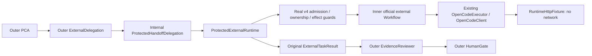

# Phase 2B-4B — protected runtime integration into typed handoffs

Baseline: `1fa520b7e55fe312c9d25099b901ef49c5ab0481`. Controlled synthetic trust,
explicit disposable SQLite v4 and in-memory fake HTTP only. No live provider/model,
operational Host, new schema/migration, production identity or human approval.

## Implementation and ownership

| File | Change |
| --- | --- |
| [ProtectedHandoffDelegation](../../src/MAF.Workflows.External/ProtectedHandoffDelegation.cs) | Small internal adapter: exact trusted request/run/prepared handle, existing ProtectedExternalRuntime, correlated original result; no raw client or executable grant |
| [ControlledHandoffWorkflow](../../src/MAF.Workflows.External/ControlledHandoffWorkflow.cs) | Same official four typed edges; preserve RequireApproval/denial, block identity mismatch, await protected child ownership unwind |
| [SyntheticProtectedHandoff](../../tests/MAF.ApprovalAcceptance/SyntheticProtectedHandoff.cs) | Test-only native PCA/scripted ChatClient, separate simulated reviewer, original RuntimeHttpFixture, explicit v4 initialization without pre-admission |
| [Program](../../tests/MAF.ApprovalAcceptance/Program.cs) | Narrow handoff run/Inspect modes in the existing test runner, existing bounded stdin gates |
| [Test project](../../tests/MAF.ApprovalAcceptance/MAF.ApprovalAcceptance.csproj), [friend assembly](../../tests/MAF.ApprovalAcceptance/AssemblyInfo.cs) | Test-only reference to the existing PCA project and access from MAF.Tests; no package/new project/Host DI |
| [ProtectedHandoffTests](../../tests/MAF.Tests/ProtectedHandoffTests.cs) | Guarded HTTP, exact identities, denial, evidence corruption, process crashes/competition and lifetime races |

Other changed documents: [Roadmap](../ROADMAP.md), [4B execution plan](../plans/PHASE2B4_EXECUTION_PLAN.md)
and this report. All historical acceptance reports and tests are unchanged.
Source review covered 4A contracts/adapter/graph, ExternalExecutionApplication,
ProtectedExternalRuntime, ExternalWorkflow/OpenCodeExecutor/DurableExecutionService,
execution/approval/runtime/receipt/cancellation SQLite contracts, SyntheticRuntime,
SyntheticCancellation/SyntheticAbort, existing process helpers, the seven guardrails
and M3-A2c/M4-B1b/B2/C reports. No alternate execution loop or trust service is added.

## Exact call path and identity mapping

Both official layers are executed, not flattened. The parent graph remains
`PCA → ExternalDelegation → EvidenceReviewer → HumanGate`. A trusted composition
preallocates **one immutable run ID** for both official Workflow sessions. Distinct
Workflow/run objects maintain distinct event lists; SDK 1.24.0 accepts this deliberate
identity mapping. It does not equate the Workflow session with OpenCode's session.

| Role | Actual synthetic identifier |
| --- | --- |
| Original TaskId | `runtime-task` |
| Parent official WorkflowRunId / SessionId | `runtime-run` |
| Child official external WorkflowRunId / SessionId | `runtime-run` (deliberately shared) |
| Durable ExecutionId | `runtime-execution` |
| Original MessageId / ExternalRequestId | `msg_runtime` |
| OpenCode SessionId | `ses_runtime`, learned only from the verified original Create response |

The exact approved request/workspace/objective/timeout is checked before delegation;
caller, authority and prepared execution identity come from the test-owned composition,
never PCA. The adapter cannot guess a session. Runtime output is checked against the
original task/run/execution/provider/message. A wrong mapping blocks downstream review
and emits no fabricated provider result. The parent uses the original external DTO;
neither the reviewer nor output gate rewrites its facts. Fingerprint and OperationBinding
v1 are untouched. Provider state confirms the actual prompt message ID is `msg_runtime`.

## Authorization, receipt and lifetime

The outer 4A assessment is deliberately Allow in these fixtures to prove it cannot
bypass real enforcement. Runtime independently resolves the caller, acquires the
native TaskId owner, rereads storage and either consumes the real atomic direct-Allow
continuation or performs current independently authorized Inspect. No approval record
is manufactured, consumed or decided. Explicit-only durable policy activation remains
unchanged. Normal business operations do not activate candidates.

The real v4 coordinator commits admission, original Create intent, original verified
receipt and Prompt intent. Existing before-wire authorization validates current policy,
control, ownership and exact effects. SQLite does not encompass HTTP. Invalid receipt
cannot downgrade to a legacy profile. The happy record has `session_receipt_required=1`,
receipt Verified/version 1, state Completed and phase Acknowledged, with zero approval
rows and `PRAGMA integrity_check=ok`.

An initial integration test reproduced competing outer/inner timers: the parent could
return while child cleanup still held ownership. The final protected branch awaits the
existing child runtime's own bounded budget and unwind rather than abandoning it with
a second wait timer. The 4A fake branch retains its existing bounded wait. Cancellation
is forwarded; no new timeout-to-Abort callback exists. The child may require its existing
bounded SQLite cleanup after the provider budget expires; the parent deadline is not
a promise to return before that ownership unwind completes.

Five in-flight observation cases (caller cancellation, runtime timeout, test-forced
native owner disposal, durable Cancel intent, policy activation/revocation) each observed
**Create/Prompt/GET/Abort = 1/1/8/0**, NeedsHumanReview, no reviewer invocation, and
successful fresh owner acquisition before the test's outer completion check. The runtime
owns the lock during active work; the adapter never exports it. A forced disposal cannot
undo a GET already sent; subsequent effects fail closed and no terminal success is claimed.
Policy/control changes after an already-sent Create still preserve the verified historical
response but prevent a new Prompt. Cancellation intent is not Abort or a remote terminal.

## Actual HTTP and Workflow events

The positive test executes the real native PCA agent with a scripted IChatClient,
real admission/store/guards/OpenCode adapter and fake HttpMessageHandler. Only reviewer
assessment is simulated. Actual HttpRequestMessage accounting at the fake handler:

| Path | Create POST | Prompt POST | GET | Abort POST |
| --- | ---: | ---: | ---: | ---: |
| Happy terminal path | 1 | 1 | 9 | 0 |
| Submit-only (no Inspect) | 1 | 1 | 4 | 0 |
| In-flight cancellation/timeout/owner/policy/control cases | 1 | 1 | 8 | 0 |
| Rejected admission/PCA scope escalation | 0 | 0 | 0 | 0 |
| Missing Inspect on restart; quarantined/corrupt receipt | 0 | 0 | 0 | 0 |

The four Submit-authorized GETs validate health/schema/agent and the original session
before Prompt; they are not Inspect observation. Submit-only cannot fetch observations.
Fake HTTP is real adapter method/path execution, **not** logical 4A counters and not a
TCP/live-provider test. No header, credential, raw prompt or transcript is recorded.

Parent ExecutorInvokedEvent and ExecutorCompletedEvent order is exactly PCA,
ExternalDelegation, EvidenceReviewer, HumanGate. Completed payload types are
BriefHandoff, ExternalHandoff, ReviewHandoff, WorkflowOutcome. Exactly one parent
WorkflowOutputEvent exists. Child events separately report:

`WorkflowStartedEvent, SuperStepStartedEvent, ExecutorInvokedEvent,
ExecutorCompletedEvent, WorkflowOutputEvent, SuperStepCompletedEvent`.

The parent still has exactly four invocations, not five. Child events are never appended
as extra parent executors. The highest successful output is ReadyForHumanReview.

## Crash/restart evidence

Focused-run PIDs below were actual independently started OS processes terminated with
`Kill(entireProcessTree:false)`. Existing runner/gates/receipt/dispatch checkpoints were
reused; no production checkpoint subsystem was added. Counter format is
**Create/Prompt/GET/Abort**, cumulative before crash and after fresh-process Inspect.

| Checkpoint | Crash PID | Restart PID | Persisted phase | Before → after | Restart result |
| --- | ---: | ---: | --- | --- | --- |
| ExecutionInserted, before admission commit | 57664 | 34992 | No execution | 0/0/0/0 → 0/0/0/0 | Not admitted; no invented execution |
| AdmissionCommitted, before Create | 12056 | 43244 | None | 0/0/0/0 → 0/0/0/0 | Unknown; no continuation reconstructed |
| ReceiptIntentCommitted | 17064 | 22072 | SessionCreationIntended | 0/0/3/0 → 0/0/3/0 | Unknown; no known session |
| ReceiptResponseCommitted | 56264 | 43540 | SessionKnown | 1/0/3/0 → 1/0/7/0 | Unknown; no prompt evidence |
| PromptIntentCommitted, before HTTP | 65484 | 64972 | PromptIntended | 1/0/3/0 → 1/0/12/0 | Running/nonterminal; no correlated completion |
| PromptHttpReturned | 67028 | 30568 | PromptIntended | 1/1/4/0 → 1/1/13/0 | Completed from original message |
| ChildResultBeforeReview | 24008 | 29720 | Acknowledged | 1/1/9/0 → 1/1/18/0 | Completed from original message |

Original task/run/execution/message/session are checked before/after for every admitted
case; integrity is ok. No additional Create, Prompt, replacement message or Abort is
sent. Prompt intent without a correlated message yields the existing adapter's nonterminal
Running result; this is not successful review or evidence that a prompt reached the
provider. Missing session/submission evidence yields Unknown. No assertion in a historical
test was weakened to change that established adapter behavior.

Ownership competition: owner PID **57112**, competing Inspect PID **30444** returns
TaskAlreadyOwned with zero HTTP; after killing only the owner, recovery PID **46864**
observes Completed. Competing Submit: owner **61180**, competitor **16692**, zero HTTP
and zero review; recovery **60228** observes Completed. Fresh successful recovery also
proves the native lock has been released. Test cleanup follows that owned recovery.

Every restart output explicitly sets **ParentResumed=false**. At ChildResultBeforeReview
the child has persisted its original result, but no Reviewer/HumanGate completion is
claimed after restart. Full outer workflow checkpoints/resume are deliberately excluded.

## Negative and uncertainty coverage

Actual runtime denial is tested despite outer Allow: Deny, RequireApproval, forged and
expired callers, unavailable/revoked authority, wrong provider/root/capability/configuration,
and PCA scope escalation. Each denied path performs zero HTTP and creates no execution
or approval. RequireApproval stays WaitingForApproval, never implicit dispatch.

Additional cases cover lost Create response, lost Prompt response, provider outage,
running and permission-pending provider, missing/corrupt/quarantined receipt, changed
request fingerprint, wrong handoff execution/message/session mapping, wrong provider
message identity and reviewer failure. Ambiguous Prompt is reconciled on its original
session; loss alone does not authorize retry. Provider waiting state stays waiting.
Unavailable review cannot change a Completed provider fact into acceptance.

Corrupt-receipt tests reuse the existing synthetic corruption technique: temporarily
remove the two immutable-record triggers, inject damaged data into a disposable DB,
then restore the exact accepted v4 manifest before verifying data rejection. This is
not a new schema/migration or production repair path. Initial invalid mutation attempts
were rejected by existing immutability/CHECK constraints; those constraints are retained.

## Verification

Final focused filter includes ProtectedHandoffTests and all unchanged TypedHandoffTests.

| Verification | Actual result |
| --- | --- |
| Focused `FullyQualifiedName~ProtectedHandoffTests\|FullyQualifiedName~TypedHandoffTests` | 111 discovered / 111 passed / 0 failed / 0 skipped; 19 seconds |
| Full offline `FullyQualifiedName!~MAF.Tests.OpenCodeLiveTests` | 1087 discovered / 1087 passed / 0 failed / 0 skipped; 2 minutes 7 seconds |
| Historical comparison | All 1044 baseline names retained, exactly 43 new ProtectedHandoffTests, zero removed |
| `dotnet build MAF.slnx --no-restore` | 0 warnings / 0 errors |
| Relative links / whitespace / scoped diff | Passed |

Local TRX evidence: `TestResults/home-validation/phase2b4-b-focused.trx` and
`phase2b4-b-offline.trx` (ignored, not committed). Final build, focused and full
runs were sequential; historical assertions were not modified. Initial integration
failures exposed the duplicate-timer lifetime issue described above. Early fixture
corruption attempts were blocked by existing SQL constraints; corrected fault fixtures
exercise data validation without weakening those constraints. Competition cleanup now
performs and verifies a fresh successful owned recovery before deleting its synthetic DB.

## Acceptance and remaining limits

The protected child execution and typed parent handoff are real code, with real durable
SQLite state and real guarded HTTP method/path calls to fake transport. Trust, provider
responses and review semantics remain synthetic. No production activation or corporate
endpoint compatibility is demonstrated. Human consent and M3-C remain blocked. Internal
visibility is not malicious same-principal isolation.

M3 admission/effect enforcement in this proof covers the external child. It does not
certify production native PCA/Reviewer model dispatch; PCA uses a scripted client and
Reviewer is simulated under its separate bounded evidence contract.

No new schema, migration, transport protocol, approval lifecycle, policy engine, agent
loop, parent-child registry or retry scheduler is introduced. All seven architecture
guardrails remain intact. Existing durable identities, fingerprint/OperationBinding v1,
ownership checks, receipt authority, before-wire enforcement and no-resubmit rules remain
authoritative. Outer in-memory single-flight is never offered as restart protection.

With final passing validation, 4B is suitable for **controlled owner acceptance** only.
Recommended next narrow increment, separately authorized after owner review: bounded
task-evidence/source provenance for the Reviewer under the same synthetic protected
composition. Durable parent-stage checkpointing needs its own future contract and is
not a prerequisite delivered here. Do not proceed automatically to 4C, M3-C, live
providers, Host activation, writes, Registry or Hybrid routing.
