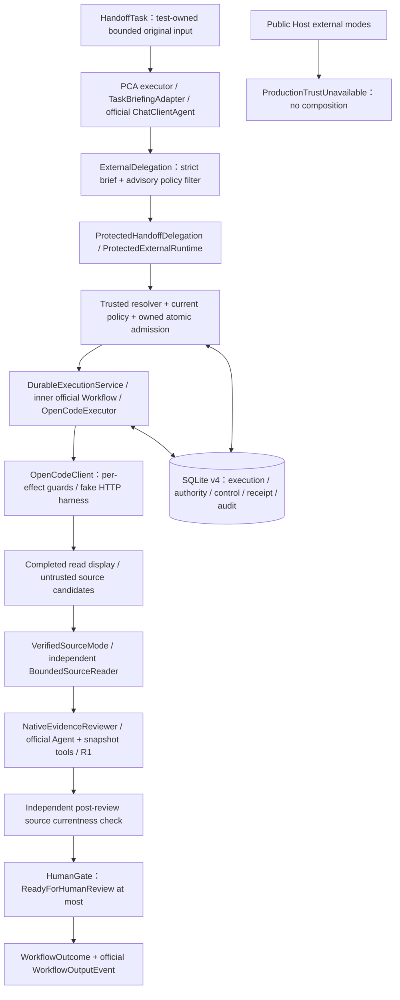

# Phase 2B-4 Closeout & Productization Gap Review

審查日期：2026-10-19（Asia/Taipei）。性質：架構與文件審查，非新的實作或產品驗收。

## 1. Repository baseline 與範圍

- Repository：`ytcha-dev/MAF`；分支 `main`；HEAD：`6be99cb0f0c09ec27ea6645db72ac7499ff67d45`。
- 最新提交：2026-10-18，`Calibrate bounded OpenCode source evidence coverage for Phase 2B-4F`。
- 審查開始時 `main` 與本機 `origin/main` 無差距；未以此推論遠端當時沒有新提交。
- 工作目錄僅有未追蹤的 `.opencode/`，保留且不讀取其可能的本機設定。先前已刪除的未追蹤過時 CLI 計畫不屬本輪變更。
- 授權限本文件及 [Roadmap](../ROADMAP.md) 的 owner-review gate 說明；不修改 runtime、測試、package、schema、CI、policy 或 provider。
- 只執行 Git／檔案靜態檢視與文件驗證；沒有 build、restore、test、provider request、模型呼叫、服務啟動或公司資料存取。歷史結果僅引用既有報告，沒有重跑或重新認證。

依據包括原始 [PCA PRD](../plans/PRD-phase1.md)、[Review PRD](../plans/PRD-phase2.md)、[external harness architecture](../architecture/EXTERNAL_HARNESS_ARCHITECTURE.md)、[七項 guardrails](../architecture/ARCHITECTURE_GUARDRAILS.md)、[現行 4A–4F 計畫](../plans/PHASE2B4_EXECUTION_PLAN.md)，並對照下列實作與測試。歷史設計文件中「尚無 execution store」、舊 Host 可執行 external mode 等描述是當時背景；本輪以 baseline 原始碼和後續驗收證據判定現在狀態，不改寫歷史。

### 4A–4F 證據索引

以下均為報告記錄的歷史成功數；focused 是其當輪篩選集合，不與 offline 相加，也不累加各輪總數。

| 里程碑 | 實際增量與驗收報告 | Focused / offline | 本次判讀 |
| --- | --- | --- | --- |
| 4A | [typed handoff](PHASE2B4_A_TYPED_HANDOFF_RESULTS.md)：四個官方 executor，scripted PCA、fake whole-task delegation、模擬 reviewer | 68 / 1044 | 官方圖確有執行；不是 provider 整合 |
| 4B | [protected handoff](PHASE2B4_B_PROTECTED_HANDOFF_RESULTS.md)：v4 admission、receipt、child ownership、fake HTTP、七個程序 crash checkpoints | 111 / 1087 | 真 SQLite／官方 child runtime；身分及外部 HTTP 為 synthetic |
| 4C | [independent source](PHASE2B4_C_REVIEWER_EVIDENCE_RESULTS.md)：獨立 bounded reader、digest、review 後重查 | 210 / 1140 | 真 fixture 檔案證據；非語義正確性 |
| 4D | [Native Reviewer](PHASE2B4_D_NATIVE_REVIEWER_RESULTS.md)：官方 Agent 與 snapshot tools | 241 / 1193 | scripted model；不是實際模型推理驗收 |
| R1 | [actual observation](PHASE2B4_D_R1_REVIEW_OBSERVATION_RESULTS.md)：每個必要 reference 須有本輪 SDK Tool-role 結果 | 230 / 1206 | 修正只列引用而未讀取的缺口；不保證模型理解內容 |
| 4E | [source candidates](PHASE2B4_E_SOURCE_CANDIDATE_RESULTS.md)：從 guarded Observe 的 structured read display 擷取 | 315 / 1265 | provider-shaped fake response；不從 summary 製造證據 |
| 4F | [coverage calibration](PHASE2B4_F_EVIDENCE_COVERAGE_RESULTS.md)：bounded excerpt、混合工具、精確重複讀取 | 357 / 1307 | 官方來源衍生離線 fixtures；genuine-provider coverage count 為零 |

4F 報告另記錄 build 0 warnings／0 errors、42 個新增 coverage cases。這是 baseline 的歷史證據，不是本次執行結果。4D／R1 的 owner-reviewed controlled milestone 狀態依現行計畫保留；本文件交付不等於 owner 已接受 4E／4F 或整個階段。

## 2. 整體架構判定與專案邊界

**仍符合原始願景；目前是受控技術組合，尚非具受信任授權與人工接受流程的操作產品。** 未發現下述已檢視路徑引入第二套 Agent runtime、Reviewer 授權 dispatch，或 persistence 自行呼叫 harness 的具體證據。不能將這個有界審查解讀成全庫形式化安全證明。

| 專案／實際依賴 | 現有責任與程式碼證據 | 實際邊界與缺口 |
| --- | --- | --- |
| [MAF.Host](../../src/MAF.Host/MAF.Host.csproj) → Core、Comprehension、Review、Workflows.External、Persistence.Sqlite；OpenAI bridge 10.10.1／DI 10.0.12 | [Program](../../src/MAF.Host/Program.cs) 組裝獨立 PCA／Git-diff Review、model client 與 ProjectTools | 沒有註冊 controlled graph、NativeEvidenceReviewer 或 production trust；[ExternalConsole](../../src/MAF.Host/ExternalConsole.cs) 明確拋出 `ProductionTrustUnavailable` |
| [MAF.Core](../../src/MAF.Core/MAF.Core.csproj) → 官方 AI.Abstractions 1.24.0 | provider-neutral task、evidence、policy、durable contracts；bounded source／Git tools；deterministic validation | 不依賴 SQLite、OpenCode JSON 或 Workflow package；Core 有工具實作，並非只有 DTO，但沒有因此取得部署信任 |
| [Comprehension](../../src/MAF.Agents.Comprehension/MAF.Agents.Comprehension.csproj) → Core、AI 1.24.0 | [factory](../../src/MAF.Agents.Comprehension/ComprehensionAgentFactory.cs) 建立 `ChatClientAgent`；[TaskBriefingAdapter](../../src/MAF.Agents.Comprehension/TaskBriefingAdapter.cs) 建立 fresh session、呼叫 `RunAsync`、嚴格解析 proposal | proposal 必須原樣 echo workspace／objective、保持 ReadOnly；不能挑選擴大任務或授權 |
| [Review](../../src/MAF.Agents.Review/MAF.Agents.Review.csproj) → Core、AI 1.24.0、Roslyn 5.0.0 | [ReviewService](../../src/MAF.Agents.Review/ReviewService.cs) 為獨立 Git-diff review；[NativeEvidenceReviewer](../../src/MAF.Agents.Review/NativeEvidenceReviewer.cs) 為完成任務的 snapshot assessment | 兩者不同入口；後者只注入 IChatClient、不保有 provider、authority、store；Roslyn 為 syntax analysis，不是執行目標 build |
| [Workflows.External](../../src/MAF.Workflows.External/MAF.Workflows.External.csproj) → Core、官方 Workflows 1.24.0 | [ControlledHandoffWorkflow](../../src/MAF.Workflows.External/ControlledHandoffWorkflow.cs) 擁有順序；protected runtime／application services 擁有 admission、lifecycle；OpenCode 子目錄擁有 HTTP 協定 | 不依賴原生 Agent 專案或 SQLite implementation，經 interface／callback 組合。internal controlled composition 尚未變成 Host ingress |
| [Persistence.Sqlite](../../src/MAF.Persistence.Sqlite/MAF.Persistence.Sqlite.csproj) → Core、Microsoft.Data.Sqlite 10.0.0／SQLitePCLRaw 3.0.5 | execution CAS／ownership、approval／control／receipt／delivery／reconciliation 的短交易與 explicit schema profiles | coordinator 在交易內重新確認 authority／policy 是 atomic invariant，不是 workflow sequencing；沒有 provider HTTP 或模型呼叫。沒有保護惡意 same-principal writer 的能力 |
| [MAF.Tests](../../tests/MAF.Tests/MAF.Tests.csproj) | xUnit；引用 Host、兩種 native agents、External、Core、ApprovalAcceptance，連結 test launcher source | tests 可見 internals、可執行 fake transport／scripted clients／process fixtures；不是可部署授權來源 |
| [MAF.Acceptance](../../tests/MAF.Acceptance/MAF.Acceptance.csproj) | 獨立 console runner，直接引用 Persistence（其餘依賴可傳遞）；[說明](../../tests/MAF.Acceptance/README.md) 列 controlled／live crash tooling | 歷史 home validation 專用；不代表現在 Host 可啟用 |
| [MAF.ApprovalAcceptance](../../tests/MAF.ApprovalAcceptance/MAF.ApprovalAcceptance.csproj) | 引用 Persistence、External、Comprehension；[SyntheticProtectedHandoff](../../tests/MAF.ApprovalAcceptance/SyntheticProtectedHandoff.cs) 組裝測試流程 | 測試擁有 identity、policy activation、fake HTTP 與 scripted PCA；不能拿來補 production resolver |

所有上述專案 target `net10.0`。External／Core 的 `InternalsVisibleTo` 是編譯可見性安排，非安全 principal 隔離；不應因它存在就要求重拆專案，也不應將它宣稱為防止本機惡意程式的邊界。

官方執行路徑確有 `WorkflowBuilder(...).AddEdge(...).WithOutputFrom(...).Build()` 與 `InProcessExecution.RunAsync`。child 在 [DurableExecutionService](../../src/MAF.Workflows.External/DurableExecutionService.cs) 用單一 OpenCodeExecutor 官方 Workflow 執行。兩層刻意使用同一預配 run ID；外部 session／message／execution ID 仍各自獨立。Reviewer 的 `BoundedClient` 只觀察 SDK Tool-role 結果、限制呼叫數，沒有自行排程 function loop；工具迭代仍由官方 `ChatClientAgent` 執行。Host 的互動輸入迴圈亦不是自製 Agent runtime。

## 3. Capability maturity matrix

分類：**A** 已實作且有真實外部 provider 執行證據；**B** 已實作且經 synthetic trust／fake HTTP／scripted model 驗證；**C** 已實作但未接入 operational end-to-end ingress；**D** 僅 contract／design；**E** 未實作。單列的主分類指該能力的最強證據，必要時補記 integration 狀態。A 是歷史 evidence 等級，不是目前可啟用或 production-ready。

| 能力 | 分類 | 實作入口／最強證據 | 限制與 readiness |
| --- | --- | --- | --- |
| Native PCA | A | Program → ComprehensionAgentFactory → AIAgent；[原生驗收](../../TEST_RESULTS.md) 的真模型／工具案例 | 獨立 CLI 可用；未納入 protected multi-agent admission；不能推論現在設定或任意模型可用 |
| Git-diff Review | A | Program `--review` → ReviewService；[Review 驗收](../../TEST_RESULTS_PHASE2.md) 記錄 24 次 live CLI trials | 有 Partial、誤判與品質差異；獨立路徑不是 4D Reviewer，亦非 production policy 保護 |
| 官方四階段 Workflow | B；operational integration C | ControlledHandoffWorkflow.RunAsync；4A 及 4F official event assertions | internal、test-owned composition；沒有 public Host 呼叫入口 |
| Protected OpenCode delegation | B | ProtectedHandoffDelegation → ProtectedExternalRuntime；4B／4F | 真 policy checks、SQLite、HTTP client；transport／trust 為 fake，不能借 Phase 2A live 證據升格為 A |
| M3 admission／approval state／explicit Resume | B | [ProtectedExternalRuntime](../../src/MAF.Workflows.External/ProtectedExternalRuntime.cs)、[DurableApprovalApplication](../../src/MAF.Workflows.External/DurableApprovalApplication.cs)、SQLite coordinators；[A2c](PHASE2B2_M3_A2C_RESULTS.md)、[B2](PHASE2B2_M3_B2_RESULTS.md) | Allow／RequireApproval 不互換；消費 approval 與新 execution 原子化，但 human identity／consent 是 synthetic |
| M4 cancellation／Abort／reconciliation | B | [CancellationAdmissionApplication](../../src/MAF.Workflows.External/CancellationAdmissionApplication.cs)、[ProtectedAbortDelivery](../../src/MAF.Workflows.External/OpenCode/ProtectedAbortDelivery.cs)、[CancellationReconciliationApplication](../../src/MAF.Workflows.External/CancellationReconciliationApplication.cs)；[M4-C](PHASE2B2_M4_C_RESULTS.md) | intent、delivery reservation、ack、terminal 各自區別；無 operational cancel CLI／worker，ack 不等於 Cancelled |
| SQLite execution／child recovery | A（歷史 2B-1）；現行 protected 組裝 B／C | DurableExecutionService／SqliteExecutionStore；[home results](PHASE2B1_HOME_RESULTS.md) 真 OpenCode 1.19.0 三情境；4B 七個 fake-provider crash checkpoints | 同機同 DB，原 IDs、Inspect-only、不重送；不是 remote exactly-once、power-loss 或 parent resume；Host recover 仍關閉 |
| 4C independent evidence | B | BoundedSourceReader.Acquire／IsCurrent、VerifiedSourceMode；4C／4F | 真 fixture file snapshot／digest；review-time only、有預算、D1／D3 未解 |
| 4D／R1 Native Reviewer | B | NativeEvidenceReviewer.ReviewAsync；[NativeEvidenceReviewerTests](../../tests/MAF.Tests/NativeEvidenceReviewerTests.cs) | 官方 Agent／真 tools、scripted model；實際觀察不等於語義理解／正確性 |
| 4E／4F source candidate extraction | B | OpenCodeClient.ObserveAsync → OpenCodeReadSources.Extract → OpenCodeExecutor；4E／4F | 僅 1.18.35／1.19.0 shape、finite budgets；官方來源衍生 fixtures，不是真實新 trace |
| Host ingress | 原生 A；external activation E；formatter C | Program／ExternalConsole／[ExternalConsoleOutput](../../src/MAF.Host/ExternalConsoleOutput.cs) | external-task、recover、recover-pending 均 fail closed；沒有完整 multi-agent 操作流程 |
| Production identity／M3-C | D；部署 E | Core trusted interfaces／TrustedPolicyAuthority；ADR-006／[M3 gate](../plans/PHASE2B2_M3_ARCHITECTURE_GATE.md) | 演算法 adapter 已有 B 證據，可信 publisher／caller／human proof、writer custody、revocation／external anti-rollback 部署未建立 |
| Human approval／outcome acceptance interface | E（state primitives B） | approval contracts／SQLite state、HumanGate enums；無 production interaction ingress | pre-dispatch approval 與 post-result acceptance 是兩件事；沒有真實 human proof、接受／拒絕結果 UI 或 durable acceptance record |
| Connector Registry／activation switches | D／E | Roadmap lifecycle 設計；M3 explicit policy activation primitive 另有實作 | policy activation 不等於 connector lifecycle registry；沒有通用 install/configure/enable/health management |
| Diagnostics／artifacts | B／C，完整 2B-3 E | ExternalTaskResult IDs／trace／requests／duration、formatter、SQLite audit；[audit projection](POST_M4_AUDIT_PROJECTION_FIX_RESULTS.md) | 沒有統一 parent outcome artifact／證據重開流程；Review `--diagnostics` 是匯入既有 diagnostics，非啟動 analyzer 或完整 telemetry 平台 |
| Parent Workflow recovery | D／E | D1 設計；ControlledHandoffWorkflow 的 dictionary／Lazy 僅 instance-local | child 可 Inspect；沒有 persisted PCA／Reviewer／HumanGate checkpoint 或自動 parent resume |
| Hybrid orchestration | D／E | Roadmap bounded planner 願景 | 無 planner/router runtime；不是固定 OpenCode 流程的依賴 |

## 4. 一次實際受控 end-to-end 呼叫重建

主案例為 [SourceEvidenceCoverageTests.SourceGroundedCoverage](../../tests/MAF.Tests/SourceEvidenceCoverageTests.cs) 的 `over20 / 1.19.0`：fixture 建立 40 行 Example.cs，回傳完整 display，選取 1–20 行證據。不是 40 行全部已驗證，也不是 live OpenCode 執行。

這些元件是四個 outer executors 的內部責任分工，圖中 Policy／verification／child runtime 不是新增 outer stages。下表的 durable 記錄皆屬 child／policy plane；parent envelopes 全為記憶體。

| 轉換與實際契約 | 責任／信任及授權 | Durable／transient | 失敗行為與已存在測試 |
| --- | --- | --- | --- |
| Input → PCA：`ControlledHandoffWorkflow.RunAsync(HandoffTask)` → `ITaskBriefing.BriefAsync` | task identity／root 由 fixture 提供；objective、source、model output 是不可信內容。TaskBriefingAdapter 使用官方 Agent | input、fresh session、brief、instance single-flight transient；未保存 prompt | task shape 不合法拒絕；brief echo／ReadOnly／JSON 不符阻止 delegation。TypedHandoffTests 與 ProtectedHandoffTests 的 `OuterAllowCannotBypassActualRuntimeDenial("pca")` |
| PCA → filter：`BriefHandoff` → 原始 `ExternalTaskRequest` | graph 重新驗證 proposal；request 從原始 task 建立，不用模型選的參數。outer `assess` callback 僅 prefilter，fixture 固定 Allow | brief／filter outcome transient，非 dispatch grant | Deny／RequireApproval 跳過外部工作。實際 admission 仍可拒絕 outer Allow |
| filter → protected admission：`ProtectedHandoffDelegation.DelegateAsync` → `ProtectedExternalRuntime.RunAsync` | exact original request／run／execution/message mapping；resolver 先確認 caller，再取得 TaskId ownership、讀 state、評估 current policy；scope/provider 要一致 | initial Created、operation/control／audit 原子入庫；owner handle transient | forged／expired／unavailable／revoked identity 或 scope mismatch 無 HTTP。`OuterAllowCannotBypassActualRuntimeDenial`；`SubmitAloneCannotObserveAndRecoveryRequiresIndependentInspect` |
| admission → durable dispatch：`LaunchOwnedAsync` → inner `WorkflowBuilder` → `OpenCodeExecutor.HandleAsync` | runtime access、owned continuation、effect checks；store coordinator 驗證 active policy／binding／control。OpenCodeClient `BeforeWireAsync` 在每次 HTTP 前再檢查 | creation intent → verified session receipt → prompt intent → acknowledgment 與 stable IDs durable；HTTP／原始 response body transient | intent 與 HTTP 不同交易；中斷保留 Unknown／原身分、不重送。`FullNestedOfficialGraphUsesRealV4AdmissionReceiptAndEffects`、七個 `RealProcessCrashRecoversOriginalChildWithoutParentResumeOrPost` cases |
| provider → candidates：`ObserveAsync` → `OpenCodeReadSources.Extract` → `ExternalTaskResult.SourceCandidates` | fake provider 的 Completed／summary／display 均是不可信 provider data；protocol correlation 驗證不會把它提升為本地來源事實。application 才附上原 execution binding | candidates／coverage disclosure transient；candidate transport `[JsonIgnore]`，不是 DB snapshot | version／shape／identity／range／tool／budget 不符清空 candidates；外部 Completed 仍保留，review 轉 insufficient。`AmbiguousOrNonSourceObservationsCannotSupplyPositiveEvidence` |
| candidates → independent evidence：`VerifiedSourceMode.ReviewAsync` → `BoundedSourceReader.Acquire` | 只在原 approved root 讀；逐項 exact binding、anchor、path、UTF-8／redaction／budget 檢查。reader issuer 提升的是來源 provenance，內容仍是不可信資料 | sanitized immutable snapshot／issuer／digest transient；不能從輸出 JSON 還原 trusted evidence | 空／mismatch／changed／redacted／超量不進 model，不 fallback summary。`SourceGroundedCoverage("changed", ...)`；SourceEvidenceTests |
| evidence → Native Reviewer：`NativeEvidenceReviewer.ReviewAsync(TaskEvidence)` | 官方 fresh Agent 與 ReadEvidence／SearchEvidence；scripted IChatClient。strict JSON／admitted refs／8-call budget；R1 需本輪成功 tool output 出現在 SDK Tool-role input | assessment／observation tracking transient，不是 consent／authorization | 缺必要觀察為 InsufficientEvidence，協定／budget 問題為 ReviewUnavailable。`TwoNewExcerptsStillRequireBothNativeObservations`、`SufficientAssessmentRequiresActualToolObservation` |
| Reviewer → gate：`IsCurrent` → `ReviewHandoff` → `HumanGate.HandleAsync` | 獨立 reader 在 Agent 後重查；gate 是 deterministic status mapping，不問真人、不消費 approval、不 dispatch | gate／WorkflowOutcome／outer events transient | changed source 降為 insufficient；完成且 sufficient 至多 ReadyForHumanReview；其他可能 NeedsHumanReview／Blocked／WaitingForApproval。同一 coverage theory 斷言 gate、stage order 與唯一 output event |

此 happy path 歷史 test assertion 的 Create／Prompt／GET／Abort = **1／1／9／0**；兩次 scripted Reviewer calls、每個 admitted source 在前後各讀一次，回傳行號保留 1–20。這是 fixture 的精確帳目，不是現場 provider 的預估流量。`FreshInspectRetainsExcerptDisclosureWithoutPersistedCandidateFallback` 證明 fresh authorized Inspect 為 **0／0／9／0**，只從新的 GET 重取 candidates；移除 display 後不從 DB／JSON 重建證據。

**完整序列目前沒有 authorized public Host entrypoint。** 受控組裝來自 test assembly 的 `SyntheticProtectedHandoff.Flow`，其中 identity／authority、policy activation、HTTP responses、PCA／Reviewer model 皆由測試擁有。`ProtectedExternalRuntime` 本身是 public library composition seam，不等於可驗證身分的操作 ingress；不能將使用者提供的 resolver 當作已部署 M3-C。

## 5. 七項 guardrails、security 與 trust boundaries

| Guardrail | 程式碼判定 | 現存風險／未達條件 |
| --- | --- | --- |
| 1 Orchestrator owns coordination | ControlledHandoffWorkflow 擁有 edges／stage outcome；DurableExecutionService 擁有 child lifecycle | parent sequencing 未持久化；是功能缺口，不是 harness 接管協調 |
| 2 Harness owns execution | OpenCodeClient 只轉換 whole-task request／observe／permission evidence；MAF 沒有新 coding loop | read-only harness policy 不是 OS sandbox；實際 provider/version 相容性仍需驗證 |
| 3 Policy owns authorization | ProtectedExternalRuntime、AtomicAdmissionApplication、effect boundary 反覆確認 operation、scope、caller、active revision | standalone PCA／Git-diff Review 是已揭露的 unprotected native routes，不能宣稱整個 Host 已受統一 policy 保護；正式統一 ingress 必須明確處理 |
| 4 Trusted authority owns identity／consent | Trusted interfaces、[TrustedPolicyAuthority](../../src/MAF.Core/Policy/TrustedAuthority.cs)、非自我 approval／exact binding 演算法存在 | production publisher／protected caller／fresh human proof 缺失；synthetic resolver、CLI actor、same-account SID、hash、Approved row 均不是身分證明 |
| 5 Persistence owns state／atomicity | SqliteExecutionStore／SqliteApprovalStore 的 coordinator 保存原子 invariants，不啟動 Workflow／HTTP | 同帳號可改 DB／DI／binary 不在其隔離能力內；remote HTTP 不與 SQLite 原子提交 |
| 6 Registry owns availability only | 尚無 registry；Host fail closed，沒有假裝 enabled 即授權 | 不能宣稱通用 disabled-switch 已全路徑實作；固定單 harness 可設計窄的 explicit activation，不需先建 registry |
| 7 LLM recommends；runtime enforces | TaskBrief proposal 重驗、Native Reviewer advisory、HumanGate enum 沒有 Accepted 或 dispatch ticket | scripted results／tool observation 不證明真模型語義品質；Hybrid 尚未實作，不能宣稱其 runtime guard 已驗證 |

沒有具體證據支持目前需要為了分層美觀拆出更多 assemblies／generic orchestration framework。真正的現行風險是將受控組裝、歷史 live 或 state primitives 誤讀成安全可啟用產品。未來大量 connectors、分散式排程、吞吐量是尚無本輪需求或量測支持的擴充議題。

### ADR 決策與當前實作的對應

- [ADR-003](../architecture/ADR-003_OPENCODE_WORKFLOW_EXECUTOR.md)：保留官方 custom executor、direct OpenCode API、whole-task delegation、獨立 session identities；沒有追加 LLM wrapper 或 A2A gateway。原文 Host ephemeral 語義是歷史階段，現有 public raw constructors 使用 `UnavailableRuntimeAccess`，不能復活舊路徑。
- [ADR-004](../architecture/ADR-004_DURABLE_EXECUTION_RECOVERY.md)：保留 intent-before-POST、original identity、GET-only recovery、Unknown、不重送、metadata-only storage；後來 protected runtime 抑制 implicit Abort，M4 使用另行 exact authorization，不能照舊文推論 Ctrl+C 必定會送 Abort。
- [ADR-005](../architecture/ADR-005_POLICY_APPROVAL_CANCELLATION.md)：approval／execution 分責，同 DB 的窄 coordinator 原子處理；現行 v4 與 M4 後續報告已超越早期 v2 提案。Pending、approval decision、explicit Resume、cancel intent、Abort ack、terminal outcome 不合併。
- [ADR-006](../architecture/ADR-006_TRUSTED_BROKER_BOUNDARY.md)：trust plane 與 orchestration plane 分離；protected Broker 是偏好的未來部署形式，並非目前已運作服務，也不要求立即建 HTTP Broker。真實 caller／writer separation、publisher provenance、revocation、anti-rollback 仍須實證。

## 6. Durable 與 transient state

| 資料 | 已保存／所有者 | 重啟後能做與不能做 |
| --- | --- | --- |
| TaskId、fingerprint、root／provider scope、run／execution／session／message IDs、phase／version／timestamps／固定診斷碼 | execution snapshot／SqliteExecutionStore | 以相同 DB 與 scope 明確 Inspect 原 child；缺 session／submission evidence 保留 Unknown，不能從 hash 還原 prompt |
| active authority tuple、exact operation、approval request／decision／consumption、task control、audit | SqliteApprovalStore／explicit v4 profile | 確認本地一致性並在新操作重驗 authority；row 不能證明真人或賦予無限 dispatch |
| original response receipt、cancel intent、one-attempt delivery reservation／ack、reconciliation evidence | v3／v4 additive state／M4 coordinator | 受控重啟維持原 session 與一次嘗試語義；不提供 distributed exactly-once，也不將 ack 當終態 |
| prompt／provider body／transcript／credentials | 不保存於 execution ledger | provider 不保留 message 時無法重建結果；沒有 DB 中的 secret backup |
| candidates、verified source snapshots、issuer、model session、R1 tracking、assessment、parent stage／outcome | 記憶體；candidates `[JsonIgnore]`；verified evidence JSON 為 output-only | fresh Inspect 可重新擷取，再獨立讀取來源，這是新 review-time evidence；不能宣稱恢復舊快照或原 parent |
| outcome acceptance／human decision on final result | 無實作 | HumanGate 不是簽核紀錄；不能宣稱使用者已接受 |

OS file ownership 只覆蓋同機同 DB 的 active TaskId；DB copy、另一個 DB 路徑、網路儲存或惡意 same-principal tampering 不在其 dedup/security 保證內。程序 crash 有歷史測試，power-loss 無證據。

## 7. 真實與模擬證據的分界

- 原生 PCA／Git-diff Review 有早期真模型驗收，且記錄品質限制；不是 4D 新 Reviewer 的品質驗收。
- Phase 2A 有實際唯讀 OpenCode delegation；2B-1 home 有三個真 OpenCode recovery variants 與每次 Create／Prompt 1／1 的帳目。它們早於現行 protected 4A–4F composition，不能補成新版 end-to-end live 證明。
- 4A–4F 使用真的官方 SDK、SQLite、本地 fixture 檔案；部分歷史 cases 是真的 process death／restart。provider 與 production trust 不是真的；4D／R1 的 model client 是 scripted。
- 4F 的 30 個 scenario/version fixtures，eligible 6→22、independently verified 4→20、complete native observation 4→20，是構造案例改善，不是 live success rate 或 statistical quality estimate。
- `Completed` 僅是 correlated external completion；`SufficientEvidence` 僅表示本輪所需 provenance／observation checks 和 advisory assessment 條件成立；`ReadyForHumanReview` 只表示可交人審。三者都不等於 human-accepted、語義正確或授權新的動作。
- 本輪沒有檢查 credential values、連線內部 endpoint、讀公司專案或啟動真模型。公司 [security event](PHASE2B1_SECURITY_EVENT.md) 與 execution hold 未解除；個人環境歷史通過不能替代 clearance。

## 8. 產品化阻礙與最小使用流程

目標：「授權使用者選擇核准本地專案，提交 bounded task，由 MAF 協調 specialist，查看真實證據並決定接受結果。」第一個操作版本可維持固定 OpenCode、唯讀、單機，不需要通用 connectors 或 coding/write flow。

| 缺口／排序 | 1：任何授權 user-facing activation 前必要 | 2：公司／production 額外要求 | 3：有用但可延後／4：目前目標外 |
| --- | --- | --- | --- |
| trusted ingress／M3-C | 選定可信 caller／policy source／exact resource binding，證明拒絕偽造／過期／撤銷；不得使用 test-owned identity；現有 fail-closed guards 保留 | 依實際 threat model 實證 protected writer／transport／human proof custody、publisher、external anti-rollback、restart／revocation；企業政策與部署審查。M3-C 是 activation gate，不只 production 最後補件 | full enterprise IAM／SSO 平台不自動列入第一版；不能藉「local demo」繞過 trust gate |
| safe Host composition | 明確組裝 PCA → protected child → verified source → Native Reviewer → gate；驗證每個 ingress／direct effect，沒有 legacy fallback。先有可審查設計，再實作 | 核准的部署／權限／維運 owner 與 security clearance | 多 UI、remote gateway、background scheduler 不必要 |
| explicit local config | 固定核准 root、loopback origin、read-only agent／policy、exact schema profile／local DB、bounds、redirect disabled；外部 capability 預設關閉，啟用與授權分開 | 核准 data-flow／model endpoints、credential handling、audit custody、資安相容性；不安裝服務或改 ACL 作為默認步驟 | 通用 Registry 不是必要依賴；目前 options 驗證不等於完整安全設定 UX |
| 真 OpenCode 相容性 | 針對所選固定版本與環境，受控驗證現行 guarded HTTP／read display／excerpt／recovery，保留 no-resubmit；真實資料只用另行批准 fixture | 公司環境需另准 endpoint／workspace／範圍及 execution clearance | 泛版本支援、擴大 limits、第二 adapter 可延後 |
| native model configuration／D2 | 為 PCA 與 Reviewer 明確指定核准 client／model，真實 JSON／tool／observation／failure 行為與人工 quality adjudication；可以明確共用核准 provider，但 sessions 必須分開 | 公司 source 不得送到未核准 AI；模型與資料用途需批准 | 不需先建 model marketplace、動態 routing 或一般評測平台 |
| human interaction | 呈現原 task、外部 status、excerpt／未覆蓋範圍、advisory assessment／limitations；使用者可接受／拒絕／保留未決，與 pre-dispatch approval 分開。若 policy 需 approval，必須可信 operator flow；否則安全停止 | 需要可稽核證明時選定 durable acceptance／consent 及保存策略，不以文字確認冒充 protected human proof | 完整 Web UI 可延後；明確 local CLI flow 可先設計。不能因此自動批准 pending provider permission |
| diagnostics／artifacts | 最小 bounded task result 能讓人看清 IDs、state、reason、coverage、Unknown／恢復方式；明確 redaction／保存與過期規則 | 依資料分類制定 custody／retention；不可無授權上傳 | 完整 2B-3 telemetry、cost dashboard、artifact browser 可延後，沒有證據顯示它是目前第一瓶頸 |
| crash recovery | 揭露 parent 不恢復、child Inspect-only；使用者能辨識未完成結果、不自動重新提交。重啟檢視證據須重新核對來源 | 若部署要求跨重啟延續人工 review，先解 D1／acceptance durability／trusted rehydration | 自動 parent resume 可延後；不可把目前 child recovery 當已交付它 |
| lifecycle／routing | 固定 adapter 的 availability／activation／authorization 分離且全入口拒絕 disabled 狀態，於後續 design 指定 | 實際多 connector 需求出現時再決定 registry governance | Registry、Hybrid、A2A、distributed orchestration、write/shell 均不是本次最小旅程要求 |

其中任何 deployment trust 要求若目前標準使用者環境無法滿足，就應持續阻擋 activation，而不是換名稱、resolver 或執行機制。受控 compatibility evaluation 可以在獨立授權 test scope 中進行，但不是給一般使用者開放的替代路徑。

## 9. Deferred architecture decisions D1–D3

| 決策 | 當前事實／觸發條件 | 現在需要的處置 |
| --- | --- | --- |
| D1：verified evidence persistence／trusted rehydration | reader issuer 僅存在於記憶體；converter 拒絕 JSON 輸入。需要持久 parent review／stage recovery 時才有真正需求 | 保留 output-only，不立即加 schema／checkpoint engine；第一個 flow 明示重啟後是 fresh Inspect＋新證據，不是假裝恢復 |
| D2：provenance vs semantic correctness | 4D／R1 解決 native tool delivery／observation，不證明模型 conclusion 正確、完整讀懂每行或抗所有 injection | 下次另准真模型案例與人工 adjudication；先定義可接受 failure／quality 條件，不用 scripted pass 代替 |
| D3：filesystem TOCTOU／same-principal isolation | 前後 currentness 可偵測觀測到的改動；無 hostile race-free snapshot 或 secure filesystem broker | production source-access threat review 及隔離決策不可省略；不以此開展一般檔案 broker／OS security 工程，未核准前限制 activation |

這些是保留的已知限制，不是本輪發現三個必須立即實作的新 subsystem。

## 10. 最小 critical path

1. **Owner 審查 closeout 與 4F 邊界**：接受／退回 excerpt disclosure、只忽略精確 grep／glob 非來源形狀、exact dedup 與保留拒絕情境；不自動視為本文件替 owner 簽核。
2. **另行授權一個安全 Host 使用流程設計 milestone（下節 B）**：只選 fixed OpenCode／ReadOnly，列出 trusted caller、policy、activation、local config、review／acceptance、Inspect 的具體順序與 failure contract。
3. **以該設計選定並證明最小 M3-C trust／activation prerequisite**：依環境決定是否需 protected Broker／其他可信 adapter；不先建一般 IAM。M3-C 未達成前 Host 持續拒絕。
4. **獨立授權受控真 provider／model compatibility evaluation**：用核准的非公司 fixture／endpoint／版本，在不啟用 public Host 的條件下可與 trust 開發獨立安排。結果影響 compatibility，不授予 human authority。
5. **信任與相容性 gates 均滿足後，才另准窄的 operational flow 實作及驗收**：重用現有官方圖、protected runtime、reader、R1；加最小 user result／human decision interaction 與 failure/recovery 呈現。需要的最小 diagnostics 隨此交付，非另起平台。

步驟 3／4 的先後可因批准環境調整；兩者都必須先於 user-facing activation。D1 自動 parent recovery、通用 Registry、Hybrid 不在此 critical path。

## 11. 下一個 milestone 比較與唯一建議

以下為待批准方向，沒有任何一項在本輪實作或執行。

| 方向 | 立即產品價值／可重用程式 | 缺少前置與安全 implications | 複雜度 | 可觀察 acceptance condition |
| --- | --- | --- | --- | --- |
| A：受控真 provider compatibility evaluation | 測量現行 source display／guard／model protocol 在真實環境是否可用；重用 OpenCodeClient、protected runtime、reader、R1、test runner seams | owner 指定合法環境／fixture、固定版本、核准模型／endpoint、network／execution authorization；synthetic test trust 只限測試，不能註冊 Host。現有 historical live 不覆蓋新鏈路 | Medium | 真實 sanitized read trace、exact request accounting、source 未改、原 session Inspect 無新 POST、真 Reviewer tools／negative cases 與人工品質判讀；失敗也須可歸因，不預設一定成功 |
| B：安全 Host composition 與 user-facing flow 設計 | 把已存在元件轉為一條可交付旅程，明確找出 ingress／trust gaps；重用 Program／ExternalConsole、四階段圖、protected runtime／formatter | owner 決定單一場景／環境／trust owner；本 milestone 不執行模型、開 listener 或解除 guard。必須把 C 列為 activation 前置，不讓設計默認 test identity | Low（僅設計；後續實作另估） | 一份可由 reviewer 從每個 user action 對到元件、authority、durable/transient data、failure、recovery、human decision 的窄設計及 acceptance checklist；所有未滿足 prerequisites 仍 fail closed |
| C：M3-C trusted identity／activation prerequisite | 解決最硬的安全 blocker，讓 policy 演算法接到真實權威；重用 TrustedPolicyAuthority、exact binding／activation coordinators、protected effect checks | 尚需部署 principal／publisher／human proof／writer custody／revocation／anti-rollback 決策及組織批准；不能靠 config flag 或新 localhost process 代替安全證明 | High | 真實 caller／publisher authentication、非自我 consent（如需）、防偽造與跨 scope、撤銷／重啟／rollback 拒絕、無 legacy fallback；獨立安全審查符合指定部署 |
| D：diagnostics／artifact usability | 改善看結果與故障判讀；重用 IDs、trace、request counts、reason codes／audit projection | 缺少定案 operational consumer／retention／redaction 需求；不能將 artifact 存檔當 trusted rehydration，且它不解決 identity 或 ingress | Medium | 在選定使用流程中，operator 能辨識 Completed／Unknown／ReadyForHumanReview、未覆蓋來源與原 session Inspect；輸出 bounded／redacted，無新 dispatch authority |

**唯一主要建議：B，安全 Host composition 與使用者操作流程設計，限 documentation/design-only。** 現在真正缺的是將既有能力接成安全可操作旅程的明確邊界與接受條件。直接做 A 只增加受控證據，無法決定誰可啟用；直接實作 C 在尚未選 deployment／human interaction 前容易擴成不必要的 security infrastructure；D 尚無瓶頸量測支持。B 應先把 C 的最小需求、A 的可驗證範圍和必要 diagnostics 確定下來，讓後續實作可收斂。這不是要求新的 4G，也不是授權另建多份重疊計畫。

本 closeout 提供的是排序判斷，不取代下一個 B milestone 的具體設計或 owner 授權。下一階段如獲准，宜沿用／精簡既有文件入口，不自動新增一系列 infrastructure 計畫。

## 12. Owner 需明確決策與 readiness

需要的 owner decisions：

1. 是否接受 4A–4F 為有上述限制的 controlled technical baseline，特別是 4F excerpt／dedup／ignored-tool 邊界；是否接受本 closeout 的產品缺口判定。
2. 是否另行授權 B 的 design-only scope；第一個旅程是否固定為單一 OpenCode、ReadOnly、本機 approved fixture/project、無 automatic permission reply／write。
3. 選定第一個操作環境、可信 caller／policy publisher／human operator 與 trust owner，確認 M3-C 的 threat model／部署證明及企業 clearance 由誰負責；此時不讀取或收集 credential。
4. 定義 pre-dispatch approval 與 post-result acceptance 的不同責任、保存要求，以及無 parent resume 時使用者可接受的中斷／fresh Inspect 行為。
5. 若後續選擇 A，再另准固定 OpenCode／native model 版本、合法 endpoint、資料範圍、bounded test workload 和 quality adjudication；本輪沒有這項執行授權。

**Readiness：可以進入另行授權、範圍明確的下一階段設計／實作規劃；不代表已具備 user-facing activation 或 production implementation 的安全前置。** 若直接授權 runtime 工作，也須先具體定義 scope／環境／acceptance，並維持所有未滿足的 guards；本輪沒有開始任何下一階段。

必須持續 blocked：公開 external/recovery Host 啟用、production authority／human approval、公司安全事件所影響的 execution、未核准真 provider／模型呼叫、provider permission reply、write/shell、新 connector／Registry／Hybrid activation。HumanGate 不得升格 Accepted，missing/ambiguous submission evidence 不得重送。

## 13. 現在不值得追加的工作與本輪驗證

沒有證據支持現在建立通用 Registry／plugin marketplace、Hybrid planner、第二 harness adapter、A2A gateway、一般 RAG、分散式 scheduler、另一套 Agent runtime、全新 Workflow-state engine，或為美觀重拆 assemblies。也沒有理由僅為增加成功數放寬 4F budgets／path rules、允許不明工具、把 summary 當來源、從 JSON 恢復 issuer trust、用 test resolver 啟用 Host。

不重寫歷史 acceptance report／test counts，不將文件完成當成 owner 已簽核。舊文件的 dated next-action 保留，由 Roadmap current gate 與本 review 提供現行判讀。

本輪驗證限：Git baseline／scope、上述 implementation／test source 靜態對照、新 review 與 Roadmap 共 110 個本地連結 target 存在性（全部通過）、`git diff --check` 與 staged scope 檢查。沒有執行完整 offline suite；**1307 passing offline tests 僅為 4F 歷史證據**。沒有新增 runtime acceptance、live semantic correctness、corporate clearance 或 production readiness 宣稱。提交／推送後停止，後續 milestone 必須 owner 另行授權。
