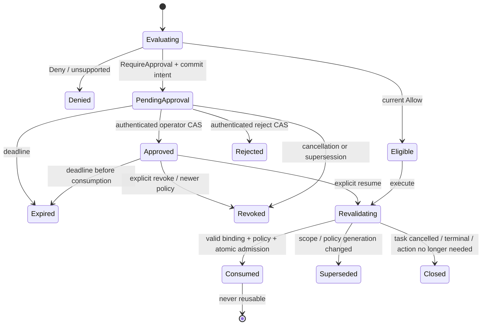
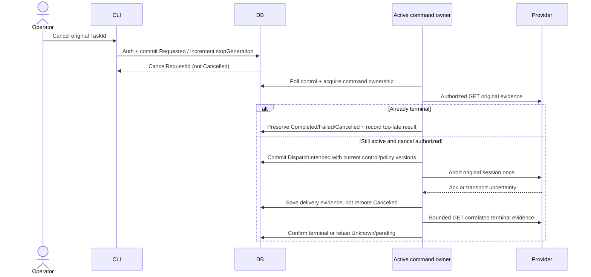

# ADR-005：Policy、人工核准與取消對帳

日期：2026-10-16（Asia/Taipei）。狀態：**M1、M2-A與另行批准的M2-B foundation已實作／驗證；production trust、runtime approval/enforcement與M3仍未啟用，完整Phase 2B-2未驗收。**

後續增量：owner已明確批准M1的provider-neutral contracts、replaceable trusted context、單一immutable policy snapshot與deterministic evaluator；實測見 [M1 results](../acceptance/PHASE2B2_M1_RESULTS.md)。僅M1完成，不代表下述approval/persistence/cancellation/runtime enforcement提案已實作或全部獲准；M2與正式operator trust機制仍待另行授權。

再後續增量：owner另批M2-A，已完成schema v2、IApprovalStore/窄transaction coordinator、sticky cancel intent與structured audit，以及51個focused／304個offline tests；[M2-A results](../acceptance/PHASE2B2_M2A_RESULTS.md)。本ADR下文保留完整target；實作差異與仍disabled的部分見文末補記，不能把資料列Approved當作runtime grant。

檢視基準：`origin/main = 64d3c36`；2026-10-16 fetch 後沒有更新提交。[Roadmap](../ROADMAP.md)、[ADR-003](ADR-003_OPENCODE_WORKFLOW_EXECUTOR.md)、[ADR-004](ADR-004_DURABLE_EXECUTION_RECOVERY.md)、[家用結果](../acceptance/PHASE2B1_HOME_RESULTS.md) 與 [公司安全事件](../acceptance/PHASE2B1_SECURITY_EVENT.md) 為依據。家用 2B-1 通過不解除公司 execution hold。

## 1. 目前事實與責任邊界

| 層 | 目前／提議責任 | 不能據此推論 |
|---|---|---|
| MAF Host／application service | 驗證 caller、task、connector、操作與 scope；在所有入口套用 policy、durable approval、取消意圖 | Enabled、健康或人工 Allow 就代表 harness 內部任意操作安全 |
| Workflow／durable service | 官方 Workflow 執行、保存 identity／intent、原 session 對帳；新 admission 協調核准與 CAS | Recovery 可以重送 prompt，或完成等於答案被接受 |
| OpenCode adapter | 檢查 scope、agent/session policy、HTTP correlation，轉譯已支援的 bounded operation | 宣稱能攔截 OpenCode 內部每一次 tool call |
| OpenCode／執行環境 | model/tool loop；實際 read/write/shell permissions；OS isolation 由環境負責 | MAF approval 取代 session permission 或 OS sandbox |

原始碼檢視：

- [Core durable state](../../src/MAF.Core/DurableExecution.cs)：terminal immutable、phase 單調、identity/version validation；`AbortRequested` 是單一 bool。
- [DurableExecutionService](../../src/MAF.Workflows.External/DurableExecutionService.cs)：同 TaskId 已存在時只走 recovery；沒有 session identity 時 Unknown；reattach 不 submit；terminal record 不被稍後 Unknown 覆寫。
- [OpenCodeClient](../../src/MAF.Workflows.External/OpenCode/OpenCodeClient.cs)：現有 `Scope` 綁 origin/root/agent/read-only rules；`ReattachAsync` 封鎖 Submit；只 GET permission/question，不提供 reply 方法；`MessageAbortedError` 才映射 remote Cancelled。
- [OpenCodeExecutor](../../src/MAF.Workflows.External/OpenCodeExecutor.cs)：`PolicyVerified` trace 現在只是 provider/root/read-only validation，**不是 MAF policy engine 的授權證據**。durable timeout 不 abort，explicit cancellation 以獨立5秒 budget請求 abort，再觀測終態。
- [SQLite store](../../src/MAF.Persistence.Sqlite/SqliteExecutionStore.cs)：schema v1，每次方法自行開連線，沒有跨 store transaction API；OS ownership 目前由整輪 execution 持有。
- [Host](../../src/MAF.Host/ExternalConsole.cs)：Ctrl+C 取消本機 CTS；目前沒有 trusted operator resolver、approval CLI 或 cancellation ledger。ephemeral 與 durable 入口都需納入未來 policy enforcement。
- [既有測試](../../tests/MAF.Tests/DurableExecutionTests.cs) 中 `WaitingCanRecoverToCompletionWithoutApprovalOrNewPrompt` 模擬 provider evidence 改變，不是 MAF 核准；`ExplicitCancellationRequiresConfirmedRemoteCancellation` 的 fake abort 直接改成 Cancelled，尚不足覆蓋 ack-only。

保留官方 MAF Workflow-first、獨立 PCA／Reviewer、loopback-only、read-only、原 fingerprint 算法及已驗證 2B-1 assertions。Phase 2B-2 的 `MafApprovalPending` 與既有 `WaitingForApproval`（provider pending）必須分欄呈現；不重用同一 enum 假裝具有相同權限含義。

## 2. 決策：小型 application policy boundary + 同 DB 的獨立 approval store

建議 B：獨立 `IApprovalStore`，與 `IExecutionStore` 共用 SQLite DB、migration owner 與**顯式的短 transaction coordinator**。增加窄的 admission/control commit methods；不把 SQLite connection/transaction 暴露到 Core，不建立通用 workflow-state engine。

| 選項 | 優點 | 代價／判斷 |
|---|---|---|
| A：全部塞入 IExecutionStore | 少一個 interface | 執行 snapshot 與人工決策生命週期耦合；initial approval 尚無 execution row；terminal execution 仍可能需要取消／核准 audit。不採用 |
| B：IApprovalStore + 同 DB 的窄 UoW | 分責清楚；approval consumption、control version、execution admission 可同 transaction | 現有 store 無共享 transaction，必須實作 coordinator，不能只依序呼叫兩個 stores 就宣稱 atomic。**採用提案** |
| C：通用 workflow-state persistence | 可容納更多未來節點 | 過早泛化、migration/恢復語義過大。2B-2 不採用 |

Application service 必須在持有正確 task ownership 的工作路徑與 adapter 副作用邊界再次檢查，不能只在 CLI 做 UI gate。Direct library entry、ephemeral CLI、`--recover`、`--recover-pending`、取消與未來 approval resume 均不得旁路。未授權的新入口 fail closed；不得用「改成 ephemeral」繞過 RequireApproval。PCA／Reviewer 舊的唯讀 tool boundary 不改變；不讓 LLM tools 呼叫 approval decision command。

## 3. Provider-neutral 契約（概念草案，非已存在 API）

| 名稱 | 必要欄位／語義 |
|---|---|
| `CapabilityDescriptor` | 固定 ConnectorId／AdapterVersion／CapabilityId；支援的 OperationKind；EnforcementBoundary=`TaskAdmission` 或 `ProviderChallenge`；可否 safely inspect、abort、challenge-reply；descriptor digest。由受信任 adapter/config 提供，不接受模型聲稱 |
| `AuthorizationScope` | canonical root/resource IDs、ProviderScope digest、agent/session policy digest、adapter/config revision、資料／唯讀範圍、budget、scope revision；path link/reparse/ancestor validation沿用現有規則 |
| `PolicyRequest` | OperationId、TaskId、預配 WorkflowRunId/ExecutionId/MessageId、RequestFingerprint、CallerSubject、connector/capability/operation、scope、可用的 session/challenge binding、intent generation、現在時間 |
| `PolicyDecision` | Allow / Deny / RequireApproval、固定 ReasonCode、PolicyVersion + monotonic PolicyEpoch、EvaluatedAt、NotAfter、scope/operation digest、required operator scope。未知 enum/capability／設定損毀／時鐘不可信→Deny |
| `IPolicyEvaluator` | `Evaluate(request, trustedContext)`：不做 provider POST，不把 engine error 當 Allow；只有目前有效 policy 可評估，歷史 snapshot 只能 audit |
| `ApprovalRequest` | ApprovalId、OperationId、BindingDigest、generation、上述 correlation/scope/policy revision、requestedBy、所需 operator scope、created/expires UTC、Pending、row version；不存 task body |
| `ApprovalDecision` | DecisionId、ApprovalId、expected row version/binding、Approve / Reject、trusted OperatorSubject、authentication method/reference、decidedAt、固定 reason code；caller不能自行提供可被相信的 `--actor` 字串 |
| `IApprovalStore` | bounded list/get、CAS decision/revoke/expire、idempotency result；不能單獨發出任何 provider command |
| admission/control coordinator | 同 transaction：建立 operation+approval intent；決策CAS+audit；consume批准+create新execution；cancel intent+關閉未用grant。這是窄的 integration seam，不是通用 event bus |

`Allow` 代表這一個操作可在有效 window內通過下一個 admission check，並非無限期 bearer grant。High-risk（write/shell、跨 workspace、scope elevation、provider permission reply）在本階段固定 Deny，即使有人 approve 也無效；未支援的操作不偽裝成可核准。

最小操作集合：`SubmitNewReadOnlyTask`、`InspectExistingExecution`、`RequestCancelExecution`。診斷與本機 metadata list/read 也有各自 caller scope；不是所有 GET 都公開。`ResolveProviderPermission` 保留名稱作未支援能力辨識，預設 Deny；不實作 Registry、dynamic routing 或危險工具。

`BindingDigest` 以版本化 canonical encoding（明確欄位順序、length/UTF-8、enum names、UTC／budget單位）涵蓋完整 operation/caller/task/execution/run/message/connector/descriptor/request fingerprint/scope/policy epoch/generation、若存在則 session/challenge ID及版本。不以 raw JSON 字串或自由文字摘要判 equality。原 2B-1 fingerprint 保持原算法，operation digest另外計算；hash不是加密或鑑權，低熵內容仍可能被猜出。

Connector enabled/configured/healthy 是必要條件之一；**Enabled ≠ Allow**。由 Host 注入單一固定 connector descriptor 與 config revision即可，沒有 Phase 2C registration API。

## 4. 人工核准：持久化等待，不持久化 prompt

### 4.1 三個互相獨立的狀態軸

1. **Execution**：保留 v1 `DurableExecutionState`／`SubmissionPhase`／terminal immutability。
2. **MAF operation/approval**：描述尚未授權／已核准／被拒絕／被取消的操作；等待可早於 execution row存在。
3. **Provider evidence**：Running／permission pending／Completed／Cancelled／Unknown；MAF decision不改寫此證據。



此圖為提議的 authorization sidecar，不增加／重排已保存的 execution enums。Pending list 須區分 MafApprovalPending／ProviderInputPending；provider pending 無 ApprovalId 時不可用 `approve` 處理。

### 4.2 新任務的精確 admission

為避免 approval restart變成既有 execution重送，初次 evaluation 先建立 `authorization_operations` 的 TaskId binding，預配置 immutable run/execution/message IDs，**此時不建立 execution row、不 POST session/prompt**。同 TaskId不同 fingerprint/scope拒絕；同請求返回原 Pending operation。核准等待期間不持有長期 task lock、transaction或 workflow thread。

原 prompt 僅在當次程序記憶體。Host重啟後，`approve` 只記錄 decision，不能啟動工作；`resume` 必須由 caller重新提供原 request，重算現有 fingerprint（含 timeout/policy）與 scope，完全一致才可能執行。不把恢復時的 `Recovery inspection` placeholder 當原 task。未重新提供內容→`InputRequired`，保留尚未消耗的有效批准；過期則失效。標準輸入／受控 input供給方式不保存到 approval DB，也避免 CLI history記錄機密。

Revalidation後，短 transaction原子檢查 approval/version/expiry/current policy epoch/control cancellation version，consume這一個 operation，並建立**唯一新** `Created` execution，使用預配IDs。只對這次新建紀錄的活躍 owner發放程序內的一次 continuation，接回既有 PersistingClient／official Workflow launch path。Grant／continuation不由 caller序列化或重放。

**若該 transaction後程序死掉，execution 已存在：永遠走 ADR-004 recovery。** 即使 Created、SessionCreating、ReadyToSubmit、PromptIntended 尚未真的 POST，都不以「批准仍在」為由補送；MissingSubmissionEvidence→Unknown。這是已消耗批准但可能未執行的可用性代價，保留安全優先。不得新增 `resume --force-resubmit`。

### 4.3 既有 execution的核准後恢復

取得原 execution最新snapshot與目前control state；重新評估 `InspectExistingExecution` policy後，才能 GET原provider session／permission／status／correlated messages。已Cancelled／Completed／Failed／Partial或cancel intent已commit→關閉該待執行action，保留終態；scope變化→Superseded，不能自動把舊批准套到新scope；無證據→Unknown、零副作用。Running僅持續觀測，provider等待僅顯示 ProviderInputPending，不重送 task。

`SubmitNewReadOnlyTask` 的批准不能轉換成 `InspectExistingExecution`、abort或tool approval；每一 operation kind有獨立policy。當 policy對新提交為Deny時，受授權 operator仍可有獨立允許的 inspect/cancel權限，不能讓廣泛 Deny阻止必要對帳，也不能以對帳授權開始工作。

```mermaid
sequenceDiagram
    actor Human as Trusted operator
    participant Host
    participant Policy
    participant DB as SQLite coordinator
    participant Provider as Original provider session
    Host->>Policy: Exact operation + caller + scope
    Policy-->>Host: RequireApproval
    Host->>DB: Atomic operation + Pending approval
    Host-->>Human: ApprovalId, binding, expiry (no prompt)
    Note over Host,DB: Host may stop and restart
    Human->>Host: Approve exact ApprovalId/version
    Host->>DB: Authenticated decision CAS (no provider POST)
    Human->>Host: Explicit resume (original input if new task)
    Host->>DB: Read latest approval/control/execution
    Host->>Policy: Re-evaluate current epoch, identity, scope
    alt Existing execution
        Host->>Provider: Authorized GET original evidence
        Provider-->>Host: Current correlated status
        Host->>DB: Recheck versions; close or retain observation intent
        Note over Host,Provider: No new session / prompt / permission reply
    else No execution and exact new-task admission allowed
        Host->>DB: Consume approval + insert unique Created atomically
        Note over Host,DB: Crash here means recovery only, never re-admit
        Host->>Provider: Existing intent-before-POST lifecycle, once
    end
```

人工 Approve不取代最新Deny。政策epoch改變一律使舊未消耗批准Superseded（包括看似更寬鬆的變更），需新評估／新ApprovalId；不沿用舊批准。重複相同DecisionId與完整內容回傳原結果；同ID不同內容或Approve/Reject競爭者CAS失敗，不能 last-write-wins。Revoke可以阻止尚未consume的Approved；consume之後另建取消意圖，不能宣稱已撤回遠端操作。

## 5. 人類身分與信任假設

推薦第一個可啟用模式：**本機 OS已驗證的 operator subject（Windows SID／token來源）+ 受保護配置中的 capability/resource allowlist**，有別於 submitting agent/service的主體。Host不能相信 CLI username、環境變數actor、模型輸出或 repo policy檔；必須從受信任 execution context解析subject。授權配置存於repo以外、由owner明確配置；資料與decision audit只存subject ID、驗證方式／固定reference，不存token／password。

OS identity不等於人類在場。如果 agent與operator共用同一OS principal，允許該SID就可能讓agent模擬人類approve。**預設不啟用此模式的可執行approval**；owner必須先選擇不同的受控operator principal與可行的DB/decision ACL，或另行核准有fresh human-presence驗證的本機身分整合。單純加 `--yes`、terminal prompt、nonce、username皆不解決此問題。沒有可信 resolver／scope binding→decision拒絕，不能demo fallback。

同一DB包含授權資料與execution資料，OS寫入權限持有者能直接竄改，SQL constraint／hash不是防竄改audit。MVP只涵蓋受信任本機操作者／Host，排除惡意同帳號程序、惡意DB owner與admin。若部署需要防範可任意改DB的submitter，必須額外隔離writer或使用獨立可信broker／signed decisions，**不在本階段假裝已解決**；在該信任前提未滿足的環境保持approval disabled。不在這次自動改ACL或建立服務。

Decision權限涵蓋具體operation/resource以及approval要求；能查詢不等於能核准。是否禁止submitter self-approval、雙人制／human-presence方案見§10待決，預設禁止self-approval，無法辨識則拒絕。

## 6. SQLite v2 提案與 atomic boundaries

以下為原完整target表／欄位；M2-A實作的子集與差異見文末補記。保留既有 `executions(task_id,version,terminal,snapshot)` 的格式與 enum值，不把未批准任務塞入該表。最小表：

| 表 | 必要資料與約束 |
|---|---|
| `authorization_operations` | OperationId PK；TaskId、Run/Execution/Message IDs、requestFingerprint、providerScope、descriptor/scope digests、caller、operation kind、generation、policy epoch/version、status、UTC deadlines、rowVersion；初次admission每TaskId最多一個有效binding；不同scope不得overwrite |
| `approval_requests` | ApprovalId PK；OperationId FK、generation、binding digest、required operator scope、Pending/Approved/Rejected/Expired/Revoked/Consumed/Superseded/Closed、expiresAt、version；UNIQUE(OperationId,generation)；DecisionId unique、decision actor/method/time/code |
| `task_controls` | TaskId PK，預配ExecutionId、controlVersion、CancelRequestedAt／CancelRequestId與不減的stopGeneration；pending前也可存在；用於不阻塞的cancel與admission競爭 |
| `cancellation_requests` | CancelRequestId PK；UNIQUE(TaskId,ExecutionId)；subject、原handle binding、RequestedAt、dispatch phase、delivery evidence、last correlated observation、version、固定diagnostic；無execution時不得假造遠端handle |
| `control_audit` | 有界固定欄位append：RecordId、operation/approval/cancel/task IDs、actor ID、event code、old/new versions、policy epoch、UTC。不是任意payload事件匯流排；大小／retention由明確維運規則限制 |

JSON metadata如使用須有schema/version與size limit；不存prompt、arbitrary reasoning、tool arguments、transcript、完整provider response、credentials或自由文字exception。Scope只存必要identifier/digest；approval CLI顯示allowlisted operation摘要，不能宣稱digest可讓人審查未呈現的任意prompt。需要審核task內容時由operator另行取得原受控輸入，保留明確的evidence limitation。

Transaction coordinator須提供至少四個固定原子操作：建立pending意圖；記錄decision+audit；consume+檢查control+建立execution；requestCancel+提高controlVersion+invalidate未consume approval。所有比較包含expected version／binding；version錯誤、expired、policy epoch不一致→整筆rollback，零provider side effects。DB transaction內不做HTTP／等待人類。

Task ownership與control不同：現有長期execution file lock仍保護同TaskId provider commands；approval decision／cancel-intent只做短DB CAS，不等待整輪owner釋放，否則running task無法被取消。活躍owner須於每個副作用前與每次bounded poll讀最新controlVersion；standalone cancel command先commit意圖，有active owner則通知/等待其後續poll，無owner時取得原ownership做cancel/reconcile。兩者不得同時abort。Worker未處理不代表意圖未保存。

Policy authority的持久epoch必須由同一受保護配置／DB revision來源控制，admission最後檢查的epoch與當下有效policy一致。不能評估完外部可變檔案後只信舊version；更新policy需以短control transaction啟用新epoch。變更epoch與admission CAS有明確先後，執行中的外部工具不可能因此瞬間被撤回。

Migration由維護入口在exclusive schema coordination與所有v1 Hosts停止後，`BEGIN IMMEDIATE`／重新核對user_version=1、建表索引FK、驗證既有snapshots、原子設定2後commit；busy timeout沿用5秒，超時停止、不搶鎖。空DB直接建立完整v2；未知版本fail closed。授權備份由operator安排，不自動複製敏感DB；失敗rollback原v1，不能改user_version後補表。

v1 records沒有批准歷史，**不可補造Allow或Approved**。v2讀取舊row僅允許經新policy授權的InspectExisting／RequestCancel；原phase恢復仍不submit。v1binary對v2須沿用future-schema rejection，不允許混合writer或無聲降級；不自動downgrade。恢復舊備份會遺失新control state，不能在不對帳下replay。現有CAS依完整snapshot比對，migration不得改舊snapshot序列化以致比較失效。

## 7. Cancellation：意圖、傳輸與遠端結果分開

取消ledger分開保存控制與證據：

- Intent：None / Requested（authenticated request已durable commit）；同execution重複cancel idempotent。
- Dispatch：NotDispatched / DispatchIntended / ResponseReceived / DispatchUncertain。必須先commit DispatchIntended，再call abort；崩潰／逾時無法判定是否送到，保持uncertain。
- Delivery evidence：NotSent / Sent（僅adapter確知傳輸證據時）/ Acknowledged / Unknown；現有bool `AbortAsync` 只有ack evidence，不得編造精確sent timestamp。ResponseReceived(false)不等於confirmed not-sent。
- Outcome：NoRemoteWork / Running / ProviderInputPending / Completed / Failed / Cancelled / Unknown。NoRemoteWork只限本機交易證明尚未admit、沒有execution或dispatch的情況；其餘遠端結果只由原correlated provider evidence建立。這是三個控制軸加一個觀測軸，不能壓成單一Cancel enum。

| 情況 | 控制／execution行為 | restart規則 |
|---|---|---|
| Pending MAF approval、尚未admit | commit cancel/stopGeneration、close approval，CancelledBeforeDispatch operation | 無execution row，零session/prompt/abort；不捏造remote Cancelled |
| Consume/Created後、session creation前或中 | owner觀測stopGeneration阻止後續POST；若已有creation intent則可能Unknown | 未證實無remote work時保留Unknown；無session不新建來取消 |
| Session已知、prompt intent前 | 不送prompt；按授權檢視原session；必要session cleanup非自動權限擴張 | 不把空session/idle當task成功；不submit |
| Prompt intent／uncertain／Running | commit CancelRequested；取得command owner、revalidate cancel scope、GET原session最新證據；仍active才commit abort intent並送一次 | uncertain dispatch先GET；預設不自動重送abort，也不重送prompt |
| Abort HTTP成功ack但仍busy／permission pending | ledger Acknowledged，execution依新證據Running／WaitingForApproval或Unknown | 持續有界GET，不approve pending permission，不填Cancelled |
| Provider不可用或abort response遺失 | intent保留、dispatch/outcome Unknown | 重啟只對帳原handle；remote可能仍執行；沒有第二個task |
| Provider確認MessageAbortedError或等效已驗證證據 | execution Cancelled terminal，取消ledger Confirmed | terminal不可覆寫；後續矛盾回Unknown observation |
| Completion與cancel競爭 | 若原結果已完成則Completed保留；取消ledger記AlreadyCompleted／TooLate | 不把Completed改Cancelled；保留cancel requested的歷史 |
| Policy變新Deny／scope變化 | 拒絕新dispatch，保留intent與明確diagnostic | 由獨立inspect/cancel權限重新評估，不能用舊批准穿越Deny |

`CancellationToken` 是程序內停止等待的訊號，不是durable取消授權或遠端終態。明確operator Ctrl+C／cancel command應經trusted caller scope後，**先保存取消意圖再觸發active owner token**；token已cancel也須有獨立短persistence/abort/observation budget，不能把它傳入所有保存動作導致丟意圖。單純timeout、HTTP timeout、程序crash／shutdown或取消一個inspect等待不等於新取消意圖，durable timeout保留2B-1不abort語義。

現有 bool `AbortRequested` 暫留為compatibility projection（曾commit本機取消／abort intent），不是sent/ack/confirmed欄位；詳細ledger為權威。舊record true但無ledger→`LegacyAbortRequested / DeliveryUnknown`，不可合成Acknowledged或Cancelled。對ephemeral舊模式若無DB，只有原有限制與結果；需durable cancellation／approval操作時拒絕或要求明確DB，不能無聲退回記憶體承諾。

取消commit與dispatch存在不可消除的TOCTOU：最後一次control CAS之後、HTTP之前若另一process取消，已admitted remote request仍可能送出。明確linearization point為admission/dispatch-intent transaction；cancel先commit則dispatch CAS失敗，dispatch先commit則取消轉為best-effort abort/reconcile。不能承諾「按cancel後遠端從未開始」。沒有remote exactly-once或可撤回的HTTP transaction。



## 8. Failure windows與恢復規則

| Crash／race window | durable truth | 安全恢復 |
|---|---|---|
| Pending保存前 | 沒有批准 | 評估重來；零remote POST |
| Pending保存後／decision前 | 原ApprovalId仍Pending | list/inspect；restart不autoapprove |
| Decision保存後／CLI回應前 | Approved/Rejected與DecisionId已commit | 同DecisionId回原結果；approve不dispatch |
| Approved後policy／scope／expiry／cancel改變 | grant尚未consume | revalidation拒絕／supersede；零新POST |
| Consume+Created交易中 | 兩者全有或全無 | rollback可重作未消耗admission；commit後僅recovery |
| Consume commit後、session POST前 | execution已存在，grant已用 | Unknown／missing evidence，不重新admit |
| Session／prompt response或本機commit遺失 | 沿用2B-1 intent／handle | GET原session，缺session則Unknown；不替代session／prompt |
| Cancel requested後owner死 | requested仍在ledger | 新owner先inspect再決定首次abort；stopGeneration封鎖新admission |
| Abort intent後／ack保存前死 | 可能已送出 | DispatchUncertain，先GET；不預設abort可重送 |
| Completion先commit／cancel稍後 | immutable terminal | 記TooLate，不能倒改結果 |
| Policy epoch與decision/dispatch競爭 | 同DB短CAS決定先後 | newer Deny先commit則阻止consume/dispatch；不撤銷已在provider內執行的tool |

未使用批准撤回／expiry只阻止未dispatch action；已執行工作需明確cancel，approval expiry不會自動殺provider。時鐘回撥或大幅跳躍／UTC無法信任→禁止consume，需operator處理；測試以可控clock驗證，不靠wall-clock sleep。

## 9. 安全不變量與最小CLI

1. 未知capability、缺scope、未知policy epoch、trust context缺失、unsupported challenge reply均Deny。
2. 沒有目前有效Allow或精確有效人工批准，不做protected side effect；新Deny優先。
3. Approval綁定operation、caller、task/execution IDs、request與scope，不能跨task／scope／connector重放。
4. Pending、Rejected、Expired、Revoked、Superseded不會dispatch；approve本身不啟動工作。
5. 所有consume與cancel race有短CAS／同DBatomic boundary；同DB同TaskId僅一個副作用owner。
6. Recovery逐次檢查policy＋current state；既有execution絕不因approval再次submit。
7. MAF批准不改OpenCode session permissions、不自動回permission/question；底層權限驗證照常fail closed。
8. 本機intent／abort ack／遠端Cancelled分開；uncertainty回Unknown，terminal不能被改寫。
9. DB／audit不保存credentials、prompt、arbitrary provider payload；不聲稱hash/SQLite可防惡意DB owner。
10. 既有唯讀行為與2B-1成功assertions保留；新增policy enforcement需明確配置trusted Allow baseline，不暗加bypass相容旗標。

以下皆為**概念命令，現在不可執行**；`maf`也不是已安裝global command。保留現有Host退出碼；未來control操作採獨立JSON envelope／exit語義，不改舊ExternalTaskResult表示approval。

| 概念入口 | 語義 |
|---|---|
| `maf approvals list --pending` | 經caller scope過濾，有界分頁；只列MAF批准，provider pending另列 |
| `maf approvals inspect <ApprovalId>` | 顯示operation/correlation、binding、policy revision、expiry、expected version、可供審核的scope及資料缺口 |
| `maf approvals approve <id> --expected-version <v>` | trusted operator resolver驗證subject與required scope；只commit決策，不resume |
| `maf approvals reject <id> --expected-version <v>` | 同樣鑑權＋CAS；固定reason code |
| `maf approvals revoke <id> --expected-version <v>` | 撤回未consume批准；已consume回too-late，建議獨立cancel |
| `maf operations resume <OperationId>` | 明確恢復；new task需受控提供原input，existing task僅reconcile；永不force-resubmit |
| `maf executions cancel <TaskId>` | 授權後先durable requested，輸出CancelRequestId、delivery/outcome分欄 |
| `maf executions inspect <TaskId>` | execution、MAF approval、provider pending、cancel intent/delivery/outcome各自顯示；remote GET需獨立Inspect權限 |

不提供自動`--approve-all`、模型tool核准、Web UI或直接傳provider permission reply。若未來要支援provider challenge，必須先確認該版本的API、穩定challenge ID/revision、明確tool/resource digest、scope與冪等語義；缺任何一項則Deny/Not Supported，不以MAF `Allow` 放寬read-only。此能力不列為首個里程碑必要條件。

## 10. Owner待決與後續

| 待決 | 建議預設／影響 |
|---|---|
| operator trust／self-approval | 禁止self-approval；需要實際不同受信任subject或另核准fresh human-presence機制。無法成立則只做pending/read-only設計驗證，不啟用可執行批准 |
| policy檔／epoch權威與ACL | repo以外受保護配置，更新epoch納入control transaction；不信任agent可修改的repo設定 |
| approved input取得方式 | explicit resume重新供給原input並比對fingerprint；不把prompt存DB，接受restart後需要InputRequired的限制 |
| v2遷移／停機與備份 | owner先同意DB遷移與v1binary不相容，所有舊Hosts停用後才遷移；不自動改ACL／backup機密 |
| provider permission bridge | 2B-2 MVP不支援；另行API/security評估與授權後才可能實作；write/shell仍Deny |
| abort uncertain後是否重試 | 預設不自動重送；只有adapter有已驗證idempotence＋新授權時才能提案 |
| deadlines／audit retention | 實作前核准具體有界值與可控clock策略；期限為grant與operation較早者，不提供unbounded approval |

原設計輪建議先做 [execution plan](../plans/PHASE2B2_EXECUTION_PLAN.md) M1：純contract／evaluator與negative tests，無provider side effects、無schema migration。Owner後續已批准並完成此範圍，結果見開頭M1連結；approval/persistence/trust activation與M2仍待授權。完整矩陣見 [acceptance plan](../acceptance/PHASE2B2_ACCEPTANCE_PLAN.md)。原文件設計輪沒有build/test/live；M1輪僅執行build與offline tests，沒有live OpenCode，不開始2B-3、2C、Phase3。

## 11. 已實作的M2-A決策與限制（2026-10-16）

- 獨立IApprovalStore負責metadata read，IApprovalTransactionCoordinator承接固定mutation；SqliteApprovalStore同時實作兩者。與既有executions共用同DB格式，但一般Host/IExecutionStore維持v1-only，遷移不開啟runtime dispatch；M3再安全整合。沒有SQLite-specific type流入Core。
- 顯式offline maintenance要求stop/backup attestations；exclusive schema file gate、持有既有TaskId locks與BEGIN EXCLUSIVE；原v1 layout/constraints與snapshot一致性fail closed，原BLOB bytes不reserialize。新v2只經maintenance建立，normal open不自動遷移。正式備份、rollback與舊Host停機責任見 [maintenance procedure](../setup/SQLITE_APPROVAL_MAINTENANCE.md)。
- 實際v2表為policy_authority、authorization_operations、approval_requests、task_controls、control_audit。Request/scope metadata存在typed approval snapshot，SQL columns做key/FK/version/CAS一致性；沒有額外cancellation_requests表，因本輪只保存cancel intent，不dispatch/abort/reconcile provider。
- M2-A approval狀態為Pending/Approved/Rejected/Expired/Revoked/Consumed。新policy revision讓舊record無法consume，但不自動把舊Approved改成Superseded；它仍只是資料。Superseded/Closed及完整provider cancellation outcome是後續target，不冒充已實作。
- IProtectedPolicyAuthority是注入的protected boundary，無production resolver/implementation。Current source是唯一epoch來源；同DB持久high-water拒絕回退、不同authority、同revision內容改變與只升其中一個revision。Policy激活必須遵守受保護source與維護序列化契約；不信任request/repo配置。高水位獨立commit，所以失敗business mutation不會撤回已觀測revision；不是防惡意DB owner或backup rollback的安全服務。
- Consume重新核對exact binding/current policy、operator仍有權、caller/control/cancel、execution/provider mapping；同transaction consume+Created+audit，**不返回dispatch continuation/ticket，不呼叫Workflow或provider**。只有M3建立完整identity與enforcement後才能接續。
- task_controls版本由0開始，cancel intent提升version並保持sticky，同transaction revoke未consume批准；不覆寫execution terminal或假造Cancelled。Audit為有界固定欄位（含epoch/version），硬上限10000 rows、讀取最多100；滿額整筆business mutation拒絕，無自動prune。
- 真實process驗證涵蓋Pending writer death/new reader與兩個migration precommit kill點；51 focused、304 offline全通過。沒有provider POST、live session或agent execution。完整證據與M2-B/M3 prerequisites見M2-A report；公司事件與舊結果不變。

## 12. 已實作的 M2-B foundation 與未啟用的 production trust

本節為 owner 另批 M2-B 的增量決策；不將前述 target 當成已完成。實測與 M3 checklist 見 [M2-B results](../acceptance/PHASE2B2_M2B_RESULTS.md)。

1. 保留 IProtectedPolicyAuthority；增加 async acquisition lease，跨越 trusted candidate 取得、durable pin 與完整 approval/control transaction commit。`IPolicyActivationCoordinator.ActivatePolicyAsync` 不接受任意 snapshot/epoch。Policy source 發布只是 candidate；同DB high-water+audit commit 才是 activation 生效點。不同 instance 由 SQLite writer/CAS 排序，當新版先啟用，舊 approval 無法 consume；先前 admission 不會被新 policy 逆轉。
2. `ITrustedPolicyAcquisition` 必須由 trusted composition 注入固定 source/authority identity，驗來源、digest、validity、monotonic epoch/version；source identity 字串與 hash **不是認證機制**。沒有實際 protected loader/credential/transport，正式 activation 保持 disabled。現有 DB high-water 防 stale/conflict，不防惡意 DB owner/整份備份回退；外部權威 anchor 與災難回復仍待定。
3. Authentication (`ITrustedIdentityResolver`) 與 exact authorization (`IApprovalAuthorization`) 分開。Require human operator、fresh human presence、有效期間與非 self approval，並對 operation/resource/binding/required scope 授權；read/list 不等於 decide。僅實作 interface 或同字串 context 不會被認證。預設 UnavailableTrust deny，沒有 production/test fallback 或 Host 註冊。**目前同 OS 帳號無可靠 human/Agent 區分，正式 approval 保持關閉**；§5 的 OS-subject 提議不能單獨作啟用依據。
4. Authorization/identity/provider-binding callbacks 是 transaction 內的本機 bounded verification，不得做網路或等待人類。未來 Broker 的 transport 認證與 proof acquisition 應在進入 storage 前完成，並定義 proof/rights revision 的 freshness、revocation 及與 activation 的序列化；不能在現有 callback 裡直接加遠端 HTTP。
5. 未來 Broker 主要替換 acquisition/resolution/authorization/maintenance access adapters；durable approval、execution 與 Workflow 核心保持。Broker own-writer isolation、authenticated protocol、exact decision proof 的 durable reference 尚未設計；如需 additive evidence/schema 擴充，須另審，不承諾零改動或現在已具 tamper resistance。
6. Schema仍v2；`AuthorizedApprovalMaintenance` 為缺 authorizer 即拒絕的精確 DB resource 入口，原 ApprovalSchema 仍是 trusted storage primitive。Stop/backup bools 為 operational attestations，非 authentication。沒有正式 migration CLI，沒有真 DB 遷移。
7. Audit仍10000硬上限，滿額全部rollback、沒有 prune/export API；controlled archival proposal與必要 receipt/anchor 前提見 [maintenance](../setup/SQLITE_APPROVAL_MAINTENANCE.md)。未定信任與原子 archive receipt 前，archive operations disabled。

本輪43個新測試、94 focused、347 offline通過；M1/M2-A與原2B-1 regression assertions保留。沒有live模型/provider dispatch、M3 CLI、provider reply、M4取消dispatch、Registry或Hybrid。七項 [architecture guardrails](ARCHITECTURE_GUARDRAILS.md) 不變；公司endpoint hold不變。
