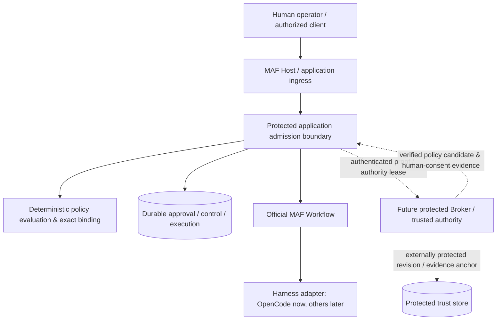

# ADR-006 — Broker-ready Trusted Policy & Approval Boundary

> Date: 2026-10-16 (Asia/Taipei)  
> Status: **Target architecture direction adopted for planning; implementation/deployment NOT authorized.**  
> Baseline: `8d6ae99569d06edae46b6e5a6dc132a997a3d32b` (M2-B foundation).  
> Related: [Guardrails](ARCHITECTURE_GUARDRAILS.md) · [ADR-004](ADR-004_DURABLE_EXECUTION_RECOVERY.md) · [ADR-005](ADR-005_POLICY_APPROVAL_CANCELLATION.md) · [M3 gate](../plans/PHASE2B2_M3_ARCHITECTURE_GATE.md).

## Context

MAF is a local-first orchestrator: official Microsoft Agent Framework Workflow coordinates native agents and external harnesses; OpenCode retains its own tool loop. M2-B implements replaceable `ITrustedPolicyAcquisition`, `ITrustedIdentityResolver`, `IApprovalAuthorization`, `IExecutionBindingVerifier`, the unregistered `TrustedPolicyAuthority` adapter, and SQLite durable authority/approval coordination. It **does not** establish a trusted production policy publisher, reliable human-versus-same-account-agent identity, a separate writer principal, or a Broker. Production policy activation and human approval remain **disabled**.

A policy digest checks content identity, not who issued it. A username, SID shared by an Agent, `--actor`, terminal confirmation, repo JSON, or an `Approved` database row alone is not verified human consent. SQLite transactions protect consistency but do not protect against a malicious principal able to replace the DB. These limitations must not disappear when an implementation adds CLI/UI or additional harnesses.

## Decision: separate the **trust plane** from the **orchestration/execution plane**

Adopt an **independent, replaceable Trusted Policy & Approval Authority boundary**, with a protected local Broker as the favored *future deployment form*. `Broker-ready` describes contracts and responsibility now; it does **not** mean an HTTP service must be built for M3, that the Broker is currently running, or that all policy evaluation moves out of MAF.

The Broker (or another provably protected authority implementation) may own **policy publication authenticity, trusted operator authentication, fresh exact human consent, authorization evidence, revocation, and protected maintenance/write authority**. MAF must still enforce deterministic policy, operation binding, admission, control, and side-effect checks. The store owns atomic durable transitions; official Workflow owns task coordination; a harness owns its internal tools and provider protocol.

**Not a substitute:** an in-process class or another localhost process under the same writable account is not, by itself, an independent security principal. An agent able to call an unrestricted Broker endpoint or modify its DB can potentially approve its own work. Real deployment requires authenticated transport, caller separation, writer/secret isolation, and authorization scoped to exact resources. A future local Broker may be offline-capable; remote/Internet exposure is not a requirement or permission.

## Contract ownership and replacement surface

| Responsibility | Long-term owner | Existing M2-B seam / limitation |
|---|---|---|
| Policy provenance / publication | Protected authority; future Broker | `ITrustedPolicyAcquisition`: adapter implemented, **no authenticated production source** |
| Candidate validation / canonical digest | MAF deterministic Core | `PolicySnapshotBinding` and evaluator; digest alone is not an authentication signature |
| Effective activation order | SQLite durable coordinator + authenticated authority source | `IPolicyActivationCoordinator`; local `policy_authority` high-water+audit commit is linearization point |
| Human authentication / presence | Protected operator channel / Broker | `ITrustedIdentityResolver`; no reliable same-account human/agent distinction |
| Exact approval authorization | Protected identity/rights decision + MAF exact binding | `IApprovalAuthorization`; trusted evidence cannot be a CLI string |
| Approval/control persistence | MAF durable coordinator, or protected writer boundary later | Existing schema v2 and CAS; current same-writer threat limitation |
| Provider dispatch & recovery | MAF admission/Workflow + harness adapter | Existing 2B-1 ledger; no Broker workflow/tool loop |
| Maintenance authorization | Protected operator/service | `ITrustedApprovalMaintenanceAuthorization`; not a production authorizer |

Contracts should support later adapter replacement **without re-architecting Workflow or the external harness tool loop**. Do not promise zero storage changes: a verified, durable proof reference or archive receipt may require a separately reviewed additive migration.

## Required evidence and sequencing

1. **Policy authority:** authenticate publisher and fixed deployment identity. SourceId plus SHA/digest is insufficient. Candidate publication is **not** durable activation. Owner D02 selects explicit-only activation, implemented in the isolated M3-A2a increment below; production source authentication/revocation and control authorization remain prerequisites.
2. **Human approval:** authenticate a real operator through a channel the agent cannot forge; require fresh presence and exact operation/resource/binding/required scope, expiry, non-self-approval, and proof-replay defenses. `Approval` is separate from `Resume`.
3. **Durable evidence:** choose protected reference/receipt, proof freshness and revocation checks, audit custody, external anti-rollback revision anchor, disaster-recovery and writer isolation. No signatures, nonce or hash are useful if the agent holds the same signing secret and write permissions.
4. **Runtime enforcement:** MAF checks at every supported entry and before protected external effects. Database commit cannot be atomic with provider HTTP. Once an admission/dispatch intent commits, newer policy cannot guarantee that an in-flight provider action never happens; use durable cancellation/reconciliation instead.
5. **Failure:** unavailable Broker/provenance/identity/proof ⇒ no *new* approval or protected side effect. Separately authorized GET inspection/reconciliation should remain possible without becoming a path for new prompt POST.
6. **Operational separation:** synthetic fixtures can validate algorithmic behavior, **not** production authenticity. No fake resolver/source should be registered as production fallback.

## Alternatives and consequences

- **All security decisions inside Host, sharing an agent-writable identity/DB:** rejected as a production trust proof; simpler local PoC only when explicitly scoped to synthetic tests.
- **Implement a full distributed IAM/SSO/RBAC service immediately:** deferred; increases scope before unified runtime enforcement is proven.
- **Broker-ready contracts with future isolated Broker:** selected as target architecture. Keeps local-first behavior, core policy deterministic, and the possibility of approved protected deployment later; leaves real trust and its operational cost explicitly unresolved.

## Non-goals / restrictions

No production Broker, authentication endpoint, policy signing system, operator UI, credential import, ACL modification, network listener, registry, Hybrid planner, agent loop, write/shell execution, or provider permission reply is authorized by this ADR. Existing security-event execution holds and company-data rules remain in force.

## Revisit / acceptance gate

Review when choosing actual process/OS principals, policy publisher, proof storage, authenticated transport, disaster-recovery anchor, or a second deployment node. Before enabling production approval, demonstrate the agent **cannot** impersonate the approver or write the effective authority/approval evidence, and validate real restart, revocation and rollback behavior. Until then report **Blocked / Not Demonstrated**, not Passed.

## M3-A2a increment: explicit-only local activation

Owner D02 is implemented by the isolated [M3-A2a results](../acceptance/PHASE2B2_M3_A2A_RESULTS.md): only explicit `ActivatePolicyAsync` writes the durable authority tuple and its audit; Request/Decide/Consume/Revoke/Control verify the exact active tuple within their business transaction. A newer unactivated candidate or unavailable source blocks business operations, with no fallback to an older cached snapshot. Publishing or acquiring a candidate never activates it. Equal activation is idempotent; rollback/conflicting revisions fail closed. Schema remains v2. This is a trusted-code storage primitive, not an authenticated production control path or Broker deployment; all production trust blockers above remain.
