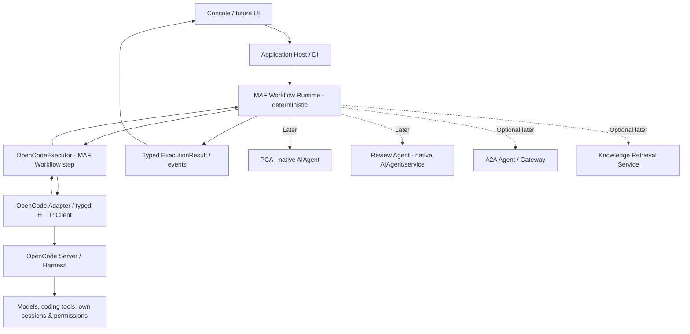
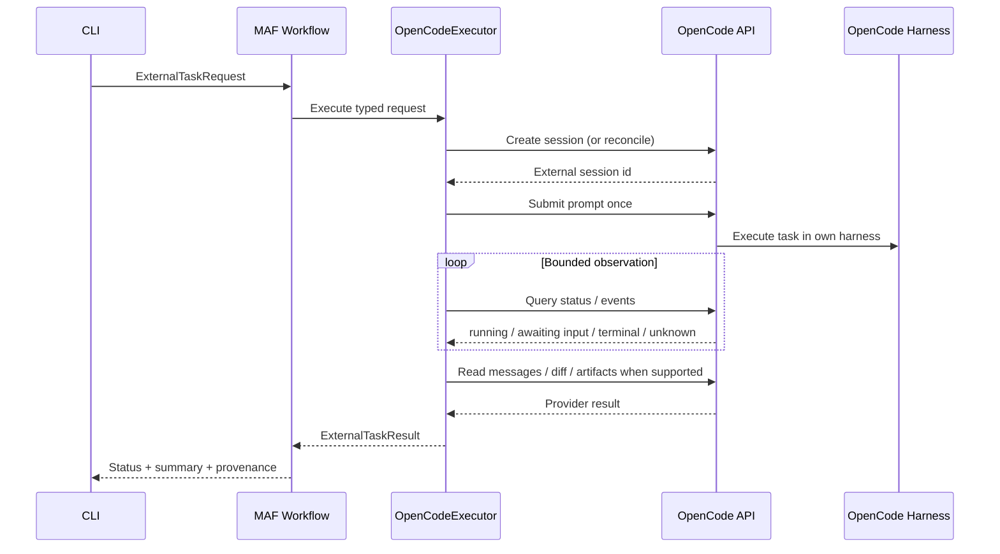

# MAF — External Harness Architecture, Contracts & Validation

> Version 0.1 · 2026-10-14 · Status: Phase 2A design adopted; later stages remain proposed\
> Decision: **MAF Workflow custom Executor + OpenCode direct API adapter** for the first PoC.

Phase 2A was implemented and accepted for a controlled read-only PoC on 2026-10-15; see [ADR-003](ADR-003_OPENCODE_WORKFLOW_EXECUTOR.md), [verified API mapping](../plans/PHASE2A_API_DISCOVERY.md) and [acceptance evidence/limitations](../acceptance/PHASE2A_RESULTS.md). The contract sketches and pseudocode below remain design guidance, not exact SDK signatures. Future-stage names and sequence follow [Roadmap v0.2](../ROADMAP.md); no execution store or Connector Registry currently exists.

## 1. Scope and verified starting point

The existing MAF repository provides native MAF PCA and Review components, a Console Host, `ProjectTools` bounded read-only access, and `IChatClient`/DI. These are reference points, not a reason to force external harnesses into the native `AIAgent` inheritance hierarchy.

**External facts to verify against the installed versions:** Microsoft Agent Framework supports graph-based Workflows composed of executors and edges; OpenCode provides a server API with sessions and task/messages. Exact method names, package versions and OpenCode REST routes are subject to version differences. The implementation MUST check currently pinned packages and the running server rather than assuming pseudocode compiles.

## 2. Logical architecture



**Hard boundary:** The orchestrator sends *task intent*, not synthetic low-level editing commands. OpenCode remains responsible for its own tool execution and internal agent loop. MAF handles policy, task state, delegation, observation, result collection and handoff.

## 3. Layers and ownership

| Layer | Owns | Must not own |
| --- | --- | --- |
| Application Host | Config, DI, CLI/user approvals, logs | OpenCode internal tool loop |
| MAF Workflow | Graph/edges, typed routing, allowed transitions | Provider-specific REST JSON |
| OpenCodeExecutor | Adapt typed workflow input/output, correlate IDs | Raw HTTP/auth details or local file editing |
| OpenCodeClient | OpenCode API requests, auth, polling/events, retry-safe transport | High-level workflow decisions |
| OpenCode server | Sessions, models, coding tools, actual permissions/edits | MAF global workflow policy |
| Native PCA/Reviewer | Their specialized understanding/review contracts | General external harness lifecycle |

`IAgentFactory : AIAgent Create()` remains useful for native MAF agents, **not necessarily as an abstraction for external harnesses**. Do not make `IAgentExecutor` or `AIAgent` mandatory for everything if provider capabilities differ.

## 4. MVP lifecycle sequence



Transport errors do not automatically imply remote termination. The workflow may enter `Unknown` pending reconciliation. Do not repeat a task after a lost response unless it is demonstrably idempotent or the original session can be checked.

## 5. Suggested contracts (design sketches, not pinned SDK APIs)

```csharp
public enum ExternalExecutionStatus
{
    Pending,
    Running,
    WaitingForApproval,
    Completed,
    Partial,
    Failed,
    Cancelled,
    Unknown
}

public sealed record ExternalTaskRequest(
    string TaskId,
    string ProjectRoot,
    string Instruction,
    ExecutionPolicy Policy,
    TimeSpan Timeout);

public sealed record ExternalExecutionHandle(
    string Provider,
    string ExternalExecutionId,
    string? ExternalSessionId);

public sealed record ExternalTaskResult(
    string TaskId,
    ExternalExecutionStatus Status,
    ExternalExecutionHandle Handle,
    string? Summary,
    IReadOnlyList<ExecutionArtifact> Artifacts,
    IReadOnlyList<string> Limitations,
    string? ErrorCode);
```

`ExecutionPolicy`, `ExecutionArtifact` are intentionally unspecified placeholder concepts. Codex must choose minimal concrete definitions, no premature generic framework. Support source/URI/path metadata and diff hashes only when needed and trusted.

Avoid a single synchronous HTTP request representing the entire remote run; separate **start**, **observe**, **collect**, **abort/reconcile**. If the provider lacks one, document an explicit fallback. Keep a `WorkflowRunId → external handle` mapping; Phase 2A may be in-memory, Phase 2B makes it durable.

## 6. MAF Workflow implementation shape

Use Microsoft's *actual* custom Executor and WorkflowBuilder APIs from the pinned dependency; **below is structural pseudocode, not copy-paste C#**:

```text
OpenCodeExecutor : MAF Workflow Executor<ExternalTaskRequest, ExternalTaskResult>
    ExecuteAsync(request, workflowContext, ct):
        enforce policy / approved target
        handle = adapter.CreateOrReuseSessionAsync(...)
        adapter.SubmitOnceAsync(handle, request)
        status = adapter.ObserveWithinBudgetAsync(handle, ct)
        result = adapter.CollectVerifiedResultAsync(handle, status)
        emit result through workflow context

workflow = WorkflowBuilder(start: OpenCodeExecutor).Build()
run = official MAF workflow runner(workflow, typed request)
```

Do not mislabel manually chaining service methods as a MAF Workflow. Verify workflow events and typed output passing in a test. Direct use of MAF `AIAgent` should be added later only where it is semantically meaningful.

## 7. Provider API exploration checklist

Check against the **actual OpenCode installation** and [official server documentation](https://opencode.ai/docs/server/):

| Capability | Typical API concept (verify exact route/version) | Requirement |
| --- | --- | --- |
| Health | server health / status | fail fast if unreachable |
| Create session | `POST /session` | obtain stable remote identity |
| Submit task | session prompt / async prompt | do not duplicate after ambiguous response |
| Observe | event stream and/or session status | bounded polling, event loss fallback |
| Collect | session messages, diff | artifact provenance; truncate safely |
| Cancel | session abort | confirm status or report Unknown |
| Permission handling | permission request/reply/status | expose to host, never auto approve |

Authentication, working directory scoping and tool permissions are version/deployment-specific; validate before accepting write-enabled tasks. OpenCode's session ID is not a MAF `AgentSession` or workflow checkpoint.

## 8. Security and policy

### PoC default

- Explicit allowlist of local OpenCode server and test-owned workspace.
- Read-only harness permission profile. Verify with filesystem hashes/`git status` around each live run.
- Local loopback HTTP only when explicitly allowed; remote network uses approved HTTPS and credential management.
- No `AI_API_KEY`, token, authorization header, unredacted repository snippet or secret in logs, traces or `ExecutionResult`.
- Treat repository text, tool results and API messages as untrusted data. They may contain prompt injection.
- No shell scripts, tool permission escalation, sandbox disablement, `ExecutionPolicy` bypass or arbitrary remote URL execution just to make tests pass.
- Explicit approval transition for requested writes or risky commands; reject when no human approval channel exists.
- Redaction is best effort, not a substitute for restricting which workspace or model provider can receive data.

### Special risk: remote side effects

A read-only `ProjectTools` implementation **does not make OpenCode read-only**. OpenCode executes in its own environment. The enforceable boundary is the external harness permission configuration plus the host's scope approval. Cancellation and API network timeouts do not roll back modifications. Never advertise transactional rollback unless implemented and tested.

## 9. Status, failure, cancellation and reconciliation

- `Completed`: confirmed remote terminal completion and valid result collection.
- `Partial`: bounded output gathered, but missing evidence/invalid artifacts or incomplete requested checks.
- `Failed`: confirmed failure; do not treat timeout as confirmed remote failure without evidence.
- `Cancelled`: remote abort acknowledged/confirmed; otherwise `Unknown` with `AbortRequested` metadata.
- `WaitingForApproval`: provider requires permission/user action.
- `Unknown`: transport lost, completion unverified, or ambiguous provider state.

**Double-submit guard:** record the requested operation identity and the external handle as soon as possible. Before any retry, probe the existing session. If ambiguous, surface `Unknown` for operator reconciliation rather than starting a fresh run. True exactly-once semantics cannot be assumed from HTTP alone.

**MAF checkpoints:** They store MAF runtime state at documented boundaries; **they do not automatically persist or roll back OpenCode's own state**. Recovery must combine checkpoint restore with provider-session reconciliation. Start without a DB; introduce durable storage in Phase 2B.

## 10. Validation strategy

### Deterministic tests, no model call

- Contract serialization and legal status transitions.
- Verified Workflow execution through actual MAF API.
- Fake OpenCode API: normal lifecycle, event loss, malformed responses, auth error, timeout, 429/5xx, cancellation, permission request, ambiguous submit.
- Regression: PCA and Reviewer still start and tests pass.
- Bounded memory/response size, logs redact secrets.

### Opt-in live E2E

- Approved disposable repository; baseline commit and content hashes recorded.
- Three repeat read-only tasks with traceable unique IDs.
- Validate remote Session ID correspondence and eventual final state.
- Verify no unexpected changes to working tree/index.
- Test offline server, slow job, cancel, disconnect, wait-for-approval, and output parsing. Record limitations when scenario cannot be simulated safely.
- Record token/cost if available; do not invent numbers.

### Evaluation report format

For each test: `TestCase`, `Environment`, `HostSDKVersion`, `OpenCodeVersion`, `RunId`, `SessionId (sanitized)`, `Expected`, `Observed`, `Pass/Fail/NotRun`, `Duration`, `Requests`, `Notes`, `UnexpectedFileChanges`.

A successful unit test or fake provider is **not** proof of live harness correctness. Three local E2E successes are still a PoC, not production-grade reliability.

## 11. Why not A2A immediately?

A2A is valuable where remote agents expose a compatible standard protocol. A proprietary OpenCode server API should not be mislabeled as A2A. A custom A2A Gateway would introduce an additional surface (discovery, capability advertisement, task mapping, auth, streaming, artifact rules) without improving the first PoC's core lifecycle proof.

Adoption rule: reevaluate once a concrete remote A2A service exists, multi-orchestrator interoperability is required, or gateway costs are demonstrably justified. Separately, MCP exposes tools/resources; it does **not** automatically give full remote Harness task lifecycle semantics.

## 12. How A evolves into C without replacement

```text
Phase 2A: Fixed Workflow → OpenCodeExecutor
Phase 2B-1: Durable mapping / restart reconciliation (planned)
Phase 2B-2: Approval and cancellation semantics (planned)
Phase 2B-3: Diagnostics / provenance (planned)
Phase 2B-4: Fixed Workflow → PCA → OpenCodeExecutor → Review → Human Gate (planned)
Phase 2C: Connector registry / activation policy (planned)
Phase 3:  Typed Planner Recommendation → Policy Validator → Allowed Workflow Branch
                                               ├→ PCA
                                               ├→ OpenCodeExecutor
                                               └→ Review
```

The Hybrid planner can propose a route, but the runtime enforces allowed executors, spending caps, retries/iteration caps, approval, safety checks and evidence of completion. Compare fixed vs Hybrid on the same benchmark; allow the new design only where it improves outcomes.

## 13. Architecture review / stop conditions

Stop and escalate before implementation if:

1. Installed MAF version cannot support the proposed workflow API as assumed.
2. Running OpenCode lacks reliable session/status/abort semantics or requires unsafe permissions.
3. A required endpoint is undocumented or violates company policy.
4. Integration requires changing current PCA/Reviewer security controls to work.
5. A test would send organizational code to an unapproved model/service.
6. The adapter cannot distinguish an uncertain remote run from a failed one.

## References (recheck for version drift)

- MAF Workflows: https://learn.microsoft.com/agent-framework/workflows/workflows
- MAF Agent Executor: https://learn.microsoft.com/agent-framework/concepts/workflows/advanced/agent-executor
- MAF Checkpointing: https://learn.microsoft.com/agent-framework/workflows/checkpoints
- OpenCode Server: https://opencode.ai/docs/server/
- Project repository: https://github.com/ytcha-dev/MAF
