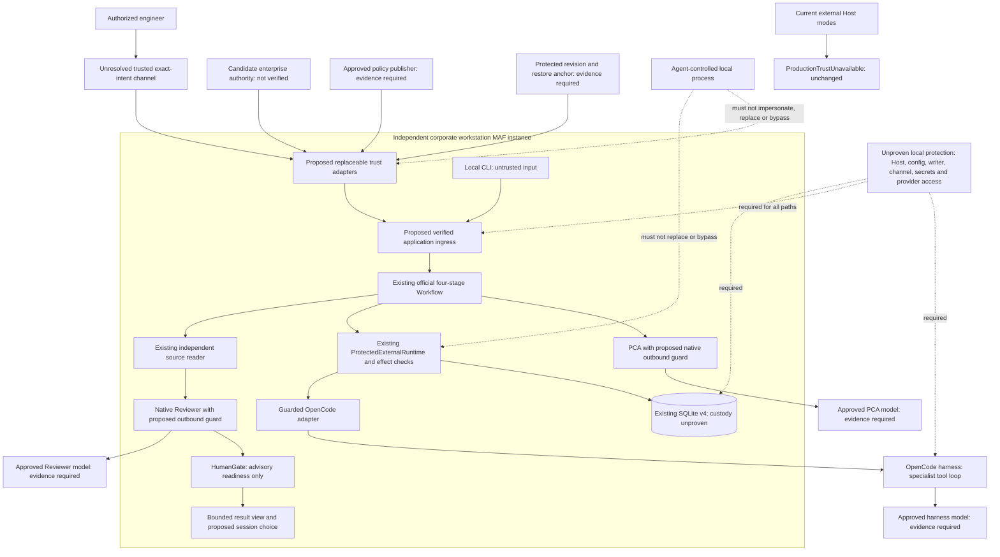

# M3-C-W0 — Corporate Windows Workstation Trust & Deployment Feasibility

日期：2026-10-19（Asia/Taipei）。狀態：**文件／可行性 gate，待 owner 審查；corporate operational Host activation：BLOCKED。**

## 1. Owner 決策與部署目標

Owner 已選擇 **corporate-workstation-first**：每位獲授權工程師的公司 Windows 工作站獨立部署一個 MAF instance，第一條旅程維持一個核准 fixture、一個固定 OpenCode、bounded ReadOnly、local foreground CLI、獨立 source evidence 與 Native Reviewer、人類控制結果接受。這是部署方向，不是當前執行或 rollout 授權。

[Safe Host design](SAFE_HOST_COMPOSITION_USER_FLOW_DESIGN.md) 是功能基線；其 Profile A personal-lab-first／先做非公司環境的排序由本次決策取代。personal lab 保留為次要 compatibility／reference，不是企業安全 gate 的替代，也不能用 home tests 解除 corporate hold。[Closeout](../acceptance/PHASE2B4_CLOSEOUT_REVIEW.md) 與歷史 acceptance／[ADR-006](../architecture/ADR-006_TRUSTED_BROKER_BOUNDARY.md) 不改寫。

未來可改為 centralized orchestration＋workstation／remote harness workers，但本輪不設計 RPC、scheduler、distributed ownership、Registry、Hybrid 或 A2A；中央 trust authority 不等於中央 MAF Orchestrator。

**建議方向：有條件優先 Option C，重用既有、公司核准且能滿足本文件契約的 enterprise authority，並獨立證明本機 enforcement／writer／provider access custody。** 不是假定公司已經有適合的服務；沒有企業證據前只能列 Requires corporate deployment evidence。若 C 不適用，僅另行審查 Option B 的 protected-local 可行性；B 也不可證明時保持 Blocked，不降級 Option A、不自建通用 IAM 或服務。

## 2. Baseline、證據等級與實作事實

Repository：`ytcha-dev/MAF`；開始 HEAD：`5ee777bf53481a70efb41fbb53c99e81a82d4061`，`main`，與本機 `origin/main` 相同，未將本機 tracking ref 當作已 refresh 遠端。起始工作目錄只有未追蹤 `.opencode/`，保留、不讀取、不提交。

證據標籤適用全文；每項部署提案不是已驗收控制：

| 標籤 | Evidence level |
| --- | --- |
| S | Verified in current source：本輪靜態核對實作，不代表本輪執行通過 |
| T | Historically validated in synthetic tests：既有報告／fixture assertions，非企業控制實證 |
| R | Historically validated in a separate approved real-provider environment：歷史 home／live，不能移轉為 corporate clearance |
| D | Supported by design/ADR only：包含本輪 proposed contracts／deployment requirements，未實作 |
| C | Requires corporate deployment evidence：須由授權 IT/security 提供真實 protection／issuer／custody 證據 |
| U | Unknown or blocked：repository 無足夠企業資料或功能未接入；不據此猜測企業設定 |

實作索引：連結是檔案，後列 exact function／type 為本輪核對點。以下現有行為均為 **S**，歷史實測另列 **T／R**。

| 檔案／function | 已實作的控制 | 未證明的企業保證 |
| --- | --- | --- |
| [TrustedAuthority.cs](../../src/MAF.Core/Policy/TrustedAuthority.cs)：`TrustedPolicyAuthority.AcquireAsync`、`Resolve`、`CanControl`、`CanDecide`；`UnavailableTrust` | acquisition 有界、source／authority／digest／revision／clock checks；lease 內 snapshot；resolver 檢查 subject/context/kind/expiry；CanDecide 需 fresh HumanOperator 且非 caller | Acquire 不驗真實企業 provenance；取決於注入 adapter。記憶體 `highest` 不是外部 restart anchor；FreshHumanPresence bool 不是獨立 proof |
| [PolicyContracts.cs](../../src/MAF.Core/Policy/PolicyContracts.cs)：`ITrustedCallerContext`、`AuthorizationScope`、`PolicyRequest`、`PolicyValidation.Supported`；[evaluator](../../src/MAF.Core/Policy/DeterministicPolicyEvaluator.cs)：`Evaluate`／`Revalidate` | exact scope／revision、disabled/healthy capability、expiry、restrictive outcome、unknown operation default-deny | context 只帶 metadata；沒有 Windows／enterprise identity implementation，沒有 native inference operation |
| [OperationBinding.cs](../../src/MAF.Core/Policy/OperationBinding.cs)：`Encode`／`Digest`；[PolicySnapshotBinding.cs](../../src/MAF.Core/Policy/PolicySnapshotBinding.cs)：`Digest` | 外部 operation v1 固定 encoding；綁原 task/run/execution/message、fingerprint、scope、descriptor／revision | hash 是 correlation，不是 issuer authentication、簽核或 secret；未綁部署 proof audience、native role／model disclosure envelope |
| [ExternalExecutionApplication.cs](../../src/MAF.Workflows.External/ExternalExecutionApplication.cs)：`Assess`；[ProtectedExternalRuntime.cs](../../src/MAF.Workflows.External/ProtectedExternalRuntime.cs)：`RunCoreAsync` | resolver 先於 metadata disclosure、TaskId ownership 後重新讀 DB，current assessment／atomic admission、original IDs、scope/provider checks；Resume 另走 exact approval | public ctor 需要真實 inputs/source/resolver；無法因注入一個 class 就建立 OS protection |
| 同 runtime：`ProtectedAccess.VerifyAsync`／`BeforeWireAsync`／`Enter`；[RuntimeAccess.cs](../../src/MAF.Workflows.External/RuntimeAccess.cs)：`UnavailableRuntimeAccess` | 每個 provider effect／HTTP route 重驗；Inspect 不 Create／Submit；raw constructors default deny；implicit Abort suppressed | 不控制其他程式直接向 OpenCode 或 model endpoint 發 request，不隔離可改 binary／DI 的同 principal |
| [SqliteApprovalStore.cs](../../src/MAF.Persistence.Sqlite/SqliteApprovalStore.cs)：`ActivatePolicyAsync`、`CompareActive`、`GuardedTransaction`；[Admission](../../src/MAF.Persistence.Sqlite/SqliteApprovalStore.Admission.cs)：`AdmitAllowedAsync`；[Runtime](../../src/MAF.Persistence.Sqlite/SqliteApprovalStore.Runtime.cs)：`VerifyEffectTransactionAsync` | explicit activation＋audit、business transaction 前後 active tuple checks；owned Created admission／intent／control CAS；無 HTTP 跨 SQL transaction | ActivatePolicyAsync 本身無 operator 參數；是 trusted-code primitive，不是 authenticated activation API。無 protected writer／external rollback anchor |
| [DurableApprovalApplication.cs](../../src/MAF.Workflows.External/DurableApprovalApplication.cs)：`RequestAsync`／`DecideAsync`；[Resume](../../src/MAF.Persistence.Sqlite/SqliteApprovalStore.Resume.cs)：`ConsumeOwnedAsync`／`VerifyConsumed`；[ApprovalResume.cs](../../src/MAF.Core/Policy/ApprovalResume.cs) | Request／Decide 不 dispatch；explicit Resume、owner-bound non-serializable authorization、exact consumed-approval checks、non-self actor validation | 真 human/operator proof、custody、revocation source 缺失；不能用當前工程師再換個 actor 名稱做 self-approval |
| [Cancellation](../../src/MAF.Persistence.Sqlite/SqliteApprovalStore.Cancellation.cs)：`RequestCancelAsync`；[ProtectedAbortDelivery](../../src/MAF.Workflows.External/OpenCode/ProtectedAbortDelivery.cs)：`DeliverAsync`；[Reconciliation](../../src/MAF.Workflows.External/CancellationReconciliationApplication.cs)：`ReconcileAsync` | cancel intent、exact Abort authorization／one attempt／ack、獨立 Inspect 與 terminal reconciliation；M4 不把 ack 當 Cancelled | 沒有 corporate caller／operational cancel CLI；帳號撤銷不自動產生 Abort 權限 |
| [SqliteExecutionStore](../../src/MAF.Persistence.Sqlite/SqliteExecutionStore.cs)：`TryAcquireAsync`／`UseAdmissionOwnershipAsync`；[Ddl v4](../../src/MAF.Persistence.Sqlite/ApprovalSchema.V4Ddl.cs)；[maintenance](../../src/MAF.Persistence.Sqlite/AuthorizedApprovalMaintenance.cs)：`InitializeOrMigrateAsync` | 同機同 DB 的 ownership、exact profiles、schema／CAS／receipt invariants；maintenance 缺 authorizer 拒絕 | lock、DDL、trigger 不防 DB／binary replace；維護 seam 尚無真實企業 authorizer，不能自動 migrate |
| [Host Program](../../src/MAF.Host/Program.cs)：top-level DI／native routes；[ExternalConsole](../../src/MAF.Host/ExternalConsole.cs)：`RunAsync` | external-task／recover／recover-pending 明確 `ProductionTrustUnavailable`；現有 native PCA／Git-diff Review 是分開且未納入 production policy 的入口 | 沒有 authority/resolver／operational graph registration；舊 native route 可用的 source fact 不是本輪准其執行的授權 |
| [TaskBriefingAdapter](../../src/MAF.Agents.Comprehension/TaskBriefingAdapter.cs)：`BriefAsync`；[ComprehensionAgentFactory](../../src/MAF.Agents.Comprehension/ComprehensionAgentFactory.cs)：`Create` | official ChatClientAgent、bounded tools、strict original task echo | PCA IChatClient 沒有 corporate outbound policy guard／role-specific identity |
| [NativeEvidenceReviewer](../../src/MAF.Agents.Review/NativeEvidenceReviewer.cs)：`ReviewAsync`、`BoundedClient.GetResponseAsync`、`EvidenceContext.RecordDeliveredResults` | official Agent、admitted snapshot tools、call／output bounds、R1 actual Tool-role observation | BoundedClient 是 observation／budget wrapper，不是 identity／egress authorization；scripted assessment 不證明 semantic correctness |
| [OpenCodeOptions](../../src/MAF.Workflows.External/OpenCode/OpenCodeOptions.cs)：`Validate`；[ReceiptTransport](../../src/MAF.Workflows.External/ReceiptTransport.cs)：`Create`／`IsOriginalResponse` | fixed loopback/root/options validation；transport 禁 redirect/cookies/proxy、原 HTTP exchange identity | owned exchange 不認證人類，也不證明 loopback listener identity、harness model recipient 或 same-principal credential isolation |

歷史證據核對（不重新計數或執行）：

- **T**：[M3-A1](../acceptance/PHASE2B2_M3_A1_RESULTS.md) admission assessment、[A2a](../acceptance/PHASE2B2_M3_A2A_RESULTS.md) explicit activation、[A2b](../acceptance/PHASE2B2_M3_A2B_RESULTS.md) atomic admission、[A2c](../acceptance/PHASE2B2_M3_A2C_RESULTS.md) protected effects，均不提供 production identity。
- **T**：[M3-B1](../acceptance/PHASE2B2_M3_B1_RESULTS.md) approval states、[B2](../acceptance/PHASE2B2_M3_B2_RESULTS.md) explicit Resume／consumed approval、[M4-C](../acceptance/PHASE2B2_M4_C_RESULTS.md) fake-provider reconciliation／真 process crash，均保留 M3-C／same-principal／企業 clearance 限制。
- **T**：[4F](../acceptance/PHASE2B4_F_EVIDENCE_COVERAGE_RESULTS.md) 的 1307 passing offline tests 是歷史 synthetic／fixture baseline，非 W0 新 pass。
- **R**：[2B-1 home](../acceptance/PHASE2B1_HOME_RESULTS.md) 與 [2A](../acceptance/PHASE2A_RESULTS.md) 真 provider 結果只涵蓋其獲准環境／版本／情境；不證明現行 corporate composition 或企業 identity。
- **D**：[guardrails](../architecture/ARCHITECTURE_GUARDRAILS.md)、[ADR-005](../architecture/ADR-005_POLICY_APPROVAL_CANCELLATION.md)、[ADR-006](../architecture/ADR-006_TRUSTED_BROKER_BOUNDARY.md)、[M3 gate](PHASE2B2_M3_ARCHITECTURE_GATE.md) 要求權威／workflow／harness／store 分責；W0 保留，不把舊提案當現行行為。
- **C／U**：repository 沒有足以確認企業 issuer、device/application protection、protected writer、有效 revocation、trusted human channel 的部署證據。**本輪可證明缺少 integration，不能證明公司沒有可重用能力。**

## 3. Corporate workstation actors 與 threat model

以下是 **D** threat model，企業部署事實為 **C／U**。managed Windows、加入 domain／Entra、admin membership 或 interactive login 均不是獨立 authorization proof；本輪不查詢其實際設定。

| Actor | 合法責任／不能混淆的身分 |
| --- | --- |
| authorized engineer／human operator | 請求 exact ReadOnly task、查看允許披露的結果、表達 outcome choice；登入不代表本次 exact human intention |
| MAF Host process | 驗證 ingress、組裝 official Workflow、enforce current policy／outbound／view disclosure；process name 不認證應用 integrity |
| PCA native Agent | proposal／bounded project tools；不能發布 policy、選 model endpoint、取得 operator approval 或擴 root |
| Native Reviewer | 讀 admitted snapshots、advisory assessment；不能 dispatch／activate／accept outcome |
| OpenCode harness／tools | specialist execution，自己的 tool/model loop；視為可能遭 prompt injection 或有 hostile local code execution 能力，不能與 authority 同信任 |
| enterprise identity authority | 驗 caller issuer／subject／application channel／有效期／revocation；是否有這個適合的來源 Unknown |
| trusted policy publisher | 發布 fixed resources／recipients／operations／revision；與一般 task caller／repo file writer 分開 |
| protected configuration／storage writer | 維持 effective configuration／active policy／execution evidence integrity 與 restore governance；不擁有 workflow sequencing |
| IT/security／deployment owner | 批准 protection／data flows／incident clearance／installation／maintenance；不是要求工程師自行升權 |
| other local users／same-user processes | 可能送 forged requests、讀取可見 credentials、改檔／恢復 DB／啟動替代程式；不因同 SID 或 localhost 就當 caller |

正常 failure：timeout、crash、network loss、wrong schema、expired proof、source change；應得可歸因 failure／Unknown。adversarial behavior：故意 spoof identity、改 policy／DB／transport、replay old state／proof、繞直接 APIs。CAS／schema checks 可處理一致性／部分損毀，不因此保證對抗具 writer 權限者。

下表「離線」是測試能證明的上限，**不是 W0 已跑的測試**；每個企業 protection 仍需 IT 證據。S 控制只在未被替換的合法程式與 trusted dependencies 下有效。

| Threat／attacker-controlled surface | Boundary | Current defenses（S；歷史測試為 T） | Missing guarantee（C／U） | Offline negative test 能證明什麼 | 所需真實 IT evidence／fail-closed（D） |
| --- | --- | --- | --- | --- | --- |
| 1 Agent 冒用 engineer：SubjectId／AuthContext／actor strings | caller issuer → protected ingress | resolver matching／expiry；UnavailableTrust；Host default block | genuine context 不可由 agent mint／取得後挪用；engineer 與 agent process 不可互冒 | forged／expired/context mismatch 被拒絕，不證明 issuer 防偽 | 證明 issuer、audience／channel binding、application／human separation；缺失則 InvalidCaller、zero new I/O／metadata disclosure |
| 2 自我核准或擴 task：approval JSON／CLI／LLM proposal | human intent／approval → exact admission | TaskBrief exact echo、CanDecide non-self fresh human、approval／Resume 分離、binding | 真 exact-intent channel、非自我 rights／freshness、approve evidence custody | self-actor／scope change／replay 拒絕，不證明 HumanOperator bool 來源 | 可信 display/action 與 request binding；RequireApproval 初版停，不改 Allow，不假冒第二 subject |
| 3 改 policy／config：repo JSON／env／agent-writable files | publisher／config → effective policy | digest／revision／active-tuple／scope comparisons | 發布者真 provenance、有效 config／binary 不受攻擊者改寫；hash 跟檔一起被換也不能信 | digest／unknown revision／unactivated candidate negative | IT 核准 publication／deployment custody；失效或不一致阻擋 activation／new effects，無 cached fallback |
| 4 改／替換 SQLite：approval／execution／receipt／audit | protected writer → durable state | transactions／CAS／DDL／exact v4／receipt；非可序列化 continuation | 防任意 same-principal DB replace、同時改所有一致欄位、保護 audit | stale／partial／wrong-profile 拒絕，不能證明 hostile writer 隔離 | 明確 writer identities／rights／integrity enforcement 與恢復程序；若不可證明，整個 operational profile Blocked，不因 integrity_check 正常放行 |
| 5 同 Windows identity 啟動另一 process／修改 DI | authenticated application → authority／provider | raw MAF APIs deny missing context；內部 visibility 無 security 宣稱 | approved executable／context／secrets 不能被另一同帳號 process 冒用；只驗 SID 不足 | alternate in-process context negative，不證明 OS 隔離 | IT 證明對此 adversary 的 application／credential／channel isolation；否則拒絕作 operational authenticator |
| 6 跨專案 workspace：CLI path／symlink／candidate path | resource admission → actual filesystem／harness | canonical scope、ProjectTools exclusions／reparse checks、BoundedSourceReader binding | approved fixture identity／root mapping custody、harness 實際可讀範圍與 D3 limitation | traversal／wrong root／reparse negatives，不能證明 harness OS sandbox | 核准 workspace 與 harness access guarantees；scope mismatch 拒絕，不自選另一 root |
| 7 stale identity／policy／consent reuse：cached refs | current authority → each action | expiry／revision／clock／binding revalidation；one-use owner continuation | 真 revocation feed／proof audience、freshness、trusted time／replay state | replay／wrong revision／expired proof denial | 定義 maximum freshness／revocation window 並證明；不可確認就無新 model／provider request；old proof 不能默認延長 |
| 8 restore old DB／policy／backup | external protected history → local restored state | process `highest`＋DB active tuple、monotonic phase／CAS；原 IDs no-resubmit | 外於可還原 DB 的 policy high-water、execution/consumed/dispatch history、restore detection | 舊 tuple 仍在時負例；無法證明整份舊 DB＋process restart 後可偵測 | IT restore/anchor ownership／expiry／time evidence；懷疑 rollback 就隔離 restored state、Block new dispatch，原 child 只在另驗 Inspect 後調查 |
| 9 工程師執行中失權：revocation／session expiry | identity/current rights → future effects | protected effect 重新 Assess／Verify；SQL 不跨 HTTP | genuine撤銷可見性、native egress guards、明確 revocation latency；in-flight 不可收回 | revision/control win race／expired context 拒絕，不能證明真帳號撤銷 | IT 提供 disable propagation／freshness acceptance；阻止後續 I/O，已送出保留 Unknown／可能仍執行，不能自動 Abort |
| 10 model／provider 被換 recipient：env／proxy／redirect／harness config | disclosure authorization → actual transport／second hop | OpenCodeOptions fixed loopback/root；ReceiptTransport no redirect/proxy；scope digest | listener／harness config integrity、OpenCode model endpoint、兩個 native origins／models／retry routes 的保護 | wrong origin／digest／recipient negative；不能證明實際公司 egress | 批准三條資料流、receiver identity／routing／retention、credential／config custody；不匹配拒絕，無 model/provider failover |
| 11 authority/service unavailable：outage／replay cache | live trusted evidence → availability | Acquire failure 清 current；UnavailableTrust；有界操作／Unknown | 哪些 external/local authority 服務可用；offline revocation／anti-rollback 沒證據 | unavailable source／timeout negative | 無 current proof 一律 deny new effects／approval；Inspect 也要 fresh rights，不因 recovery bypass；無 auto offline Allow |
| 12 raw execution bypass：library ctor／直接 HTTP／其他 native ingress | protected journey → every reachable side effect | raw OpenCodeClient／ExternalWorkflow／DurableExecutionService default deny；BeforeWire route checks | same-principal caller 直接用 endpoint／credential、換 binary、獨立 native CLI 的企業限制 | missing-context direct API zero-HTTP negatives，只涵蓋 MAF guard | IT 證明 provider access／secret custody／approved application path，並盤點舊 native routes；不能稱 private API／loopback 已阻止旁路，缺失 Blocked |

## 4. Trust boundary diagram（D：提議，非已部署）

圖中的 protection、enterprise service、human channel、native guards 都是 **D／C／U**，不是可呼叫服務。先前 layout 的 internal workflow／VerifiedSourceMode 仍需 deliberate facade wiring，這不會被一個 authority adapter 自動解決。TA 不負責 orchestrator 或 harness tools；持久化不做權限發布或 dispatch。PCA／Reviewer model 和 OpenCode model 是三條不同 disclosure 授權。

## 5. 三種部署選項比較

此節全是 **D** 技術選項；具體企業可用性 **C／U**。不假定 AD／Entra／WAM／SSO／某 Windows service／certificate API 自動滿足其中任何一格。

| 面向 | A：managed workstation、in-process authority | B：protected local authority／security boundary | C：enterprise-managed external authority＋受保護 local enforcement |
| --- | --- | --- | --- |
| security under this threat model | 可做合法程式的 deterministic checks；harness 同有效 principal 且可改設定／DB／binary 時，不足證明 genuine authority | 有條件可隔離 issuer／writer／human channel，但必須證明 agent 不能 impersonate／呼叫任意 grant endpoint／改 resources | 外部 issuer 可避開本機 authority tampering；仍必須證明 local verifier／DB／provider access 不可旁路；C 單獨不能解 local compromise |
| 必要既有 corporate capability | 管理設定只是部署背景，不能填補人類 proof／protected writer | IT 管理的真正 protection／principal／authenticated IPC／deployment controls；具體機制與證據 Unknown | 已有且核准可供此應用使用的 identity／policy authority＋真 audience／rights／freshness contract；本地 protection 另證 |
| new infrastructure | 最少程式碼，但達不到本 threat model，不是最低可接受版本 | 若沒有既有 protected boundary，需另批安裝／lifecycle／patch／recovery，不能由工程師自裝或假設 admin | 重用合適既有服務可少新增 infrastructure；若現有僅通用登入、不符契約，不自動建立新 enterprise IAM／central MAF |
| per-workstation deployment／cost | 簡單，但無法因量產就可信 | deployment principal、updates、service/IPC maintenance、protected storage、rollback recovery 的成本較高 | 每台安裝 local adapter/config 與 approved application controls；central service lifecycle 可重用，但 onboarding／incident／availability 有成本 |
| offline／network | 能離線算規則，不等於離線權威／撤銷可信 | 只有已證明 protected local issuance／revocation／clock／restore history 才可考慮離線；目前未證，預設 deny | 依賴批准的 enterprise connectivity／fresh evidence；outage deny new actions，不以 cached token/JSON 放行 |
| credentials／writer custody | 同帳號可讀 private key、token、config、DB 時失敗；signed file 也不防替換 verifier | secret／signing／write authority 與 agent-controlled execution 有可驗證隔離；驗 recipient 仍要 local controls | issuer secrets 在外部 protected owner；本地 access token／provider secret 仍需防另一 process 使用，不能只靠外部 signature |
| publication／revocation | hash／env／SQLite row 不認證 publisher 或動態撤銷 | local protected publisher channel／revision anchor，由 IT owner 證明 | enterprise publisher／revocation owner，local active tuple 仍須 explicit commit；取得新 policy 不自動 activate |
| human intent | terminal yes／interactive login 不足；同帳號 Agent 可假扮 | protected display/input 與 exact operation binding、fresh evidence，非單純「有 IPC」 | 企業 human channel 若能提供 exact task/view proof可重用；普通登入／SSO 不能推論 fresh consent，可能仍需 approved local protected channel |
| anti-rollback | current process＋DB high-water 可跟 restore 一起消失 | protected anchor 必須不隨一般 DB restore／agent write 回退；沒有這個證明仍失敗 | enterprise anchor 可提供獨立 revision／restore evidence；僅 policy counter 不覆蓋消失的 execution／spent intents，須另外定義恢復規則 |
| future centralized orchestration | in-process assumptions難作通用信任；不得把 SID當 universal subject | 若 boundary adapter 可替換且綁 deployment audience，未來可重用責任，無需現在 remote RPC | trust plane 可保持獨立，由多個 local orchestrators 使用；未來 orchestrator 位置變更也須新 execution-node binding |
| implementation complexity | Low 但安全目標不可達；不能標 production-trusted | High／依既有公司能力而變，未知安裝／權限限制 | Medium–High，取決於既有 authority／local controls是否符合；不是已批准估工 |
| activation evidence | 無法以當前 A alone 證明 threats 1–5／8／12 | 真 principal／channel／writer／revocation／restore／bypass 驗證＋組織批准 | 真 issuer／audience／scope／freshness／revocation、獨立 history，加 local custody／no-bypass 與批准 data flow |

### Preferred conditional direction 與 fallback

**選 C 作為第一個 evidence-discovery 方向**：先問 IT 能否重用已批准 authority／publication／human-action／deployment protection，避免在每台 workstation 新造 security service。地方 MAF 的官方 Workflow／SQLite／OpenCode 仍各自執行，不將 orchestration 中央化。

C 的條件是供應方實際提供或由核准 integration 可證明所需 contracts，而非「有 corporate SSO」。尤其當 harness 能以 engineer 同 principal 取得同樣的 reusable token，或能改 Host／DB、直連 provider，C 的 auth success 仍不足。必須有獨立證明的 application／channel binding、protected writer／execution／credential custody；其機制可能由既有 deployment controls或 approved local boundary 提供，**不是先假定需要新增 B service**。

若既有企業能力不具 exact scope／human intention／revocation 或必要 custody，fallback 是 **B 的文件與 IT 可行性審查**。B 只有在 IT 能批准並證明 separation／maintenance 成本時才可進下一 gate；不自行安裝 service、改 ACL、建 certificate 或提升權限。C／B 均無法證明時，最小正確產品狀態是 **operational activation Blocked**，保留 source/documentation 工作；A 只可作算法參考，不是降級上線方案。

## 6. Genuine caller 與 human-action 最小契約

此節是 **D／C** required semantic contract，不是新 DTO、token format、signing implementation 或已存在 enterprise API。proof 可以是受保護 channel-owned context／不可任意挪用的 opaque reference；不要求把 credentials／raw tokens 存入 Core。任何 proof 的密鑰／bearer handle 若 agent principal 可取得且可用來 mint／reuse scope，都不符合要求。

### Common exact-binding envelope

下列欄位為各事件的共同最低要求，某事件不適用時須由 issuer 明示 domain／範圍，不可默認 wildcard：

- issuer／authority ID、verified subject／subject kind、authenticated application／deployment audience、channel context；Core subject 採 opaque、issuer-scoped identity，不以 SID／帳號字串當永久全域語義。
- 原 TaskId、WorkflowRunId、ExecutionId、MessageId、operation／capability、原 task fingerprint、intent generation；known session 才含原 session ID，不在 Create 前杜撰。policy publication 自身先綁 policy document／revision及允許資源，而非虛構 task；後續每次 operation 再套 exact binding。
- 核准 workspace/resource（local canonical mapping 由 adapter驗證）、ReadOnly、allowed data classes、exact OpenCode origin／agent／policy 及 native role/model recipients／config revision；無 wildcard endpoints／自選另一 project。
- policy epoch/version、publication/config/scope revision、proof/domain format version、issued-at／not-before／expires-at、revocation epoch/reference／status freshness、trusted clock assumptions。
- exact purpose／audience、one-intent／request identifier或 challenge／nonce 等 replay discipline，由 protected issuer／consumer保存必要使用／失效證據；value 長得像 nonce 不代表已防 replay。Inspect 可明確重新授權多次 GET，不能拿 Inspect proof 做 Submit。
- human intention／outcome proof 必須綁實際顯示的 exact task/view、fresh action與 approved channel；與 caller auth proof 分開評估。新 viewer／restart／policy change不能自動繼承 consent。
- protection／custody owner、批准 disclosure／retention、proof verification failure／revocation/outage → deny新 action。除批准 metadata/digests外，不將 source content／完整 objective／transcripts 發給 trust service；若需額外資料須另核准。

原 [OperationBinding v1](../../src/MAF.Core/Policy/OperationBinding.cs) 覆蓋部分 operation metadata，沒有實作以上 enterprise-proof envelope。相同 digest 不會證明 issuer／audience／human presence。現在 `ITrustedCallerContext` 只有 subject／authentication-context metadata，不能當可由 CLI 組造的證書。

### A–H contracts 分離

各列均繼承 common envelope；下表明列 issuer、subject／purpose、scope／recipient、freshness／revocation／replay、custody與 failure。C 供應者是否可提供、B 是否可保護，現在都是 **U**。

| Contract | Issuer／verified subject／binding與資源接收方 | 有效期、撤銷、replay／proof freshness | Custody／failure／first-use |
| --- | --- | --- | --- |
| A Caller authentication | approved enterprise identity source或真正 protected local adapter；驗 engineer／application channel，對 exact request 的 actor 及部署 audience負責；無權因登入而推論任務／模型權限 | bounded fresh identity evidence、revocation檢查，不能以新 context ID 延長舊 proof；不同 app／node／purpose reuse 拒絕 | issuer／channel／client credentials 不受 agent impersonate；無 proof或失效 → InvalidCaller。**首版必要**，可重用既有登入作 base input，但不是完成證明 |
| B Policy publication provenance | 組織指定 publisher／authority owner；綁完整 policy bytes／digest、epoch/version、allowed callers／scope／recipients／budgets | publication freshness＋external revision anchor；old/conflicting tuple 拒絕；取得 candidate 不 activate | deployment／publication write rights與 agent分離；issuer不可驗 → PolicyUnavailable。**首版必要**，不讓 repo JSON或env升格 publisher |
| C Submission authorization | same approved policy authority；被授權 caller對原 task／operation／fixed ReadOnly resource／OpenCode，以及兩個 separately authorized native flows 的權限 | current policy＋expiry／revocation、one-intent binding；原 Created/intent後不可重新 Submit，認證 refresh不延長 task permit | protected application／store／wire enforce；RequireApproval不等Allow，Deny／失權停止。**首版必要**，不是 human approval object |
| D Separate Inspect authorization | authority指定有權 caller，綁 original TaskId／run／execution／session／message、同root/provider、GET用途；不需重建原 prompt | 每次 explicit Inspect獨立 current rights／有效 budget；允許新的 Inspect op但不能Create／Prompt／Abort | ingress先驗subject再讀／披露metadata；失權／未知則 generic denial，outage不能豁免。**首版必要** |
| E Human task-submission intention | 組織核准的不可由 agent impersonate 的 human-action channel；engineer對原task fingerprint／objective preview、scope、全部資料接收方與budget的明確意圖 | fresh action bound to one task／display revision；新task/root/recipient/change需新意圖；重放不得產生第二submission | trusted presentation／capture custody；terminal yes只能作UX input，獨立登入不足。無 exact-intent evidence → 不submit。**首版必要**，不要求完整approval平台或第二人批准 |
| F Pre-dispatch MAF approval | policy指定的合格 non-self operator／rights issuer；綁原approval ID/version、operation digest、required scope與原request，不能改caller冒充非self | fresh operator proof／expiry／revocation／decision ID；Approve≠Resume，consume＋Created atomic；replay／differentpurpose拒絕 | genuine human/consent／writer isolation；**首版不啟用**：RequireApproval安全停止。後續才另准真正Approve／Reject／explicit Resume，不用E或H代替 |
| G OpenCode internal tool permission | harness提出challenge，其session/tool狀態不是MAF authority；未來若處理需驗原session／challenge／operation／resource | prompt／permission／question IDs不能跨task/session重用；新proof須受MAF及provider雙層規則約束 | **首版只呈現WaitingForApproval、絕不reply**；無權授予工具write/shell，不能用F或H自動放行 |
| H Post-result human outcome acceptance | genuine operator channel，對精確TaskId／ViewId、原identities、result／sources／assessment digests／coverage及as-of狀態表態；不是future dispatch | fresh view/action，view replacement／restart預設Undecided；human identity／disclosure權限仍須current；不能將proof轉成F/C | 先前設計是SessionOnly choice、無durable acceptance schema。**首版是否可用須組織確認**；如需audit/跨重啟保存，另審儲存，不偽裝durable proof。ReadyForHumanReview永不等Accepted |

Direct-Allow 首版所需是 A–E＋兩個 native egress decisions、真 protected deployment／restore／data approval；**不用先交付 F 的完整 approval/resume 平台**。若 policy要求F，或組織要求可稽核durable H而尚未交付，受影響journey保持Blocked。不可將 engineer/requester改名為「Agent」以規避CanDecide non-self規則。G一律不回覆。

## 7. Policy publication、explicit activation 與 revocation

**S**：`TrustedPolicyAuthority.AcquireAsync` 取得候選並 pin lease；`SqliteApprovalStore.ActivatePolicyAsync` 是唯一 effective tuple writer；business `CheckActive`／`GuardedTransaction` 要求 candidate 與 durable active tuple一致。來源發布新版不會被 ordinary submit自動activate；相同tuple idempotent，舊或conflicting revision fail closed。

**D／C** 最小企業 integration：

1. publisher身分與可發布的scope獨立驗證，不以certificate存在／digest相等代替來源驗證。密鑰若agent可用來簽任意policy，簽章不增加權威性。
2. authentic activation controller 驗 exact deployment／DB／authority／revision、批准的 operator/change request後，才呼叫既有 primitive。`ActivatePolicyAsync` 沒有actor參數，所以 authenticated control／maintenance path 是缺口，不能直接加「activate=true」設定。
3. current caller／publication／resource rights／recipient approval在admission及每個wire前重新確認；candidate acquisition可非同步在SQL外，lease內GetSnapshot／CanControl／CanDecide等同步callbacks必須本地驗已取得的proof，**不在transaction內呼叫企業API**。
4. remote identity/rights adapter須定義 freshness／revocation傳播窗口與驗證失敗；current Resolve同步、AcquireAsync無operation參數，不是任意remote-auth RPC。operation-bound evidence需在owned application context／SQL前取得並固定驗證；如現介面不足，另審窄的adapter seam，不默認網路callback可塞進store。
5. engineer失權後禁止新的native request／tool-result outbound／provider effect／view disclosure。不能收回已發HTTP或已送模型資料；顯示Unknown／可能仍執行，不自動重送或Abort。需要Abort時另有current獨立授權，不能從withdrawn Submit權限推導。
6. authority失聯／無新proof／尚未activate新版 → no new actions。獨立合法Inspect仍需它自己的fresh identity／policy；不是因故障而放行。沒有本輪證明的offline-grace模式；最大允許freshness與撤銷延遲由IT批准，不能自行猜數值。

## 8. Protected writer、credential、execution 與 provider custody

**S**：ExplicitV4、receipt exchange、CAS／短交易保證合規執行下的一致性。`ReceiptTransport.Create`限制該HttpClient的route行為，不限制另一process自行連線；`UnavailableRuntimeAccess`限制現有raw MAF entry，不控制任意新HTTP client。**C／U**：目前沒有writer／secret／process/channel隔離部署證據。

**D** 企業需證明的最小 custody domain：

- effective policy／approved config／model recipients／app binaries／dependency/DI composition 的發布／變更只由批准owner掌管；agent-controlled source不是deployment來源。
- DB／authority/control/receipt/audit的writer、backup／restore／maintenance權限有可核對保護，不能由同agent修改或替換整份檔案。被恢復的資料不能自行證明未rollback。
- authority proof／native 與 OpenCode provider credentials 的可用權不能落到可任意擴 scope 的 agent；「key 不可 export」也不足，如果同 principal 能用它簽出任意許可、讓 authority 替自己擴權，或直接使用 credential。
- trusted application context／human channel不能被同Windows identity的另process偽造；僅檢查PID／process name／SID／loopback不構成此證明。具體企業機制由IT提供，W0不列某OS API已解決問題。
- provider access須阻止受限journey以外的agent任意Create／Prompt／model outbound；只隱藏CLI選項不夠。若harness必須能用model credentials，需證明其能力不能被拿去呼叫未批准endpoint／scope，或清楚拒絕該deployment profile。
- 本機許可權／service／IPC／code deployment controls若需要改動，皆須由IT另准與部署；工程師執行MAF不要求localadmin。企業需有更新、撤銷、recovery與incident owner，不為W0新建privileged process。

沒有以上證據，不聲稱「企業受管工作站已是security boundary」。亦不以in-process class／自稱Broker的localhost服務補足。初版只處理核准fixture；不把read-only宣稱成harness的OS sandbox。

## 9. Anti-rollback、restore 與 audit assumptions

**S／T**：process `highest`、DB active high-water、execution phase／CAS／owner、防重複intent／one-use receipt等可防合法current store上的stale operation；歷史crash測試保留原identity且不重送。**C／U**：整個DB／policy／process一起回到舊狀態時，現有local資料無法獨立證明歷史，沒有power-loss／malicious restore／distributed exactly-once保證。

**D** 必須分開兩種rollback：

| 類型 | 需要的獨立保護／first-use處理 |
| --- | --- |
| policy／identity authority rollback | 企業或真正protected-local owner保存不隨一般DB備份回退的revision／revocation／time anchor；local explicit activation仍必要。只比對兩份都可改的JSON／row無效 |
| execution／consent／spent-intent rollback | 舊DB可能遺失Created、PromptIntended、Consumed approval、receipt、Abort reservation；最新policy alone不能防重送。需保護live ledger與restore流程，或在獨立protection domain留下足夠歷史以偵測restore／撤銷舊execution epoch；具體策略待IT證據，不自動新增集中式執行引擎 |
| backup restore／device replacement／DB copy | 必須detect或由可信maintenance明確隔離，不從「空／完整v4 DB」推論可新submit。未能重建不可重送證據，blocked／Unknown，另准original-session Inspect調查；換DB／TaskId／device不得當自動retry |
| audit custody／human outcome | local audit可與DB一起被改／還原，無外部保護不能宣稱防竄改。SessionOnly choice不是corporate durable簽核；IT需確認第一個fixture旅程可接受此限制，否則另審而非默默上線 |

無需在W0設計通用audit平台或新schema。但「沒有操作過restore」不是防rollback證據；若公司無可批准的restore quarantine／獨立anchor，activation仍Blocked。proof／hash／IDs只存最低必要metadata，不保存credentials／prompt/transcript當backup。

## 10. 三條資料流與 native-model authorization

**S**：Program 建立一個由 env 指定 endpoint/model 的 OpenAI-compatible IChatClient；TaskBriefingAdapter 與 NativeEvidenceReviewer 可注入各自 client，但沒有 corporate policy-aware outbound guard。Reviewer 的 BoundedClient 只實作 nonstream `GetResponseAsync` observation／budget 控制；不能把它當 SDK 底層 retry／streaming 的 security hook。

| Flow | 可能披露的內容 | 最小獨立 authorization／protection（D／C） |
| --- | --- | --- |
| PCA → native model | objective、workspace metadata、bounded file/search/Git status/diff 與 tool results | caller/task、PCA role、核准 project/data classes、exact origin/provider/model、allowed tool results 與 budgets；protected client／recipient config，不繼承 OpenCode Submit permission |
| MAF → loopback OpenCode → 其 model | task/root/ReadOnly policy；harness 讀 source 後送自己的 model | approved local listener／agent/session policy 及 harness 的 second-hop model origin/provider/model/config、tools/credentials custody；loopback 或一個 scope digest 不證明二次出站目的地 |
| Reviewer → native model | objective、external summary、admitted exact lines／paths／refs、ReadEvidence/SearchEvidence outputs | Reviewer role 的獨立許可、same task 與 evidence/data-class binding、exact model recipient、budgets／revision；verified 來源不等於允許外送，assessment 不賦權 |

**D** native request minimum binding（兩個角色各一份，不是新通用 provider registry）：

- verified caller／application audience、TaskId／run／execution／原 fingerprint、PCA 或 Reviewer role；Review 另綁該結果與 admitted batch/view 身分，不接受其他 task 的 snapshot。
- project/resource 與 local canonical mapping、ReadOnly、允許 data classes 與 tools，是否可披露 paths／Git diff／source lines；exact provider、model identifier 與 origin，禁止 silent fallback／redirect 另一接收方。
- policy/config/tool-scope/model-config revision；每 stage request count／tool count／request 與 response bytes／token caps（provider 支援與否須實證）／timeout／aggregate output；SDK 不得忽略不支援的 budget 卻宣稱強制成立。
- proof expiry／current revocation／allowed audience／replay discipline；每個新 request 前驗證，包括 function tool result 回送。PCA／Reviewer 不能從內容自選 client、重新宣稱 permission 或擴 budget。

| Request shape | 必要 enforcement 與 W0 判定 |
| --- | --- |
| ordinary nonstream call | role-bound IChatClient gate 可在 Agent 入口驗 intent／data envelope；仍需 approved transport 確認實際 wire recipient、request budget／retry，不能只檢查一次 URL 字串。現無此 corporate guard（S／U） |
| function round trips | 每次 tool result 送回 model 都是新的 data disclosure／budget 消耗，必須重新驗權／expiry／model；只允許已註冊 bounded tools，不能把 source instruction 當 permission。官方 Agent 仍擁有 tool loop（S 元件，D 新 guard） |
| streaming | first-use 提議不啟用 streaming。未來若啟用，須同等 GetStreamingResponseAsync／wire／chunk budgets、tool-result 後續 request 與 cancellation 處理；不能因 wrapper 只 override nonstream 而旁路。已送資料不可撤回（D 限制） |
| SDK／provider retries | 首版提議禁用未核准的 automatic native retries／model failover；另准 retry 須相同 recipient／task／role，每次計 budget 與 fresh authorization，並明示 model 可能重算。IChatClient 看不到 SDK 內部多次 send，須驗真正 transport／設定（C／U） |
| proxy／redirect／second hop | native transport 須證明 fixed approved routing／recipient；不能拿 OpenCode transport 的 no-proxy 當公司 network 政策已完成。若企業要求 proxy，另審相容性，不私自改設定。harness 自用 model routing 需獨立證據（C／U） |
| revocation mid-call／tool output | 不再送下一 request／tool roundtrip；bounded cancellation 不代表已撤回 in-flight 資料或 remote 運算。結果須區分 partial/unavailable/Unknown，不重送 OpenCode task（D） |

### Minimal additive Core operations 是否合理

**D：合理，建議在真正 deployment contract 選定後，僅補兩個固定 native operation／capability 語義**（PCA read-only inference、native verified-evidence review；這些只是 proposed 名稱，現有 enum 不存在）。重用 deterministic evaluator／current authority、bounded task binding 與 role-specific client seams，不把外部 Submit Allow 泛化成全 model access，不建立 general IAM 或第二 Agent runtime。

實作前必須審查以下 **S-based compatibility risks**：

1. `PolicyValidation.Supported`／CapabilityFor 與 evaluator 目前只允許四種 external 操作，僅新增 enum 不會正確授權。ExternalExecutionApplication.Assess 與 protected provider effects 不應因此接受 native operation 或原本不支援的 scope。
2. `OperationBinding.Encode` v1 依固定欄位順序、enum 文字與 descriptor 編碼；`PolicySnapshotBinding.Digest` 使用 enum 數字與 capability/rule 集合。不可 renumber／rename 舊值、默默改 v1 domain／golden。native role／model／data-class／wire budget 需明確 versioned binding，未被 hash 的 sidecar 不能當 exact 授權；提議 native 專屬 encoding domain/version，外部 v1 保留。
3. policy 加入 native rules 會改 snapshot digest 與 active tuple；舊 approval／resume／receipt 的 binding 不得自動升級。需 explicit activation、strict legacy rejection／重新授權規則，不承諾舊 proof 仍有效。
4. SQLite `authorization_operations.kind`、approval snapshots、audit enum ranges／SQL kind literals、receipt `format_version`／`binding_version=1`、same-task uniqueness 都有既定語義。native inference 不能直接塞入 external initial-admission／approval ledger；先檢查全體 reader／writer／snapshot／DDL 相容性，不因 table 缺某個 CHECK 就宣稱可用。
5. native direct-Allow 初版不要求新增 durable approval／acceptance 表。是否需要持久 native proof reference、spent-intent history 或新 format，須依 IT contract／restore threat 決定；**不承諾零儲存變動，也不在 W0 授權 migration**。

## 11. Existing M3-C code → genuine deployment dependency map

本表是 **D** gap／test plan；「現有seam」為 **S**。每列offline negatives只能驗證演算法與拒絕路徑；genuine evidence均 **C／U**，不能拿T替代。

| Gap／現有seam | Missing responsibility／proposed owner | External protection required | Planned negative tests | Genuine deployment acceptance evidence | Blocks first-use? |
| --- | --- | --- | --- | --- | --- |
| ITrustedIdentityResolver／ITrustedCallerContext | 企業 identity/application adapter owner 驗證 genuine context；沒有 production adapter | issuer／audience／channel 可防同 principal 冒用與 proof 挪用 | 偽造或複製 context、過期、錯誤 audience／actor | 安全團隊證明另一 agent/process 無法冒用；正常 caller 可操作、失權後拒絕 | Yes |
| ITrustedPolicyAcquisition／TrustedPolicyAuthority | 公司 publisher adapter owner 提供 verified source 與 current status | publication authenticity／custody、revocation／time | 偽造 source／digest、舊 epoch、outage | 指定 publisher、可核對 proof 來源與 freshness；不能由 repo/agent 修改 | Yes |
| IApprovalAuthorization.CanControl／IExecutionBindingVerifier | adapter 驗 exact caller/resource rights 與原 execution provenance | 防替換 provider／project／execution／model；受保護的資源對照不代表需要新 Connector Registry | scope/task/recipient substitution、binding mismatch | 公司核准單一 fixture 的 resource mapping 與 operator 權利；原 IDs 可核對 | Yes |
| IPolicyActivationCoordinator／ActivatePolicyAsync | deployment activation controller owner 驗證精確變更 | approved controller、revision／DB binding、anchor | 未授權 activate、candidate 自動 activate、rollback | 只有核准 publisher/controller 可啟用；發布不等於 activation，停用／撤銷可見 | Yes |
| SQLite v4／maintenance authorization seam | IT/deployment 指定 writer／backup／restore／maintenance owner | agent 不能改 DB／effective code；restore 不遺失 no-resubmit history | stale CAS／profile、receipt replacement、restored-state quarantine | 實際 writer custody、restore 隔離／anchor、audit 保護；不要求使用者貼 ACL dump | Yes |
| ProtectedRuntime／ReceiptTransport／OpenCodeOptions | runtime/client deployment owner 與 IT provider owner | approved Host／transport／config／credentials 受保護，不能直接 HTTP 旁路 | raw constructor、錯誤 route/listener/config／credential purpose | approved application 與 agent 可用權區分、second-hop recipient、直接旁路被拒的證據 | Yes |
| TaskBriefingAdapter／NativeEvidenceReviewer IChatClient | 窄的 role-bound egress adapter 與 policy contract owner | 公司核准 model recipients／tool disclosure／wire enforcement | role/model/data/subtask substitution、retry/stream bypass、tool 之後 proof 過期 | 真 native client／transport／data-flow 證據；不新增企業 endpoint probe | Yes |
| exact human submission intention（無既有 capture adapter） | 組織核准的 human-action channel owner；不是 CLI string | trusted presentation／不可由 agent 偽造的 fresh action | task/view replay、objective/recipient change、synthetic human flag | engineer 對 exact task 的 fresh action 可驗，不以 login/yes 代替 | Yes |
| CanDecide／DurableApprovalApplication／ConsumeOwnedAsync | 未來 qualified approver／proof adapter；首版不交付 | genuine non-self proof／expiry／replay／custody | self-approval、wrong version／digest、consume replay | 另准真 operator／proof／explicit Resume 驗收 | 僅 policy 要求 approval 時必要；首版遇到即停止 |
| post-result human choice（僅先前 design） | owner/security 決定 SessionOnly 是否符合首個 fixture；無 runtime/schema | view-specific human channel／disclosure rights；若需 durable 另審 | stale view、restart accept、accept 造成 dispatch | 組織接受 ephemeral 限制或另准 storage；不把 HumanGate 當 accepted | 結果決定的規範須定案；不自動要求完整 durable 平台 |
| UnavailableTrust／ProductionTrustUnavailable | Host 維持 default-deny 與未來 explicit gate | deployment 不註冊 synthetic fallback，也不繞舊 native 入口 | 所有入口拒絕時零 I/O、missing resolver、disabled/revoked | approved profile 不可用即 fail closed；企業 owner 核准可啟用範圍 | Yes，直到全前置成立 |

新 adapter 不負責 Workflow 順序；不需要新 assembly、中央 orchestrator 或 generic framework。`IApprovalAuthorization` 的 approval 方法可維持不可用，直到另准 F；但 direct-Allow 所需 `CanControl`、caller／publication／execution binding 不可用 synthetic 值代替。既有 `UnavailableTrust` 不得被「temporary lab」resolver 取代。

## 12. Corporate restrictions 與歷史incident

**Repository 記錄事實**：[PHASE2B1_SECURITY_EVENT](../acceptance/PHASE2B1_SECURITY_EVENT.md) 記錄 2026-10-15 14:42:30 UTC+8，Symantec 以檔案寫入／Ransom.Haknata 規則終止 testhost；中止 TRX 整輪為 Failed，即使部分 results 為 Passed 也不能算通過。repository 保留「未取得恢復授權或 IT/security 判定」狀態；W0 沒有新的 clearance 證據（**U／Blocked**）。不把臨時目錄命名假說當誤報判定。

**R 不取代 C**：後來受控 home build/live 結果只證明其環境，不解除企業 execution hold。本輪沒有重試事件、清理 incident target、修改 records、換副檔名／路徑／程序規避偵測。

W0 沒有／不授權：build/test/testhost／executable acceptance、restore/migration、OpenCode/server 啟動、模型／內部服務／identity API 呼叫、listener scanning、AD/Entra/WAM/SSO 查詢、token/secret/certificate store 檢視、device/domain 敏感設定列舉、ACL/GPO/firewall/Defender/Symantec/WDAC 變更、service/certificate/agent 安裝、privilege escalation、禁止的 .ps1 執行、公司專案內容變更或外送。

工作限 repository 靜態 source／歷史 docs／Git 及本輪文件驗證。Git delivery 僅依 owner 明確指示推送這三份文件到既有 origin/main；不包含未追蹤設定、actual device/subject identifiers、logs、tokens 或其他 company material，不將此推送擴為其他外送授權。後續企業驗證須操作專屬授權與必要 IT clearance；遇 security block 停受影響執行，保留證據，不換工具繞過。

## 13. IT/security 最小 evidence request checklist

全部為 **C／U** 的問題，請由授權人員提供能力說明、核准範圍或去識別的驗證結論／控制文件 reference；**不要提供 password、private key、token、SID dump、device ID、內部 hostname／完整 ACL／秘密設定**。W0 不代為 probe，問題不是請 user 執行 commands。

| ID | 精確問題／最低可接受證據 | 未取得的結果 |
| --- | --- | --- |
| IT-01 | 企業是否已有核准給此 application 使用的 genuine identity／policy source？誰是 issuer／policy owner，能否驗 subject、application/deployment audience、current rights／revocation，而不只回登入成功？提供 contract 能力與 owner reference | C 可行性 Unknown；不接 SSO／API 試跑 |
| IT-02 | 在 harness 與 engineer 可能同 effective principal 時，什麼實際 control 防另一 process 冒用 Host context、替換 binary/config/DI、使用相同 credential 或直接 call provider？適用的 adversary 範圍與證據是什麼？ | local enforcement 未證明，C 或 B 均不足以啟用 |
| IT-03 | 是否有 approved channel 可證明 engineer 剛確認 exact task／workspace／budget／全部 recipients？能否綁 display/operation 並防 agent 偽造／replay？普通 interactive SSO 不算；只需 direct-Allow 意圖，不要求完整 approval 平台 | E 未證明，不 submit |
| IT-04 | 誰可發布／explicit activate policy／enable 固定 capability？effective config、DB／audit／provider credentials 誰可 write/use，如何防 agent 修改或替換？提供 protected custody 設計／驗證結論，不提供秘密或 ACL dump | publication／writer／activation Blocked |
| IT-05 | 撤銷或停權後允許的最大 freshness／propagation window 為何？來源失聯／clock 異常時是否 deny new actions？如何防 revision 與 spent execution history 隨 DB backup restore 回退？restore 隔離／recovery owner 是誰？ | 無 offline fallback；restore 未知不新 dispatch |
| IT-06 | 是否批准 PCA model、OpenCode 自用 model、Reviewer model 三條資料流？允許哪些 fixture/source/tool-result data classes、model/provider/config、routing/retention？是否需 approved proxy，如何驗 second hop 與防 recipient drift？ | 三條未准即不能啟用相應階段 |
| IT-07 | 歷史 Symantec 事件涉及的哪些 build/testhost/native SQLite/temp/process/model 範圍已經或可取得 clearance？由誰批准、可用何種隔離 fixture 與有界 workload？只需正式範圍與 reference，不重現事件或改 security controls | execution hold 持續，不執行測試或 live |
| IT-08 | 首個 corporate fixture journey 是否允許 SessionOnly outcome choice、child-only Inspect、沒有 durable human acceptance／parent resume？若需 audit，最低保存與 proof custody 要求為何？ | owner/security 決策未定；不新增 acceptance schema |
| IT-09 | 若 C 不符，是否存在可重用的 approved protected-local boundary？若需 service/principal/IPC 或 resource controls，由誰部署／patch／revoke／recover，工程師是否無需 admin？允許先做何種文件／deployment validation？ | 僅另審 B 可行性；不得安裝或自行建服務 |

IT 可用內部授權方式保留詳細證據，repository 僅記錄必要核准 reference／redacted conclusion。沒有回覆不是否定企業已有能力，也不是批准預設設定。

## 14. 最小後續增量／dependency order（全部另需授權）

最多三個可收斂 gate，未在 W0 開始；不自動建立 M3-C 平台。命名僅為本文件順序，不創造已批准 phase。

| 順序 | 最小scope／reuse／productvalue | Prerequisite／acceptance／stop |
| --- | --- | --- |
| 1 Corporate capability／contract 確認 | IT/owner 回覆 IT-01–09；選 C 的供應能力或 B 的既有 boundary，定案 direct-Allow A–E／native exact binding／writer／restore／recipient。重用 existing interfaces，不先寫 adapter stub 或服務 | **下一步首選仍是 evidence/design gate**。須有具體 issuer/channel/custody/restore/data owner 與批准的驗證方式；Unknown 就列 blocker 後停止，不授權 runtime/network |
| 2 Narrow genuine trust／native-egress adapter，限核准環境 | contract 成立後，另准可替換的 identity/policy/control／maintenance integration、兩個 native operations 與 role/wire guards；保持 Host disabled。新 protected-local／central trust 部署是單獨 IT dependency，不自動安裝；重用 TrustedPolicyAuthority／binding／v4 coordinators | 先批准 code/format/storage compatibility 與企業 test execution。計畫 forged/stale/revoked/wrong-audience、task/recipient substitution、restore／retry/stream negatives，加真 deployment protection 證據。synthetic 全綠仍不可 activate；失敗不降級 A |
| 3 固定 corporate workstation journey 組裝／bounded acceptance | 真 trust 與 incident clearance 成立後，另准 Safe Host facade／CLI、source/reviewer/outcome view／original child Inspect；重用官方 graph／protected runtime／reader／R1。真 OpenCode/native client compatibility evaluation 需另准 fixture/endpoint，可獨立先做，不等於 Host activation | 須有真 issuer／rights／intent／revocation／restore／provider-bypass 證據、三條 data-flow approval 與 bounded real compatibility 結果。Inspect 無新 POST、human choice 無 grant；缺項維持 ProductionTrustUnavailable。固定旅程完成即停，不擴 approval/resume、所有公司專案或 remote orchestration |

增量 2 的 negative cases 只能在公司允許的環境／命令範圍執行；本文件沒有授權測試。真 provider/model 相容性與 genuine human/issuer protection 是不同證據，不能互代；home compatibility 可作 secondary reference，不能補企業 gate。

## 15. Future centralized orchestration compatibility

以下是 **D** replacement 責任，不是 distributed 設計：

- `SubjectId`／authority audience 由 adapter 映射 issuer-scoped subject/application/deployment；不要把 Windows SID、machine identity 或 local path 寫成 Core 永久的 universal identity。
- 目前 External application 確實使用 canonical root 做本地 resource binding（S）；未來可在 deployment adapter 將穩定 resource／execution-node identity 映射成本地 approved path，不把同字串路徑當跨機同一 resource。W0 不改 fingerprint／binding encoding。
- caller/operator authentication、policy publication／activation、revocation／restore anchor 可替換，但 MAF 保留 deterministic admission／per-effect checks，harness 保留 specialist execution，store 只保 state／atomicity。
- execution binding 須保 TaskId/run/execution/session/message 與 purpose／issuer／recipient／node audience，不把一個 workstation permit 當所有 worker 的通用 grant；現有 DB lock 只限同機同 DB，不外推 distributed ownership。
- audit／receipt／human choice 的 provenance 與 custody owner 須可辨來源；將來移動 orchestrator 也不能從 summary 或 JSON 復活 trust。中央 trust service 不是 Task Scheduler，不要求現在 remote RPC／Registry／Hybrid／A2A。

## 16. Fail-closed、W0 驗證與停止規則

**當前結論：corporate-workstation operational activation BLOCKED（U／C）**，不是選 C 就解除。必要 blockers 包括：

- 無 genuine caller／authenticated publisher／exact human intention／fresh revocation／protected active policy 與 restore history。
- local binary/config/writer/secret/provider access 可被 agent principal 冒用或修改而無保護證明；限定 UI 或 library guard 不夠。
- PCA／Reviewer native outbound operations/guards 未實作；OpenCode second-hop model/config 未獲批准；recipient、scope、budget 或 revision 不符。
- policy RequireApproval 而首版沒有真正 non-self F／Resume；不得以 post-result accept、terminal yes 或 synthetic HumanOperator 代替。
- corporate execution hold 未解除、v4 maintenance／schema／audit／proof 不可用；無 automatic migrate／prune／policy activate／offline Allow／resubmit。
- 若企業要求 durable outcome approval／parent resume，而首版僅 SessionOnly／child Inspect，需另准 scope，不能把 ReadyForHumanReview 當 acceptance。

故障時阻止新 side effects／proof issuance 與不合法 metadata 披露；已交付可能保留 Unknown、原 IDs、明確另授 Inspect。authority／identity 不明時 Inspect 也不得繞過。Remote Abort 須另有 current 權限，ack 非 terminal，不宣稱瞬時撤銷已送動作。

本輪驗證限：baseline/status／source-function 與 acceptance report 對照、三份 scoped docs 共 141 個本地 link target 存在性（全部通過）、diagram 元件／trust labels 人工核對、diff/staged scope 與 whitespace。圖未用額外 renderer 執行。沒有 build/test／testhost／migration／live workflow／identity／network probe／OS 設定查詢／secrets access；沒有新增 acceptance pass。歷史 T／R 數字不提升為 W0 結果。

提交僅本文件、Roadmap 與 Safe Host 的 dated priority note；`.opencode/` 及所有 runtime/tests/ADRs/acceptance 不變。完成 commit/push 後停止。

## 17. Owner 決策與 next action

已決定：corporate workstations 各自獨立 MAF 為 primary，personal lab 為 secondary reference，central orchestration 為 later evolution。待 owner 明確批准：

1. 是否採 **C-first capability discovery＋必要 local custody 證明**，指定 enterprise identity/policy／workstation deployment／security contact owner，以 IT-01–09 索取去識別能力證據；不授權由 MAF 探測。
2. 若 C 不符，是否只啟動 B 的 protected-local 可行性／營運成本審查；如兩者均不能證明，接受維持 Blocked，不啟用 managed in-process A。
3. 第一個 corporate fixture 的 approved model/data flow／direct-Allow purpose、exact human intention、restore/rollback／revocation freshness 與 SessionOnly outcome 限制是否符合企業要求；不在缺規範時實作 adapter、durable acceptance 或服務。

**下一個 owner 決策是指定 IT/security 證據 owner 與 contract 確認 gate 範圍；不是批准 Host 開關或新增 Broker。** M3-C、Windows service、production adapter、Host journey、provider/model 執行、下一 milestone 均未開始。`ExternalConsole.RunAsync` 持續拒絕 `ProductionTrustUnavailable`。
