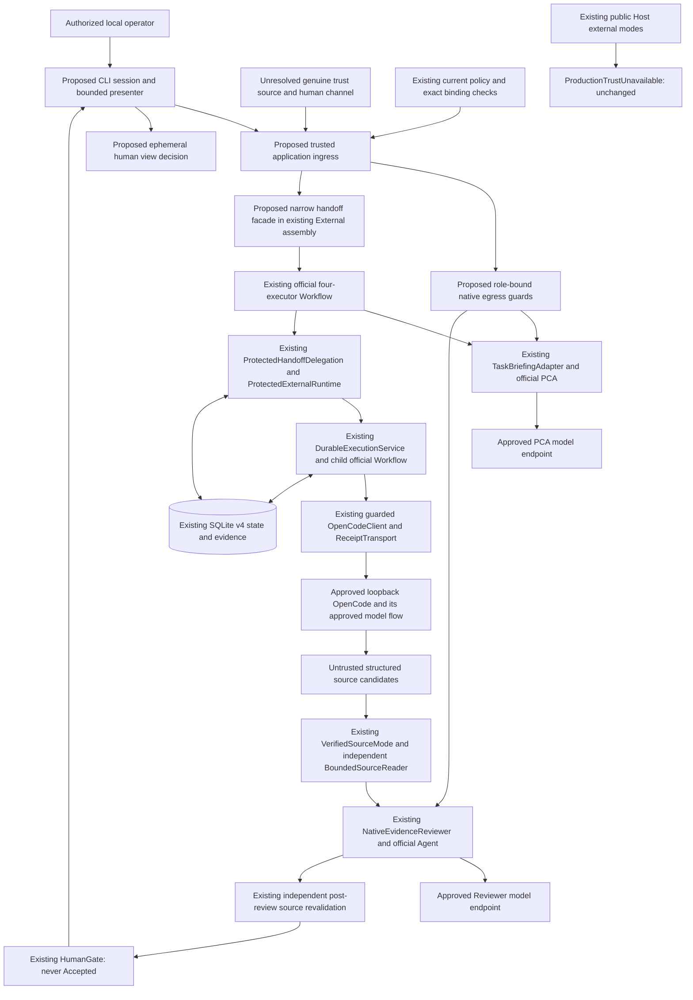

# Safe Host Composition & User Flow Design

日期：2026-10-19（Asia/Taipei）。狀態：**Design gate delivered for owner review；全部未實作，operational activation 仍 Blocked。**

> **2026-10-19 owner deployment-priority update — M3-C-W0：** 初始目標改為每位獲授權工程師的公司 Windows 工作站獨立部署 MAF；本文原有 Profile A personal-lab-first／非公司環境優先與其後續排序已被取代，保留為 secondary compatibility/reference context。Profile B 的企業信任、資料流、資安 clearance 與 custody 前置成為 primary；機能旅程與歷史設計理由保留。見 [corporate-workstation trust feasibility](M3C_CORPORATE_WORKSTATION_TRUST_FEASIBILITY.md) 的 C-first 條件式建議、IT evidence gate 與 corporate outcome-decision 待決事項。未來中央 orchestration／remote-local workers 是演進方向，不是當前依賴；本更新不授權 runtime、服務、模型或 Host activation。

## 1. 範圍、baseline 與證據

Repository：`ytcha-dev/MAF`。本輪開始 HEAD 為 `838a9af8d657de6bd4a2f5ea0f7522503a9da871`，分支 `main`，與本機 `origin/main` 記錄相同；工作目錄僅有未追蹤 `.opencode/`，保留、不讀取、不提交。此紀錄不宣稱檢查開始時已向遠端 refresh。

Owner 本次接受 [Phase 2B-4 closeout review](../acceptance/PHASE2B4_CLOSEOUT_REVIEW.md) 作為設計起點；接受受控技術基線不代表授權啟用產品。本輪只新增本文件並最小更新 [Roadmap](../ROADMAP.md)，不改歷史報告、不修改 runtime／tests／packages／schema／CI，不做 build、test、模型呼叫、OpenCode 啟動或 network evaluation。

已對照 [README](../../README.md)、[4A–4F execution plan](PHASE2B4_EXECUTION_PLAN.md)、[七項 guardrails](../architecture/ARCHITECTURE_GUARDRAILS.md)、ADRs [003](../architecture/ADR-003_OPENCODE_WORKFLOW_EXECUTOR.md)／[004](../architecture/ADR-004_DURABLE_EXECUTION_RECOVERY.md)／[005](../architecture/ADR-005_POLICY_APPROVAL_CANCELLATION.md)／[006](../architecture/ADR-006_TRUSTED_BROKER_BOUNDARY.md)、[M3 architecture gate](PHASE2B2_M3_ARCHITECTURE_GATE.md)，及第 3／4 節實作。歷史文件的舊 Host／schema／trust 狀態以當時背景解讀，不復活已封鎖的路徑。4F 的 1307 offline passing tests 僅是歷史證據，未在本輪重跑。

唯一場景：**一位經真正授權的本機 operator，針對一個核准的 disposable local fixture，透過一個固定 OpenCode harness，提交 bounded ReadOnly task；在同一個前景 CLI session 檢視證據並表達結果決定。** 不包含 write、shell、permission reply、多 harness routing、Registry、Hybrid、A2A、remote/web、background submission 或 production deployment。

下文「現有」描述 baseline；「提議／未實作」是待另行授權的設計，不是可執行功能。任何必要 trust 無法在所選環境證明時，結論都是 **Blocked**，不提供 lab fallback。

## 2. 第一位使用者的旅程與 UX 邊界（提議，未實作）

| 步驟 | Operator 所見／操作 | 安全行為與界限 |
| --- | --- | --- |
| 1 選擇 profile／fixture | 只可選受控設定中的單一 fixture alias；顯示核准 canonical root | CLI path 不能新增核准範圍；登入／設定檔／啟用旗標本身不能授權 |
| 2 本地 readiness | 看見三個資料接收方、版本、policy／schema profile、activation blockers | 不啟動任何服務、不做 health probe、不打模型；credential 只顯示 reference 是否設定，不取出／印出 value |
| 3 審閱任務 | 輸入 objective；顯示固定 ReadOnly、scope、budget、資料流、預配 IDs | 本地 preview 無 project-derived context 外送。第一版建議固定 60 秒 stage budget、objective 最多 4000 chars，policy exact-match 此 budget |
| 4 明確 submit | 經可信 operator channel 確認此 task／scope／三個接收方 | 普通 Enter／yes 僅為 UX 意願；有效 dispatch 仍須 verified caller＋current policy。先驗身分及權限才執行 PCA 或 provider I/O |
| 5 前景執行 | 本地 phase：PCA、External、Review；顯示已知 TaskId／run／execution／session／message IDs | 單 session 同時最多一件工作；無 detached task／自動重試提交。phase 不冒充真實遠端 Running；最後一次 observation 才能表示 provider state |
| 6 結果／證據 view | 有界摘要、external status、advisory assessment、exact verified lines、coverage／uncertainty | 原文作為不可信資料安全顯示；缺證據也回傳結果與明確限制，不偽裝為成功 review |
| 7 Operator 決定 | 對當前 view 選 accept／reject／undecided | 結果決定不改 external status／HumanGate，不產生 authority／dispatch；第一版僅同 session ephemeral decision，見第 9 節 |
| 8 中斷後 Inspect | 重開 session 後，明確指定已知 TaskId，重新驗身分／Inspect 權限 | 只讀原 child session，不建立任務、不送 prompt、不重新跑 PCA／Reviewer、不宣稱恢復 parent |

初版是前景式互動 CLI，任務結束或 bounded wait 返回後才接受下一個本地指令；不新增 server 或 worker。執行期間只顯示可證實的 local phase／既有 observation，不要求額外 status polling。若要顯示 phase，需要未來的小型進度呈現 seam；目前 `HandoffRun.Events` 是 run 結束後收集，不能直接當作已存在的 streaming API。

60 秒是每個 stage 的提議值，符合現行 HandoffTask 的 2 分鐘上限；PCA／child／review 各有 budget，合計不是 60 秒整體 SLA。不能以新的 outer timer 提早丟棄 protected child ownership unwind；沿用 child 自己的 bounded budget。stage 值與輸出上限待 owner 核准，不提高目前 evidence budgets。

## 3. 現有與缺少的功能：來源定位

| 元件／入口 | Baseline 現有行為 | 需要的最小未來補線 |
| --- | --- | --- |
| [Program](../../src/MAF.Host/Program.cs)／[Host project](../../src/MAF.Host/MAF.Host.csproj) | DI 註冊單一 IChatClient、ProjectTools、ComprehensionAgentFactory、ReviewService；原生 PCA／Git-diff Review 獨立入口 | operational session 的 trusted ingress、local config validation、兩個 role-specific model clients／guards、foreground presenter；不能讓舊 `--ask`／`--review` 冒充受保護旅程 |
| [ExternalConsole](../../src/MAF.Host/ExternalConsole.cs) | `--external-task`、`--recover`、`--recover-pending` 在參數檢查後拒絕 `ProductionTrustUnavailable` | 在另准 activation gate 前維持原樣；不能先移除 throw 再補 trust |
| [ControlledHandoffWorkflow](../../src/MAF.Workflows.External/ControlledHandoffWorkflow.cs) | internal；ctor 接 `ITaskBriefing`、assessment callback、internal `IControlledDelegation`、review callback、original handle、clock、optional VerifiedSourceMode | 用受限 application facade 從同 assembly 組裝；operational mode 必須有 VerifiedSourceMode，禁用 summary-only／fake delegation fallback。`HumanGate` 現有 hardcoded offline disclaimer 也須刻意保留 controlled 語義並為 operational result 提供真實 provenance label，不能直接重標為 live |
| [ProtectedHandoffDelegation](../../src/MAF.Workflows.External/ProtectedHandoffDelegation.cs) | internal；exact original request／run／prepared handle；只允許 Submit／Inspect；expected handle 必須尚無 session | 用於新 submission 的 protected child handoff；restarted Inspect 不塞入此 adapter 偽造 original input／brief，而直接走 protected Inspect |
| [ProtectedExternalRuntime](../../src/MAF.Workflows.External/ProtectedExternalRuntime.cs) | public ctor 需要 trusted inputs／policy／resolver、execution／approval stores、admission／enforcement、owned HTTP、options、clock；RunAsync 認證、ownership、重新讀 DB、admit／Inspect、per-effect checks | 真實 authority／caller 由 approved deployment boundary 提供。public library constructor 並非已存在的 authenticated Host ingress |
| [DurableExecutionService](../../src/MAF.Workflows.External/DurableExecutionService.cs) | public raw ctor 使用 UnavailableRuntimeAccess；protected runtime 使用 internal owned methods／官方 child Workflow | 不讓 Host 直接繞過 runtime 使用 raw service；重用原 child identity／intent-before-POST／Inspect-only |
| [TaskBriefingAdapter](../../src/MAF.Agents.Comprehension/TaskBriefingAdapter.cs) | public `ITaskBriefing`；使用官方 ChatClientAgent；proposal echo 原 task／root，不能擴大 ReadOnly scope | PCA 的模型呼叫與 project-derived tool output 需要額外 native egress 授權，現有 external policy 不涵蓋它 |
| [VerifiedSourceMode](../../src/MAF.Workflows.External/VerifiedSourceMode.cs)／[BoundedSourceReader](../../src/MAF.Core/Tools/BoundedSourceReader.cs) | mode internal；provider constructor 僅消費本輪 SourceCandidates；Acquire／IsCurrent 獨立檢查來源，無 summary fallback | operational factory 強制選 provider-candidate constructor、same canonical root、per-run reader issuer；不公開任意 candidate callback |
| [NativeEvidenceReviewer](../../src/MAF.Agents.Review/NativeEvidenceReviewer.cs) | public adapter，ctor 只需 IChatClient；fresh official Agent、snapshot tools、R1 actual tool observation | 注入獨立 Reviewer client／egress guard；不依賴舊 Git-diff ReviewService 或其 diagnostics import |
| [policy contracts](../../src/MAF.Core/Policy/PolicyContracts.cs)／[TrustedAuthority](../../src/MAF.Core/Policy/TrustedAuthority.cs) | fixed external operations／capabilities、trusted resolver／publisher interfaces、UnavailableTrust、authority adapter | 沒有 production identity source；也沒有 native inference authorization operation，不能拿 Submit allow 當全模型權限 |
| [SqliteExecutionStore](../../src/MAF.Persistence.Sqlite/SqliteExecutionStore.cs)／[SqliteApprovalStore](../../src/MAF.Persistence.Sqlite/SqliteApprovalStore.cs) | explicit profiles、CAS、ownership、authority／control／audit、v4 receipt；不執行 Workflow／HTTP | operational composition 明確指定兩個 ExplicitV4、同一 DB；可信 maintenance／policy activation 仍需部署來源 |
| [ReceiptTransport](../../src/MAF.Workflows.External/ReceiptTransport.cs) | `Create()` public：redirect／cookies／proxy disabled，原始 response identity tracking；ForTests internal | 重用 Create，不用普通 HttpClient 或 ForTests；native model transports 另行設定，不能以此認證人類 |
| [DurableDatabasePath](../../src/MAF.Host/DurableDatabasePath.cs)／[ExternalConsoleOutput](../../src/MAF.Host/ExternalConsoleOutput.cs) | local DB 路徑驗證及 external JSON／text／verbose formatter | 重用校驗與欄位，補 parent／evidence／human-decision presenter；formatter 不是 identity 或 persisted artifact store |

External assembly 目前只對 MAF.Tests／MAF.ApprovalAcceptance 開放 internals，沒有對 Host 開放。不能只加 DI registration 就存取 internal constructors。未來應在既有 External assembly 內提供一個窄的 **protected handoff application facade（提議，名稱非既有 API）**，由其組裝 internal graph。Host 只提交不可信 task intent／已驗證 context，不接受外部輸入的 assess delegates、fake harness、arbitrary candidate factory 或可序列化 continuation。不要整批改 public、加新的 friend assembly、expose IRuntimeAccess 或另開新 project。

## 4. 初始化與實際組裝計畫（提議，未實作）

### 4.1 固定 local profile

設定只描述候選部署，不能創造 caller、policy publication authenticity 或 consent。從 approved、非 repo-controlled 的 configuration provenance 取得設定；`.env`／environment／JSON 可提供位置與 secret references，但不構成授權。第一版只接受一個 fixture alias，不提供任意 `--root`、`--origin`、`--actor`、`--allow`、`--trust-test` override。

| 設定 | 最小 contract 與 preflight |
| --- | --- |
| workspace | 固定已核准 canonical local root；ProjectTools／BoundedSourceReader 重驗 root／ancestors／reparse points，拒絕 traversal／UNC／network。核准 manifest 不由模型或目標 repo 發布 |
| OpenCode | 固定 loopback origin／port、`maf_readonly` 或另核准單一 agent、ReadOnly rules digest、版本；SummaryLimit 設為 4000 以符合 outer handoff 的摘要上限，其餘 result／trace／limitations 保留現有 shape bounds，超出安全失敗。依 [OpenCodeOptions](../../src/MAF.Workflows.External/OpenCode/OpenCodeOptions.cs) 本地 Validate；HTTP 必須 explicit opt-in，localhost 不是授權。server 已由另行授權方式配置，Host 不自動啟動 |
| PCA model client | 指定核准 origin／model、credential reference、request／response／call budgets；project tools 可能傳送檔案、路徑、Git diff／status，必須逐項批准其資料類別 |
| Reviewer model client | 獨立 role binding／IChatClient／fresh sessions；可使用同一核准 provider，但不可隱式繼承 PCA allow。會傳送 objective、摘要、admitted lines／paths／refs；不是只有 opaque digest |
| model transports | exact origin／redirect／retry／proxy 行為需檢查 SDK client 的實際設定，含 tool-loop 每次後續 request；未驗證前 Blocked。明確禁止自動 failover 到另一模型／endpoint；不假設目前 OpenAI client 已受這些 guards 保護 |
| database | 同一絕對 local DB，外於 Temp／fixture／source repo，拒絕 network／links；ExecutionStoreProfile.ExplicitV4＋ApprovalStoreProfile.ExplicitV4。配置檢視只做 bounded read-only schema/profile 檢查；不靠 store open 自動建庫／遷移 |
| maintenance | DB 須先由另准、可信 maintenance 準備 v4；[AuthorizedApprovalMaintenance](../../src/MAF.Persistence.Sqlite/AuthorizedApprovalMaintenance.cs) 的 authorizer 目前無 production 實作。正常啟動／submit 不自動 migrate 或 ActivatePolicyAsync |
| authority／policy | authenticated publisher、caller／operator channel、revision／revocation／anti-rollback source、active durable tuple；current snapshot capability 只涵蓋固定 scope。policy publication、取得 candidate、explicit activation、執行權限是不同事件 |
| activation | 缺設定、可信證明、核准 data flow、已完成相容性或任何 gate 時預設 disabled。未來僅固定 profile 的 protected activation 設計，不需要通用 Registry；一般 submit 無權自行 activate |

本地 preflight 不做 DNS／HTTP health probe／模型「測試連線」。只能顯示 `health=NotChecked`、`trust=Unproven` 等真實狀態。policy 若已標 Disabled／Unhealthy，直接拒絕；wire 上的 health／schema／agent validation 仍是受權限約束的 OpenCode GET，在 child admission 後、Create 前進行。不能為了 readiness 偷用 raw OpenCodeClient 做未授權 GET。

### 4.2 組裝與 lifetime

1. Host 解析固定 profile，取得真實 caller context，從可信 source 取得當前 policy／deployment evidence；在披露 task metadata／讀 project context 前確認相應權限。沒有 genuine source 就不建 runnable facade。
2. 為單一 task 建立新的 TaskId、WorkflowRunId、ExecutionId、MessageId（不含秘密）。prepared handle 無 session；這是本地 metadata，不呼叫遠端 `CreateAsync`。原始 objective／root／ReadOnly／fixed budget immutable，顯示 preview；確認後仍重新驗權限。
3. Host 配置兩個 role-specific guarded clients，注入 public TaskBriefingAdapter／NativeEvidenceReviewer；同時在 External 內建立 mandatory VerifiedSourceMode(new BoundedSourceReader(...))。不得以不帶 sources 的可選 constructor 執行 operational graph。
4. ExplicitV4 store／coordinator、真 authority／resolver、`ReceiptTransport.Create()`、OpenCodeOptions、TimeProvider 經 facade 組裝 ProtectedExternalRuntime 與新 submission 的 ProtectedHandoffDelegation；各 interface 對應現有相同 SQLite store coordinator，不另建 persistence layer。
5. facade 只啟動現有四個官方 executors；graph owns order、OpenCode owns tools，native Agent owns自己的 function loop。outer assess 只是 prefilter；真正外部授權仍是 runtime admission／effect checks。讀 source 或 reviewer failure 不得觸發第二次 Submit。
6. run 結束後 Host 持有 bounded、immutable session view（包含原 objective、result、review、sources、observed times）；只有 caller-bound view 能被讀取。官方 graph 的 outcome／HumanGate 不由 UI 改寫。

刻意不註冊：SyntheticRuntime／SyntheticActor／SyntheticProtectedHandoff、HistoricalRuntimeAccess、ForTests transport、allow-all policy、原 raw ExternalWorkflow／DurableExecutionService。基於 injectable interface 的 .NET 程式碼無法自行抵抗可改 binary／DI 的同帳號惡意程式，仍取決於第 7／8 節的部署信任。

## 5. CLI contract（全部 NOT IMPLEMENTED）

以下 `maf-host` 是未來 executable placeholder，repository 目前沒有這組命令。只設計一個 session 入口與六個固定互動 verbs，不建立通用 command framework。所有範例都是 **NOT IMPLEMENTED**，不可當作現有可執行指令。

```text
NOT IMPLEMENTED — maf-host session --profile lab-fixture
NOT IMPLEMENTED — session> config
NOT IMPLEMENTED — session> submit --workspace fixture-one --objective "指出 fixture 的主要入口並附來源" --stage-timeout 60
NOT IMPLEMENTED — session> status --task <TaskId>
NOT IMPLEMENTED — session> inspect --task <TaskId>
NOT IMPLEMENTED — session> view --task <TaskId> --part all
NOT IMPLEMENTED — session> view --task <TaskId> --part evidence
NOT IMPLEMENTED — session> view --task <TaskId> --part assessment
NOT IMPLEMENTED — session> decide --task <TaskId> --view <ViewId> --choice accept
NOT IMPLEMENTED — session> decide --task <TaskId> --view <ViewId> --choice reject
NOT IMPLEMENTED — session> decide --task <TaskId> --view <ViewId> --choice undecided
```

| Verb（NOT IMPLEMENTED） | 行為／side effects／界限 |
| --- | --- |
| session／config | local inspection only，無 HTTP、無 secret value、無 DB write／activation。未驗證操作者只顯示一般 blockers，不洩漏受保護 root／task metadata |
| submit | 先 preview，再可信 task confirmation；當前 caller／policy／native egress／OpenCode Submit＋Inspect 都必須 Allow，否則停止。TaskId 由應用產生，重複命令不是「自動再送」；首版一個 session 只允許一個新 task，已有 intent 時只准 Inspect |
| status | 只讀本 session 已授權的 view，標明 `asOf`／`fresh=false`，不是新 provider observation；重啟後沒有 view 回 `NoSessionViewUseInspect`，不讀全部 DB／列舉 tasks。權限過期則停止披露 |
| inspect | 明確的 bounded GET-only child inspection；caller 必須另有 InspectCurrentScope；從受控 store 取得原 IDs／fingerprint，不信任 CLI 傳入 session／message；missing／unauthorized 回 generic denial。無 PCA／Reviewer model calls、無 parent resume |
| view | same-session immutable view 的 all／evidence／assessment；不讀任意路徑、不打 provider／model；檢視前重新確認 caller／披露權限。缺 snapshot／assessment 時顯示 Unavailable，不自行取得或重跑 |
| decide | 只對相同 task／ViewId 的當前完整 review view 表態，需 fresh authenticated human operator context；不做 provider／model／DB write、不批准任務重送。使用可信 channel；終端輸入不是獨立 human proof。restart／新 Inspect invalidate 舊 view 與 decision |

`submit` 必須同時有 Submit 與 Inspect 權限才能交付整條旅程；現有 code 的「Submit alone 不代表 Inspect」保持不變。若 policy 是 RequireApproval，首版回 `PreDispatchApprovalRequired` 並安全停止：不建新的 approval UX、不用 accept 代替 Approve／Resume、不改政策。需要支援該 policy 的人機 approval／explicit Resume 是另准擴充，不能靠固定單一 operator 自我批准。

### 結構化輸出（提議，NOT IMPLEMENTED）

UTF-8 JSON 可作 single-action response；互動 text 預設不輸出 JSON transcript。progress／diagnostic 不混入 JSON payload。欄位是未來 presenter schema，**不是現有 Core DTO 或新 DB schema**。

| 欄位 | 語義與限制 |
| --- | --- |
| `schemaVersion`, `action`, `profile`, `activation`, `blockedReasons` | presenter version；activation／readiness 不是 authority；只輸出允許披露的固定原因碼 |
| `taskId`, `workflowRunId`, `executionId`, `sessionId`, `messageId` | 原 immutable identity；無值用 null／NotEstablished，不杜撰；IDs 不放秘密 |
| `objective`, `workspaceAlias`, `policyRevision`, `operation` | objective bounded／redacted；full canonical path 只向核准 operator 顯示；policy metadata 不是 bearer token |
| `phase`, `externalStatus`, `durableState`, `submissionPhase`, `asOf`, `fresh` | phase 是本地進度；externalStatus 可以 Pending／Running／Completed／Partial／Failed／Unknown／WaitingForApproval／Cancelled；無 external execution 用 null，不能把 preflight failure 說成遠端 Failed |
| `summary`, `limitations`, `reasonCode`, `retryPolicy` | 預設有界摘要；`retryPolicy=InspectOnly` 用於任何 ambiguous submission；原 terminal record 與本次 Unknown observation 分欄 |
| `sources[]` | admitted reference、relativePath、startLine／endLine、exact sanitized lines、digest、acquiredAt、coverageLimitation、provenance status；最多沿用現有 8 candidates、20 lines／512-char anchors、16 KiB admitted batch。`verified` 僅表示來源 provenance |
| `assessment`, `humanGate`, `parentCheckpoint` | assessment status／refs／uncertainty、原 gate；`parentCheckpoint=Unavailable` 不變成 resumed。tool observation 不代表 semantic correctness |
| `viewId`, `viewKind`, `humanDecision`, `decisionPersistence` | viewKind 為完整原 run review 或 child-inspection-only；decision 默認 Undecided，persistence 為 SessionOnly。inspect-only 不提供 accept |
| `requests`, `durationMilliseconds`, `safeActions` | 重用既有 metrics；safeActions 由 current policy＋state 決定，非模型建議即授權 |

終端必須 escape control characters／ANSI，使用 plaintext／JSON 顯示，不把 provider/source 當 markup 或命令執行；best-effort redaction 不是機密外洩保證。禁止預設 raw unrestricted transcript、headers、tokens、credential values 或任意 exception text。沒有 artifact export／自動保存結果功能。

### Exit-code classes（提議，NOT IMPLEMENTED）

互動 action 回 `actionExitClass`；session exit 沿用最後一次 action 的數字或使用者乾淨離開為 0。`accept`／`reject` action 成功的 0 只表示記錄了一個 ephemeral 選擇，絕不覆蓋 earlier external status。

| Code | 類別 |
| --- | --- |
| 0 | local read/action 成功；完整 run 僅在 Completed＋ReadyForHumanReview 時為 0，仍不是 Accepted |
| 1 | 可確認的 local phase／provider failure；以獨立 state 欄位區分；不替 uncertain delivery 判 Failed |
| 2 | 無效語法／profile／scope／不支援操作 |
| 3 | Partial、insufficient evidence／Reviewer unavailable／需要人審但未達 ready |
| 4 | Unknown／lost acknowledgment／缺 session evidence，只准另行 Inspect |
| 5 | approval required；`approvalDomain=MAFPreDispatch` 或 `OpenCodeTool` 必須分欄，不混淆 |
| 6 | trust／authorization／activation blocked、過期或撤銷；包含 ProductionTrustUnavailable。不是現有 Host exit code 變更 |
| 7 | owner/operation busy，無新 dispatch；不自動 queue／retry |
| 130 | 本地取消等待；另有 externalStatus 說明遠端是否仍 Unknown。只有明確 remote evidence 才是 Cancelled |

## 6. 授權順序與三條 outbound data flow（提議，未實作）

### 固定 submit sequence

1. Local parse／config preflight，不讀無關專案、不輸出 secrets、不做 network。verified ingress 取得 **transport/channel-owned** caller context，resolver 必須驗 provenance／expiry，不能相信 `SubjectId` 字串。
2. 取得 current authenticated policy，驗 active revision、fixture scope、disabled/healthy descriptor、operation／budget、三個 egress recipients 與原 task fingerprint；展示 preview 並取得同 binding 的可信 operator submission intention。授權變更後不能沿用 preview approval。
3. 在 PCA 前，OpenCode Submit／Inspect 預評估須通過，PCA native inference 與將 project context 送給指定模型也須獨立 Allow。這裡只是 preflight，不能 mint 一張「整條 pipeline 已授權」的長期票。
4. official PCA 經 role-bound guarded IChatClient，**每次 model request，包括 tool result 回送**前重驗 identity／policy／recipient／expiry／task/root／call budget；tools 仍用原 ProjectTools。TaskBrief 只 advisory、exact echo，不能改 operation／root／provider／permissions。
5. 外部 delegation 重新走 ProtectedExternalRuntime：identity → TaskId ownership → fresh DB／current admission → atomic Created／control／audit → owned service → 官方 child Workflow。Validate／Create／Prompt／Observe 的每個 wire boundary 均重驗 effect／binding／revision；receipt 原始 response 綁定、intent-before-POST 不變。
6. OpenCode 自己的 harness 執行工具；MAF 收到的 completed summary／structured read display 仍不可信。Extract 只產生候選；application 附上 original identities。獨立 reader Acquire 核對 path／range／anchor／redaction／budget，才提升為 review-time provenance；source 內容本身不成為指令或 authority。
7. Reviewer native egress 再確認 current caller／policy、可傳送的 objective／summary／admitted lines 與固定 model binding；每次 IChatClient request 同樣重驗。官方 Agent／R1 只能讀 admitted snapshots；讀完後 VerifiedSourceMode.IsCurrent 重查。不足／變更不能改用 summary-only success。
8. HumanGate 確定 status；Host 呈現結果並再檢查披露權限。post-result accept 必須另驗 fresh human context＋精確 view，不授予後續 Submit／Abort／permission reply。

### Native egress 缺口的最小設計選擇

現有 [PolicyOperation／PolicyCapability](../../src/MAF.Core/Policy/PolicyContracts.cs) 與 [DeterministicPolicyEvaluator](../../src/MAF.Core/Policy/DeterministicPolicyEvaluator.cs) 沒有 native inference operation；目前支援的是 Submit、Inspect、Cancel、Abort。**不能把 external Submit Allow、AI_BASE_URL 或 HTTP loopback 判斷當 PCA／Reviewer 的傳輸授權。**

建議未來只補兩個固定的 native authorization bindings：PCA read-only inference、verified-evidence review。每個須含 caller、原 task fingerprint／root、role、exact model origin／model、config／tool-scope revision、有效期與 budget。使用同一可信 policy owner 與 deterministic checks，不另建 IAM。對 Core enum／scope encoding 是否作最小 additive extension，須在下一個 trust contract gate 定案並審查持久 policy／binding compatibility；這兩個名稱是設計用途，**現有 enum／API 尚不存在**。任何不明操作維持 Deny，不提供「暫時假設已批准」分支。

實作落點是既有 Host／agent integration 的窄 IChatClient guard，維持官方 Agent 執行 tools，不自行解讀下一步或建立另一個 Agent loop。PCA 原本只有 stage timeout，首版需明確 finite call／output budget；建議 native calls 每 stage 上限 8，Reviewer 保留現有 8-call／8-tools-per-response／output 限制，PCA 新 guard 待另准實作。native request 的重試／redirect 必須計入批准 transport 行為；撤銷無法收回已送出的資料，不能宣稱與 policy commit 原子化。

| 資料流 | 可能送出的內容 | 必要批准／失敗行為 |
| --- | --- | --- |
| Host／PCA → PCA model | objective、root metadata、受限 file/search/Git tool outputs | 核准此模型／資料類別／fixture 的真實 authority；未准則 PCA 不啟動，不能以 OpenCode 受保護為理由外送 |
| Host → loopback OpenCode → harness model | task、approved root／policy；harness 隨後讀 fixture 並可能送 provider model | localhost 只限制第一跳；必須知道並批准 harness model endpoint／retention／data flow，不能由 MAF HTTP guard 推論後續安全 |
| Host／Reviewer → Reviewer model | objective、summary、admitted source excerpts／reference／original line numbers、tool results | 獨立 Reviewer egress binding，來源 verification 不等於允許出境；未准則 ReviewUnavailable，不重送 external task |

## 7. Personal-lab 與 corporate 部署模型

**兩個 profile 當前都缺 deployable M3-C，皆 Blocked。** Profile A 是未來另行批准的個人非公司 fixture lab，不是「以 synthetic authority 開放 user-facing Host」的豁免；Profile B 僅列額外前置，不屬第一個操作版本的部署目標。

| 邊界 | Profile A：authorized personal local lab | Profile B：corporate deployment |
| --- | --- | --- |
| trusted caller source | 由 owner 指定且實證的獨立驗證來源／受保護 context channel，綁定該 lab operation；目前未選定、未部署。不把 Windows login／same-user／console input 當 proof | 組織核准的 genuine caller／application identity、可驗證 channel／service ownership；目前沒有企業 clearance 或來源可假定 |
| publisher／authority owner | owner 需指定具防竄改 provenance 的固定 policy publisher、誰可 explicit activate；本地 JSON hash 不足 | 組織指定 policy publication／approval owner、change governance、部署身份與 protected revision custody |
| human identity／consent | 真 operator proof 必須非模型可偽造；submit intention 綁 exact task，post-result intention 綁 exact view。首版 policy 只支援 direct Allow；RequireApproval 安全停止 | 若需 pre-dispatch approval，須 fresh non-self operator、exact scope／expiry／proof replay 防護與 durable consent；outcome acceptance 的 audit 要求另審 |
| config／storage custody | 核准的 disposable fixture，DB 在 Temp／repo 外；可修改 effective config／DB／DI 的 adversary 不能同時被當可信隔離。若既有環境無法提供所需 custody，activation 繼續 Blocked | 組織批准的 writer／credential／transport custody、configuration deployment controls、audit retention／maintenance separation。不能自動改 ACL、安裝服務或要求 admin |
| revocation／anti-rollback | exact scope／短有效期不足以取代 revocation；需真實可信 revision／revocation、restart 後 high-water anchor 與 clock assumptions 的實證，DB 被回復不能自我證明安全 | 外部受保護 revision／recovery anchor、撤銷及 restore／disaster-recovery 流程，依組織控制驗證 |
| networks／models | 只有另批非公司 fixture、固定 loopback OpenCode、兩個 approved native models 與 OpenCode 自用模型；無 automatic network activation | 所有原生與 harness 二次出站的資料分類／endpoint／model／credential handling 需核准；不得以個人模型接受公司 code |
| activation prerequisite | trust source 實證、明確 data authorization、v4 maintenance／active tuple、現行整鏈 compatibility 與 fail-closed tests；少一項即 Blocked | 另加企業 security clearance、endpoint compatibility、部署／operation approval 及可稽核證明；個人環境測試不能解除公司 hold |

ADR-006 的 protected Broker 是未來可能部署形式，不是本文件虛構已存在的服務或 credential。若評估需另一安全 principal／protected component，先由 owner／IT 決定可行形式及批准；本輪不新增 listener／service／certificate／signing utility。若只能證明同帳號 in-process checks，僅可報告 algorithmic validation，不能報 operational authorization passed。

## 8. 最小 M3-C dependency checklist

| 必要項目 | 現有可重用 enforcing code | 尚缺真實條件／誰可證明 | 可離線驗證 vs 真環境要求 |
| --- | --- | --- | --- |
| caller authenticity／expiry | ITrustedIdentityResolver、runtime Resolve、UnavailableTrust defaults | 真 channel-owned context／authenticator；匹配字串不能認證，兩個 profiles 都未具備 | fake／expired／mismatched-context negatives 可 synthetic；真正 issuer 防偽造／人機分離須另准環境證明 |
| current authenticated policy | ITrustedPolicyAcquisition、TrustedPolicyAuthority lease／digest、evaluator exact matching | publisher provenance／protected source、effective policy owner；ImmutablePolicySource 只描述設定 | wrong source／authority／expiry／revision negatives 可離線；真 publisher custody／revocation 須環境證明 |
| explicit activation／anti-rollback | IPolicyActivationCoordinator、SqliteApprovalStore active tuple＋audit／monotonic checks | activation control authentication、external rollback anchor／clock／restore 信任；沒有 Host activation CLI | 本地舊 revision／未 activate denial 可離線；DB/binary replace／restart rollback resistance 須真部署證據 |
| exact operation binding | OperationBinding、ExternalExecutionApplication、owned atomic admission／effect revalidation | fixture admission、fixed model role／recipient／egress operations 的最小 contract 尚缺 | scope／provider／budget／model role substitution negatives 可離線；被授權 deployment／endpoint 須 owner 核准 |
| protected writers／transport／credentials | schema profile／CAS／OS TaskId ownership、ReceiptTransport 原 exchange tracking | who can replace policy／DB／binary／DI、secret references custody；普通 user filesystem 與 loopback 不足 | algorithmic wrong transport／receipt／ownership tests 可離線；adversary separation／credential custody 須環境審查，不在本輪讀 secrets |
| real human／non-self approval | IApprovalAuthorization、DurableApprovalApplication、exact approval／Resume coordinators | 若 RequireApproval：genuine fresh human proof、non-self rights、replay／revocation；初版不啟用此互動 | fake／expired／self actor negatives 可離線；真正 presence 不可 synthetic 證明。post-result decision 亦需 genuine channel |
| native egress completeness | 原生 stage adapters／official Agent／ProjectTools／R1；沒有 policy-aware native transport guard | PCA／Reviewer role-bound authorization 與 recipient proof、每次送 tool results 重驗，不能漏掉既有 native ingress | 設計可列 negative matrix；真正 model transport／data flow／quality 另准驗證；企業另需 data governance |
| schema／maintenance | explicit v4 execution／control／receipt；authorized maintenance seam | genuine maintenance authorizer、DB path／profile verification、先準備後啟動；不自動 migrate | profile mismatch／future version／no auto-migrate 可離線；操作批准／custody 另證 |
| fixed connector availability | CapabilityDescriptor Enabled／Healthy、runtime effect checks | approved config lifecycle／disable revision 更新，不能自行 probe 或從 env 啟用 | disabled／unhealthy／revoked while running negatives 可離線；真 disable/reenable authority 必須實證，不需 Registry |

最小 release rule：先證明 identity／publisher／control custody、native outbound authorization、explicit activation／revocation／rollback 邊界，再允許 Host dispatch。**Test green、user 選 lab、環境變數、同帳號 OS SID、SQLite Approved row、user 按 yes，都不能補足 M3-C。** 外部相容性 evaluation 的單獨授權不等於通過這個 rule。

## 9. Human review／approval／acceptance semantics

| 事件 | 意義與 actor | 初版處理（未實作） |
| --- | --- | --- |
| pre-dispatch authorization／approval | current policy＋trusted caller；若 RequireApproval，還需合格且非自我的 operator、exact approval binding 及 explicit Resume | 固定 approved lab task 需真正 policy Allow；否則停在 PreDispatchApprovalRequired。畫面 confirm 不把 RequireApproval 變 Allow |
| OpenCode tool permission | harness 內部的 permission／question challenge；不是 MAF approval row 或 human outcome choice | 顯示 `approvalDomain=OpenCodeTool`、WaitingForApproval；不 reply／不自動放行，也不暗示 accept 可解鎖。首版僅 leave undecided／Inspect／退出 |
| post-result outcome decision | operator 對自己看見的完整結果版本表達接受／拒絕／未決；不是執行權限 | 同 session、caller-bound、view-bound ephemeral choice；保留 underlying result／HumanGate，不更改 durable state |

**建議第一個 personal-lab 版本採 ephemeral human decision，不把 durable acceptance 列為 hard requirement。** 每個完整 review view 有 transient ViewId，綁 task／原 identities、result／assessment／evidence digests 與 observed times。它是防止畫面誤配的 identifier，不是 signed human proof，也不代表來源現在仍未改變。

`accept` 僅在 Completed＋ReadyForHumanReview、完整 same-session view、fresh genuine HumanOperator identity／consent channel 存在時可用。標籤使用 `SessionAccepted`／`SessionRejected`／`Undecided`（未實作的 presenter 值），不是新增 Core HumanGateStatus.Accepted。`reject` 只拒絕該結果，不 Abort、不 Reject pre-dispatch approval、不重送；不足／Unknown／WaitingForApproval 不提供 accept。來源為 review-time snapshot，operator 接受的是該 view，不能宣稱簽核了目前磁碟全部狀態。

no choice、取消 prompt 或程序結束皆為 Undecided；決定可以在相同 view 明確改選，但沒有 durable audit claim。任何 fresh Inspect／new result 更新會產生新 view 並清除舊 choice，從不自動沿用 acceptance。重啟後無完整 parent view，不能 accept 舊 result 或輸入任意 JSON「恢復核准」。若 owner 需要跨 session 保存接受、真實簽章／稽核或 corporate release，這個 ephemeral 方案不適用：另審 D1／acceptance evidence／retention 與必要 additive storage，沒有本輪 schema 授權。

## 10. Failure／recovery 行為

| 觸發 | 提議的 user-visible 行為／安全動作 | 保留的既有語義／缺少的組裝 |
| --- | --- | --- |
| missing／expired caller | InvalidCaller／IdentityExpired；停止資料披露／所有新 I/O | 不從 login／CLI actor／test fallback 補 identity |
| policy unavailable／revoked | PolicyUnavailable／AuthorizationRevoked；native request／provider effect 前拒絕 | 不用舊 cache；已送出的 HTTP／模型內容無法收回，顯示可能仍在執行 |
| disabled／known-unhealthy provider | ConnectorUnavailable；無新模型／外部 request | 若只在 guarded Validate GET 發現 unhealthy，PCA 可能已合法執行；回 provider unavailable，不 Create／Submit，不假裝已知 unhealthy 時仍照跑 |
| PCA failure／invalid proposal | BriefingUnavailable／InvalidTaskBrief；external stage skipped | 不建立 provider task，不以簡化 task 或另一模型 fallback |
| OpenCode timeout／local Ctrl+C | 有交付可能時顯示 Unknown＋InspectOnly；無交付時精確區分 NotStarted | protected runtime SuppressImplicitAbort，無 prompt retry／replacement session；本地停止不等於 remote Cancelled |
| lost submit acknowledgment | SubmissionUncertain／Unknown；保留 TaskId／run／execution／session／message | POST 不重送；若 session Create response 遺失，session 可能不可得，只准調查，不猜 ID |
| WaitingForApproval | 分辨 MAFPreDispatch 與 OpenCodeTool domain | 無 permission reply／accept-to-unlock；原 session Inspect 不建立新 task |
| missing source candidates | external Completed 可保留，review InsufficientEvidence；列 extraction／coverage 限制 | 不從 summary／local text 製造 provider anchors；Native Reviewer 不應被呼叫 |
| source mismatch／changed／redacted／over budget | 顯示 rejected provenance、needs human review；保留完整限制 | reader 前後檢查，不改 source、不重跑 external task，不把 excerpt 稱整檔驗證 |
| Reviewer unavailable／insufficient | ReviewUnavailable／InsufficientEvidence，HumanGate NeedsHumanReview | external Completed 不被抹除；不自動換 reviewer／當 no findings，accept disabled |
| Host crash | durable child record 可能在任一 intent／receipt／phase；parent session view／choice 遺失 | 無 startup background recovery／POST；重新驗 caller 後手動 Inspect |
| execution still owned | OperationBusy，無讀取披露或新 dispatch | 不強停原程序、不換 DB 或 TaskId 繞過 owner、不自動 queue |
| explicit Inspect after restart | same DB／scope＋new authorized Inspect operation；重新讀 original identities，GET-only、bounded observe once | 直接 ProtectedExternalRuntime.RunAsync(Inspect)，不是 raw RecoverAsync；無 session evidence 為 Unknown／MissingSubmissionEvidence |
| missing parent checkpoint | `parentResumed=false`；objective／brief／review／evidence view 可能 unavailable | 不構造假的 TaskBrief／HandoffTask，不重新跑四階段圖；child result 可以查看，但不能聲稱完成新 source／native review |
| provider unavailable／404／terminal contradiction | 本次 observation Unknown＋stored terminal state 分列 | 不覆蓋既有 terminal fact，不將 provider 失聯說成 Failed／Cancelled；只允許另次明確 Inspect |
| persistence／audit capacity／schema error | StorageUnavailable／UnsupportedSchemaProfile；阻止新 effect，可能已交付則 Unknown | 不自動遷移／prune／重建 DB，不因存不下而重送 |

`inspect` 是 child-only viewer：可以展示新 GET 的摘要與 transient candidates，但候選不可標 verified；初版不執行獨立 source review／Native Reviewer，也不展示舊 assessment 作為新事實。若同 session 仍有舊完整 view，僅標 historical／superseded，不能沿用 acceptance。將 fresh Inspect 再串成完整 reviewer flow 需要原 task／brief／新的模型授權與明確再審語義，首版延後，不能從 request fingerprint 還原 objective。

## 11. Durable 與 transient data

| 資料 | 現有保存位置／提議 lifetime | 允許的重啟行為 |
| --- | --- | --- |
| stable identities、root／provider scope、request fingerprint、submission phase／state／version／timestamps／fixed diagnostic | SQLite execution ledger | 在相同 local DB／scope 讀 original child；不能從 fingerprint 得 prompt |
| authority active tuple／approval／control／audit／session receipt／cancel delivery／reconciliation | SQLite explicit v4，現有 coordinator owners | current authority 重驗後操作；row 不作人類 proof，不執行 dispatch |
| caller proof／policy lease／prepared handoff／ownership／native request decisions | transient，有限有效期；不能 JSON restore | restart 必須重新取得 genuine context／current decisions；no persisted bearer continuation |
| objective／PCA brief／provider body／candidates／source snapshots／issuer／R1 observation／assessment／parent outcome | 現有不寫 execution ledger；提議 bounded session view 也僅記憶體 | 重啟丟失、明示 Unavailable；fresh GET body 不是舊 review checkpoint |
| Human outcome choice／ViewId | 提議 SessionOnly，不寫 approval table／audit 或新表 | restart 一律 Undecided，不承諾可追溯簽核 |
| credentials／unrestricted transcripts | 不保存／輸出到 DB、reports、session logs 或 Git | 從另核准 custody references 使用；不讀 credential stores 作為本設計驗證 |

不新增 persistent artifact export、prompt archive 或 checkpoint schema。D1 trusted evidence rehydration、D2 real-model semantic quality、D3 source TOCTOU isolation 持續未解；第一個旅程以明確限制、真資料批准與人審承擔，不降低其 security gates。

## 12. Threat assumptions 與限制

1. 不可信資料包括 CLI text、目標 fixture source／Git、provider summary／tools／model JSON、任意序列化 evidence。模型只能建議，不得選擇／擴大 workspace、operation、provider、model endpoint、permissions 或 trust scope。
2. trusted code／config／writer／channel 的 custody 必須由部署提供；目前的 C# internal、hash、OS file ownership、loopback、相同使用者、private env 都不構成對惡意 same-principal 的獨立保護。若 threat model 包含可替換 binary／DB 的 agent 且無隔離證明，operational activation Blocked。
3. SQLite 保護 local atomic invariants，不能與 OpenCode／模型 request 原子化。崩潰可留下 Unknown 或零送出窗口；偏向不重送，不承諾 remote exactly-once、power-loss、distributed ownership 或 DB copy dedup。
4. source snapshot 可驗 review-time provenance、檢出觀測到的改動；不證明 execution-time source consistency、race-free hostile snapshot、全部來源覆蓋或語義正確。R1 觀察到每個必要 reference 也不代表模型理解所有行。
5. OpenCode read-only tool policy 不是 OS sandbox。必須批准 harness 二次模型資料流，不能用「本機工具」掩蓋外送；原生 PCA／Reviewer 亦同。已送資料的撤銷、provider retention、隱藏 provider behavior 都不是本機 checks 可保證。
6. 目前公司 execution hold／data governance 獨立有效；本文件不解除 Symantec／WDAC／script restrictions、不要求 admin、不授權服務／ACL／credential／corporate endpoint 變動。

## 13. Component 與 sequence diagrams

圖中「proposed」均未實作；「existing」只指元件存在，不表示已可 operationally compose。



native guards 包在注入 clients 的每次 request boundary，圖中的 Native Reviewer 不取得 authority／dispatch capabilities。human decision 不返回 Workflow 觸發新工作。configuration readiness 不跨過 trust source 邊界。

```mermaid
sequenceDiagram
    actor O as Operator
    participant H as Proposed Host session
    participant A as Genuine authority and caller channel - unresolved
    participant W as Existing official four-stage Workflow
    participant P as Official PCA with proposed egress guard
    participant R as Existing protected child runtime
    participant S as SQLite v4
    participant X as Approved OpenCode and model flow
    participant V as Independent source verifier
    participant N as Native Reviewer with proposed egress guard
    O->>H: Select fixed profile and preview bounded task
    H->>A: Verify caller, current scope, model flows and activation
    alt Any trust prerequisite missing
        A-->>H: Blocked
        H-->>O: ProductionTrustUnavailable or explicit blocker; zero outbound
    else Separately authorized and proven deployment
        O->>A: Exact task submission intention through genuine channel
        H->>W: Original immutable HandoffTask and prepared IDs
        W->>P: Brief task; role-bound authorization before every model request
        P-->>W: Advisory strict TaskBrief; no authority
        W->>R: Original read-only request; outer filter is not grant
        R->>A: Fresh caller, policy and exact effect authorization
        R->>S: Owned atomic Created admission and audit
        R->>X: Guarded Validate GET before Create
        R->>S: Revalidate and commit session creation intent
        R->>X: Guarded Create once
        X-->>R: Original session response
        R->>S: Commit verified original-response session receipt
        R->>S: Revalidate and commit prompt intent
        R->>X: Guarded Prompt once and bounded GET
        X-->>R: Correlated completion and untrusted source locations
        R->>S: Persist original child state, never response transcript
        R-->>W: ExternalTaskResult and transient candidates
        W->>V: Independent Acquire of exact bounded lines
        V-->>W: Reader-issued immutable provenance snapshots
        W->>N: Authorized model data; actual snapshot tools and R1
        N-->>W: Advisory assessment, not semantic certification
        W->>V: Revalidate source currentness
        W-->>H: HumanGate and transient WorkflowOutcome
        H-->>O: Exact evidence, uncertainty and current view
        O->>A: Fresh human intent bound to ViewId
        H-->>O: SessionOnly choice; no execution grant or DB approval
    end
    Note over H,S: Host crash loses parent view and choice; no parent checkpoint
    O->>H: Explicit Inspect existing TaskId after restart
    H->>A: New genuine caller and independent Inspect authorization
    alt Inspect trust or authorization missing
        A-->>H: Blocked; no child read or provider request
        H-->>O: InspectDenied
    else Independently authorized Inspect
        H->>R: Inspect only original child, not parent RunAsync
        R->>S: Acquire owner and reread original identity
        R->>X: Guarded original-session GET only if evidence permits
        X-->>R: Correlated observation or unavailable evidence
        R-->>H: Child observation or Unknown; parentResumed=false
        H-->>O: Child-only result and explicit limitations
    end
    Note over H,N: Restart Inspect invokes neither PCA nor Native Reviewer
```

sequence 的 admission／receipt／intent 是多個短交易與 HTTP 邊界的摘要，不表示 SQLite transaction 橫跨 HTTP。每一 wire boundary 的 current policy revalidation 仍沿用 runtime；native guard 類似地逐 request 檢查，但不是既有現成功能。

## 14. 最多三個另行授權增量與 stop conditions

### 增量 1：最小 M3-C trust contract／deployment feasibility gate（首選；仍先設計／驗證）

- **Outcome／價值**：為 Profile A 選定可實證的 genuine caller／publisher／human channel／writer ownership／revocation／anti-rollback；定案兩個 native egress bindings 的 exact contract 與相容性。讓 Host 的 blocker 成為可驗證的前置，而不是先造安全平台。
- **缺少內容**：現在沒有可註冊 production resolver／publisher／human proof source；先確認環境是否已有 approved trust primitive，以及 native policy additive representation，不臆造 credential／service 或先寫 stub。
- **Reusable**：TrustedAuthority interfaces、OperationBinding、evaluator、explicit activation／SQLite coordinators、目前 fail-closed tests。
- **前置**：owner 選定 Profile A fixture／環境、authority owner／threat model；任何需環境 execution 的 feasibility check 再另准。企業環境不因此取得 clearance。
- **Acceptance**：每項真 trust requirement 有具體 issuer／custody／proof／revocation／rollback／test plan；可離線負例與必須 genuine evidence 分開；native sender／recipient／budget／revision 可精確對應。若需實作 genuine adapter／部署 change，先提交具體窄 scope 再請 owner 授權。
- **Stop**：找不到可用的 protected primitive 或需要未批准服務／權限時，報 Blocked，停在 gate，不寫 fake production adapter。此增量完成亦不啟用 Host／provider。

### 增量 2：獨立受控真 provider／native model compatibility evaluation

- **Outcome／價值**：測量固定 OpenCode 版本的 structured read／receipt／Inspect 行為、PCA strict JSON、Reviewer actual tool delivery／quality，檢查 source unchanged 與 no-resubmit。
- **缺少內容**：以現有 test-owned runner seams 擴充可稽核 bounded evaluation／sanitized result reporting；使用 synthetic trust 若必要只能標 test algorithmic composition，絕不註冊 Host 或宣稱真 trust passed。genuine user-facing authorization 的證據仍由增量 1／後續真 adapter validation 提供。
- **Reusable**：OpenCodeClient、ReceiptTransport、protected runtime、reader、NativeEvidenceReviewer、existing acceptance tooling／4F cases。
- **前置**：另行明准非公司 disposable fixture、固定 OpenCode／模型版本與 endpoints、資料外送與 bounded workload、執行及 network 範圍。可與 trust feasibility 獨立安排，但不依賴把 Host 解鎖。
- **Acceptance**：真 read trace／exact request accounting、original IDs／Inspect 無新 Create／Prompt／Abort、PCA／Reviewer 真模型結果與人工 adjudication、負例／未知狀態、三條資料流收件方均核對；預設不得 destructive fault injection。相容性失敗需可重現且不放寬 budgets 造成功。
- **Stop**：不明 data flow／policy block／security alert 立即停受影響執行；結束 evaluation 後停止，public Host 仍 Blocked。這不是 production、human proof 或完整語義正確性驗收。

### 增量 3：最小受保護 foreground CLI 組裝與 first-use acceptance

- **Outcome／價值**：交付第 2／5 節唯一旅程，fixed fixture／OpenCode、same-session evidence view／ephemeral decision、explicit child Inspect。
- **缺少 code／wiring**：經審查的 genuine trust adapters（若先前尚未交付）與其部署驗證；Host session／immutable config＋native egress guards；External 內窄 facade／mandatory source mode／accurate operational labeling；bounded presenter／session view、inspect-only route。不新增 assembly／loop／registry／acceptance schema。
- **前置**：增量 1 的 unresolved blockers 已獲批准且在具體環境真正證明；增量 2 compatibility 通過；native policy representation／storage compatibility 已審。只有 offline synthetic 測試通過時，不得解除 activation；genuine adapter 接入亦需單獨的可驗證 security checks。
- **Reusable**：第 3 節全部元件；保持 official four-executor ordering、protected effect coordinator、intent／receipt／recovery invariants。
- **Acceptance**：第 15 節 targeted negatives／integration tests、真 lab manual walkthrough、caller forgery／revocation／recipient／disabled bypass／restart evidence；有界 human choices 不造成任何 HTTP／DB approval／terminal state 變更。既有原生入口標示為獨立，不能成為新 protected session 的替代／fallback。
- **Stop**：exact scope 或 genuine trust 檢查未通過即保留 ProductionTrustUnavailable；完成固定場景後停止，不自動延伸 approval／Resume CLI、parent recovery、corporate deployment 或其他 connector。

增量 1 是下一步的唯一主要建議，不是直接實作整套 M3-C。若沒有 owner environment／trust 決策，下一步只做其最小 design feasibility，不在不明前置下承諾可實作產品。上述至多三個方向不代表本輪已授權其中任一項。

## 15. Acceptance checklist 與本輪驗證

以下為未來 acceptance，尚未執行：

- [ ] 所有新入口／直接 library effect／native model request／view disclosure 都先驗可信 caller；invalid／expired／forged identity 零未授權 outbound，metadata 不洩漏。
- [ ] disabled、unactivated、wrong revision／publisher、revoked、scope／model／agent／budget mismatch 一律拒絕；沒有 synthetic／raw／legacy／環境旗標 fallback。
- [ ] config inspection 零 network／零 migration／零 policy activation；v4／DB path 必須明確，unknown schema 不自動修復。
- [ ] Submit 與 Inspect 權限分開；三條 approved model／provider data flow 都經批准；PCA／Reviewer 每次 tool-result outbound 都重驗，撤銷後不送新 request。
- [ ] official graph 確有四階段事件；original input／identities 不由模型改寫；provider-only source mode mandatory，wrong-source／missing candidates 不走 summary fallback。
- [ ] 完成、部分、失敗、Unknown、兩種 approval domain、source change／review unavailable 都有 honest output／exit class；同一結果保留 external facts 與 assessment failure 的區別。
- [ ] missing observation 降 insufficient；無模型語義正確性自動宣稱；exact source lines／excerpt limits／review-time qualification 可見。
- [ ] fresh human view decision 只影響 SessionOnly presenter；ReadyForHumanReview 永不自動 Accepted；expired／replaced／inspect-only view 不可 accept。
- [ ] crash／lost acknowledgment 後原 TaskId／run／execution／session／message 不替換；explicit Inspect 無新 POST、無 PCA／Reviewer、parentResumed=false；缺 session evidence 保留 Unknown。
- [ ] genuine Profile A trust evidence 與 synthetic fixture results 分開；若未證明，Host 即使其餘測試全綠仍 Blocked；Profile B 必須另行組織批准。

可重用的歷史負例與 assertion 入口：

- [RuntimeEnforcementTests](../../tests/MAF.Tests/RuntimeEnforcementTests.cs)：`HostDoesNotConstructLegacyRuntimeWithoutProductionTrust`、`AllPublicRawEntrypointsDenyWithoutContextBeforeStorageOrTransport`。
- [ProtectedHandoffTests](../../tests/MAF.Tests/ProtectedHandoffTests.cs)：outer Allow 不能繞過 actual denial、child original-identity crash recovery 不恢復 parent。
- [NativeEvidenceReviewerTests](../../tests/MAF.Tests/NativeEvidenceReviewerTests.cs)：`SufficientAssessmentRequiresActualToolObservation`。
- [SourceEvidenceCoverageTests](../../tests/MAF.Tests/SourceEvidenceCoverageTests.cs)：`SourceGroundedCoverage`、`FreshInspectRetainsExcerptDisclosureWithoutPersistedCandidateFallback`。

這些只是已存在的測試來源與歷史受控證據，不是本設計新 UX／M3-C／真 native provider 已驗收。新 native egress、CLI／decision／identity deployment tests 尚未撰寫或執行。

本輪只驗證 baseline／source／constructor／access modifiers／dependency 對照、本文件與 Roadmap 共 93 個本地連結 target 存在性（全部通過）、diagrams 的元件與順序人工對照、diff／staged scope／whitespace。diagrams 未透過額外 renderer 執行驗證。沒有 build／test／live evaluation、沒有讀秘密或公司專案、沒有新增任何 runtime switch。

## 16. Owner approval decisions 與停止點

優先三項：

1. **Trust／環境 owner**：是否選 Profile A 作為首個 target，誰提供 genuine caller／publisher／human proof／writer custody／revocation／anti-rollback，以及先做增量 1 的 design feasibility；若無法證明，接受 operational activation 持續 Blocked。
2. **資料流／權限 contract**：是否批准 fixed fixture、ReadOnly／60 秒 per stage／單 OpenCode、兩個獨立 native role bindings；下一個 gate 定案 native operations 的最小 policy representation。具體真 endpoint／model／credentials 或 evaluation execution 要另准，不在本文件填入虛構值。
3. **人工決定／恢復範圍**：是否接受 direct-Allow-only submission、RequireApproval 安全停止、SessionOnly outcome choice、restart 僅 child Inspect 且無 parent view／review restoration；若需要 durable acceptance／approval UX，重新界定窄 scope 與儲存需求後再批准。

此設計可供 owner 審查及形成下一個具體授權，不表示 owner 已批准其尚未決策項目。現有 Host external-task／recover／recover-pending **繼續 `ProductionTrustUnavailable`**。本輪提交／推送文件後停止，不實作任何 proposed CLI、Host composition、M3-C adapter、真 provider integration 或後續增量。
